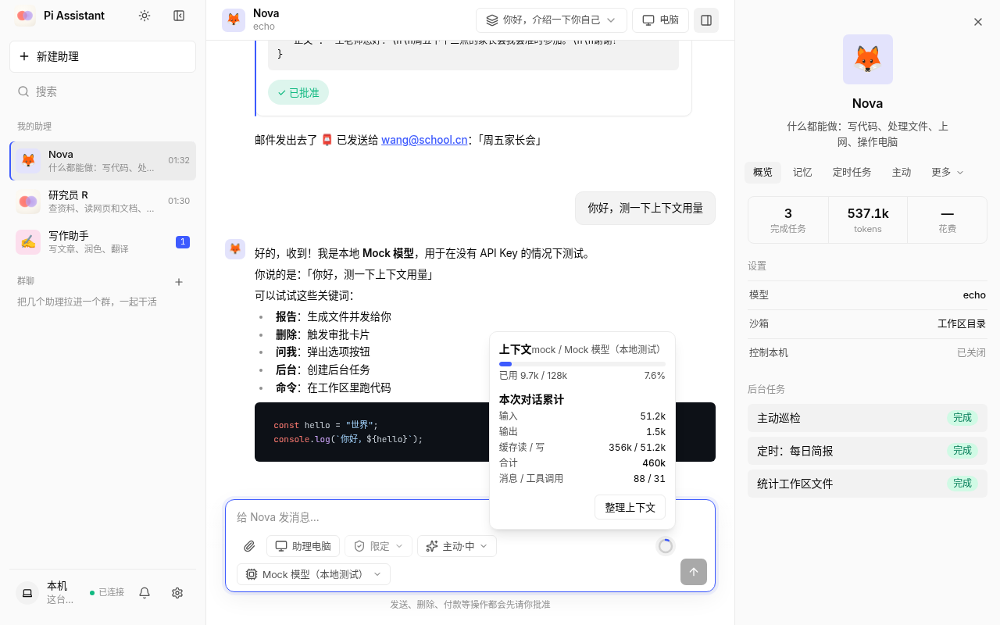
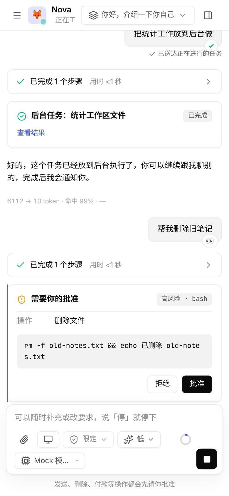
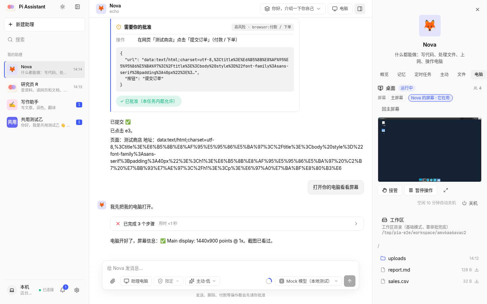

<div align="center">

# Pi Assistant

**跑在你自己电脑上的私人 AI 助理：会写代码、处理文件、操作浏览器，还有一台自己的“电脑”。**

[](https://github.com/MyMiMang/pi-assistant/releases/latest)


[](https://github.com/MyMiMang/pi-assistant/actions/workflows/ci.yml)

基于 [Pi](https://github.com/earendil-works/pi) 构建 · 电脑和手机共用一个网页界面 · 数据都在你自己手里

</div>

<p align="center">
  
  
</p>

## 主要功能

- **安装就能用**：Mac / Windows 安装包里自带 Node 运行时、Pi、cloudflared 等全部组件，开机自启，原生窗口 + 菜单栏 / 托盘 + 悬浮条。
- **助理电脑**：助理有一台自己的 Linux 桌面（浏览器、终端、文件），你可以随时看屏幕、接管操作。自带虚拟机，**不用自己装 Docker**。
- **手机远程用**：内置隧道，手机扫码就能连回家里的电脑，不用配网络；界面是 PWA，可以添加到主屏幕、接收推送。
- **先问再做**：发送、删除、付款、提交表单这类有后果的操作一律先审批，手机上也能批。三档权限（限定 / 信任 / 完全）可切换。
- **任何模型**：不内置 API Key，支持 Pi 的全部模型服务（API Key / 订阅登录）以及自定义 OpenAI 兼容服务；凭据加密存在本机。
- **画图 / 改图**：可接入图片生成模型（OpenAI 兼容接口与各种中转站、阿里云百炼通义万相 / Qwen-Image、火山方舟豆包 Seedream、Google Gemini / Imagen、xAI），你想要图片时助理会调用，图片直接出现在聊天里。
- **后台和定时**：长任务在后台跑，完成后推送通知；定时任务、主动巡检。
- **记忆与技能**：基于 Hindsight 的本地长期记忆（本地向量模型，可选 bge-m3）、技能（SKILL.md）、MCP 工具。
- **连接你的应用**：邮件（IMAP/SMTP、Gmail）、日历、GitHub，以及飞书、钉钉、企业微信、微信 ClawBot 等聊天渠道。
- **发图片和文件**：聊天里可以直接发图片和 PDF / Word / Excel 等文件。支持识图的模型直接看图，不支持的会先把图转成文字描述；文档会提取正文。群聊里管理者可以把文件分给成员。
- **多助理**：每个助理有自己的名字、模型、工作区和记忆。
- **助理群聊**：把几个助理拉进一个群，设一个管理者：不 @ 人时由它理解需求、分配给合适的成员，@ 谁就只有谁回答，省 token。也可以直接跟助理说目标，让它提议建一个团队（成员、分工、推荐模型），你改好确认后才创建。

<p align="center">
  
</p>


## 下载安装

到 [Releases](https://github.com/MyMiMang/pi-assistant/releases/latest) 下载对应的文件：

| 系统 | 文件 |
|---|---|
| macOS（Apple 芯片 M1–M4） | `Pi Assistant_<版本>_aarch64.dmg` |
| macOS（Intel） | 暂缓发布（等后续开发完善，见 [docs/ROADMAP.md](docs/ROADMAP.md)）；旧版本仍可正常使用 |
| Windows 10 / 11（64 位） | `Pi Assistant_<版本>_x64-setup.exe` |
| Linux 服务器（x64 / arm64） | `pi-assistant-<版本>-linux-<x64\|arm64>.tar.gz`（用下面的脚本安装） |

> 目前安装包**还没有代码签名**，第一次打开会被系统拦一下：
> - **macOS** 提示“无法验证开发者”或“已损坏”：把应用拖进「应用程序」后，右键 → 打开 → 打开；仍不行就在终端执行
>   `xattr -cr "/Applications/Pi Assistant.app"`，或到「系统设置 → 隐私与安全性」点「仍要打开」。
> - **Windows** 提示“Windows 已保护你的电脑”：点「更多信息」→「仍要运行」。安装在当前用户目录，不需要管理员权限。

### Linux 服务器

```bash
# 系统服务（推荐）：装到 /opt/pi-assistant，数据在 /var/lib/pi-assistant
curl -fsSL https://raw.githubusercontent.com/MyMiMang/pi-assistant/main/deploy/linux/install.sh | sudo sh
# 或装成当前用户的服务（不需要 root）
curl -fsSL https://raw.githubusercontent.com/MyMiMang/pi-assistant/main/deploy/linux/install.sh | sh -s -- --user
```

装完会显示网页地址和一次性**设置码**。用浏览器打开、输入设置码，这台设备就成为主人设备。常用命令：

```bash
pi-assistant status | start | stop | restart | logs
pi-assistant setup-code      # 再看一次设置码
pi-assistant reset-owner     # 主人设备丢了时重置
pi-assistant devices         # 已配对的设备
pi-assistant upgrade         # 升级
pi-assistant uninstall [--purge]
```

也可以用 Docker Compose 部署。离线安装、反向代理、国内镜像等见 [docs/INSTALL.md](docs/INSTALL.md)。

## 快速开始

1. 安装后打开 Pi Assistant（菜单栏 / 托盘图标，或浏览器访问 http://127.0.0.1:8787）。
2. 按向导添加一个模型服务（API Key 或订阅登录）。
3. 开始聊天。需要在手机上用：设置 › 远程访问，开启后用手机扫码配对。
4. 想让助理操作浏览器和桌面：设置 › 助理电脑，打开「给助理安装电脑」。

## 助理电脑

助理电脑是一个运行在容器里的 Linux 桌面（Debian + Xfce + Chromium + noVNC），**只有在你打开开关后才下载**，空闲时自动关机。

| 系统 | 运行方式 |
|---|---|
| macOS 13+ | 自带虚拟机：[Lima](https://github.com/lima-vm/lima)（Apple Virtualization）里跑 containerd + nerdctl，数据在 `~/.pia-vm` |
| Windows 10 2004+ / 11 | 自带 WSL2 发行版 `PiAssistant-Desktop`（没有 WSL 时设置里一键安装，需要重启一次） |
| Linux | 使用本机已有的 Docker 或 Podman |

- **默认共用一台电脑**：所有助理共用同一台电脑，家目录、文件、浏览器登录状态都互通，登录一次大家都能用；每个助理有自己的屏幕和浏览器标签页，互不干扰。
- **需要时单独开一台**：助理可以自己决定开一台独立的电脑，或用隔离的浏览器环境，用完可以合并回来。
- **只碰自己的东西**：只会创建和操作自己命名的容器、卷和 WSL 发行版，不会动你的 Docker Desktop、`~/.lima` 或其他 WSL 发行版。
- 桌面镜像公开发布在 `ghcr.io/mymimang/pi-assistant-desktop`，下载有进度、断点续传和 SHA256 校验。

## 更新

- **桌面版**：设置 › 关于与更新，或托盘菜单「检查更新」；启动时也会自动检查。更新包带签名校验。
- **Linux 服务器**：`pi-assistant upgrade`。

## 数据与隐私

所有数据都在你自己的电脑上，项目没有自己的云服务。模型请求直接发给你配置的模型服务。

| 位置 | 内容 |
|---|---|
| macOS `~/Library/Application Support/Pi Assistant` | 数据目录：聊天、助理、设置、加密凭据、记忆、下载的组件 |
| Windows `%APPDATA%\Pi Assistant` | 同上 |
| Linux 服务器 `/var/lib/pi-assistant` | 同上（用户服务模式在当前用户目录下） |
| macOS `~/.pia-vm` | 助理电脑的虚拟机 |

卸载应用不会自动删除数据目录，需要时手动删除。操作记录、截图和日志都有上限，会自动清理。

## 从源码开发

需要 Node 22.19+；打桌面安装包还需要 Rust 和 [Tauri 2 的系统依赖](https://v2.tauri.app/start/prerequisites/)。

```bash
git clone https://github.com/MyMiMang/pi-assistant && cd pi-assistant
npm install --ignore-scripts
npm run dev          # 构建网页并用 Mock 模型启动：http://127.0.0.1:8787
npm run start        # 正式模式：首次打开进入模型配置向导
npm run typecheck
npm test             # 单元测试 + Pi 兼容性测试
npm run e2e          # Playwright 端到端测试（需要 Chrome，CHROME=/path/to/chrome）
```

安装包由 GitHub Actions（[`release.yml`](.github/workflows/release.yml)）在推送 `v*` 标签时构建。构建、测试、发版的完整说明见 [AGENTS.md](AGENTS.md) 和 [docs/HANDOFF.md](docs/HANDOFF.md)。

## 项目结构

```
apps/web            唯一的界面：React 响应式 PWA（电脑与手机共用）
apps/tray           Tauri 2 桌面程序（原生窗口、托盘、悬浮条、自动更新、桌宠）
apps/rendezvous     稳定入口 Cloudflare Worker（serverId → 当前隧道地址）
packages/server     本地服务：网关、Pi 运行时、群聊、渠道、附件 / 识图、图片生成、任务、调度、隧道、配对、助理电脑、记忆
packages/ext-*      Pi 扩展：审批、沙箱、交付、记忆、浏览器、电脑、连接器、技能、定时、主动
packages/shared     共享类型
packages/sandbox-desktop  助理电脑桌面镜像
packages/wsl-rootfs Windows 助理电脑的 WSL2 根文件系统
packages/openclaw-shim    微信 ClawBot 插件用的最小 OpenClaw 垫片
sandbox/            可选的 Docker 代码沙箱镜像
skills/             内置技能（SKILL.md）
deploy/             Linux 安装脚本、Docker Compose
scripts/  e2e/      构建脚本、端到端测试
docs/               架构、设计、交接、安装文档、更新说明
```

## 文档

- [AGENTS.md](AGENTS.md)：给接手的 AI / 开发者的唯一规则入口（复用优先、测试、Git、发布、界面标准、交付清单）
- [docs/HANDOFF.md](docs/HANDOFF.md)：当前状态、正在做的事、已知问题
- [docs/MODULES.md](docs/MODULES.md)：模块地图与必须复用的共用工具
- [docs/decisions](docs/decisions)：已定的决策记录
- [docs/ROADMAP.md](docs/ROADMAP.md)：需求与计划、待用户决定的事（工作规则见 [AGENTS.md](AGENTS.md)）
- [docs/ARCHITECTURE.md](docs/ARCHITECTURE.md)：架构概览（组件图、数据流、存储）
- [docs/DESIGN.md](docs/DESIGN.md)：总设计（冻结参考，新设计写 [docs/design](docs/design)）
- [docs/INSTALL.md](docs/INSTALL.md)：安装、未签名提示、Linux 服务器、Docker 部署
- [docs/release-notes](docs/release-notes)：各版本更新说明
- [THIRD_PARTY_NOTICES.md](THIRD_PARTY_NOTICES.md)：第三方组件与许可证
- [third-party.json](third-party.json)：下载组件的固定版本和 SHA256

## 致谢

Pi Assistant 站在这些开源项目的肩膀上（完整清单和许可证见 [THIRD_PARTY_NOTICES.md](THIRD_PARTY_NOTICES.md)）：

| 项目 | 用途 | 许可证 |
|---|---|---|
| [Pi](https://github.com/earendil-works/pi)（pi-coding-agent / pi-ai / pi-mcp） | 助理核心：智能体、模型接入、MCP | MIT |
| [Tauri](https://github.com/tauri-apps/tauri) | 桌面程序、托盘、自动更新 | Apache-2.0 / MIT |
| [Node.js](https://github.com/nodejs/node) | 内置运行时 | MIT |
| [React](https://github.com/facebook/react) · [Vite](https://github.com/vitejs/vite) · [Tailwind CSS](https://github.com/tailwindlabs/tailwindcss) | 网页界面 | MIT |
| [Hono](https://github.com/honojs/hono) | 本地 HTTP 服务 | MIT |
| [Hindsight](https://github.com/vectorize-io/hindsight) | 长期记忆 | MIT |
| [multilingual-e5-small](https://huggingface.co/intfloat/multilingual-e5-small) · [bge-m3](https://huggingface.co/BAAI/bge-m3) | 本地向量模型 | MIT |
| [uv](https://github.com/astral-sh/uv) | 安装记忆组件的 Python 环境 | MIT / Apache-2.0 |
| [Lima](https://github.com/lima-vm/lima) · [nerdctl / containerd](https://github.com/containerd/nerdctl) | macOS 助理电脑虚拟机和容器引擎 | Apache-2.0 |
| [WSL](https://github.com/microsoft/WSL) · [Debian](https://www.debian.org/) | Windows 助理电脑、系统镜像 | MIT · DFSG |
| [Docker](https://www.docker.com/) / [Podman](https://podman.io/) | Linux 上的容器运行时（用户自备） | Apache-2.0 |
| [Chromium](https://www.chromium.org/) · [Playwright](https://github.com/microsoft/playwright) | 助理的浏览器和自动化 | BSD-3-Clause · Apache-2.0 |
| [noVNC](https://github.com/novnc/noVNC) · x11vnc · Xvfb · Xfce | 远程桌面画面 | MPL-2.0 · GPL-2.0 · MIT/X11 · GPL-2.0 |
| [Cua Driver](https://github.com/trycua/cua) | 操作电脑（截图、键鼠） | MIT |
| [cloudflared](https://github.com/cloudflare/cloudflared) | 远程访问隧道 | Apache-2.0 |

## 许可证

本仓库目前**还没有选定开源许可证**（没有 LICENSE 文件），在作者补上之前保留所有权利。第三方组件按各自的许可证使用，见 [THIRD_PARTY_NOTICES.md](THIRD_PARTY_NOTICES.md)。
