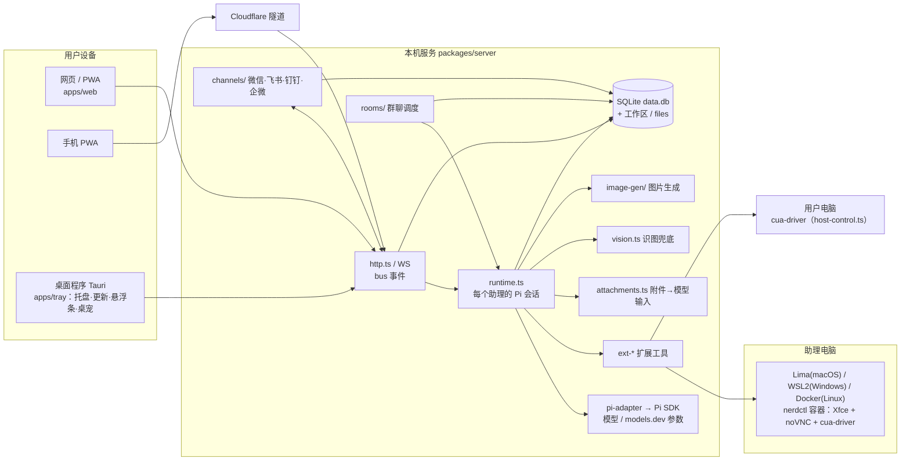

# 架构概览

简版说明，细节见 [DESIGN.md](DESIGN.md)（章节号写在括号里）。

## 组件
| 组件 | 位置 | 说明 |
|---|---|---|
| 本机服务 | `packages/server` | Node 22 + Hono。`main.ts` 启动，`http.ts` 放全部接口，`bus.ts` 推事件给前端（WS） |
| Pi 集成 | `src/pi-adapter/` | 只有这个目录直接用 Pi SDK（§5.15）；`models.ts` / `model-db.ts` 管模型和 models.dev 参数 |
| 助理运行时 | `src/runtime.ts` | 每个助理（每个对话）一个 Pi AgentSession，挂上扩展工具，把 Pi 事件写成消息（`messages.ts`） |
| 扩展工具 | `packages/ext-*` | 审批闸门、工作区命令、电脑操作、浏览器、连接器、发文件 / 提问 / 后台任务、记忆、技能、定时、主动性 |
| 审批 / 提问 | `src/requests.ts` | 产生卡片消息，等用户在 App 或渠道里回答 |
| 助理电脑 | `src/desktop.ts`、`src/desktop/*`、`packages/sandbox-desktop` | 后端选择（Lima / WSL / Docker），默认所有助理共用一台电脑、每个助理一块屏幕（§15.2、§15.4） |
| 操作用户电脑 | `src/host-control.ts`、`ext-computer` | cua-driver 按权限档位开放工具，用户电脑上的网页走 CDP（§14.6） |
| 群聊 | `src/rooms/` | 管理者调度、@ 规则、上限、增量注入、群附件、建群提议（§17） |
| 渠道 | `src/channels/` | 消息先写进 App，再镜像到渠道（§14.13）；原生图片 / 文件发送（`media.ts`、`caps.ts`）；审批卡片（含群聊的）转发到绑定的单聊 |
| 附件 | `src/files.ts`、`src/attachments.ts` | 上传存到工作区；图片发给支持看图的模型，否则交给 `vision.ts` 描述；文档提取文字摘录 |
| 图片生成 | `src/image-gen/` | 多家服务商，`generate_image` 工具（§18） |
| 思考内容 | `src/thinking.ts` | 把正文里的 `<think>` 内容拆出来，放到可折叠的思考区 |
| 桌宠 | `src/pet/`、`apps/web/src/pet/`、`apps/tray/src-tauri/src/pet.rs` | 透明窗口 + 点击穿透（§19） |
| 远程访问 | `tunnel.ts`、`named-tunnel.ts`、`auth.ts` | cloudflared 隧道 + 设备配对（§5.13） |
| 记忆 | `src/memory/` | basic 或 Hindsight sidecar（§5.19.1） |
| 下载管理 | `src/downloads.ts` | 所有大组件统一显示进度、断点续传、校验 |

## 一条消息的流程
1. 网页 `POST /api/agents/:id/messages`（群聊用 `/api/rooms/:rid/messages`），可以带附件 id。
2. `runtime.send()` / `turn()`：先由 `attachments.ts` 整理附件（图片、文档摘录），再调 Pi `session.prompt(text, {images})`。
3. Pi 流式输出 → `bindSession` 写入 / 更新消息 → `bus` → WS 推给网页，同时由 channels 镜像到渠道。
4. 工具调用经 ext-approval 判断要不要审批 → `requests.ts` 发出卡片 → 用户批准后继续。
5. 群聊：`rooms/index.ts` 按规则排队，每个成员在群里有一个隐藏对话，轮到它时注入还没看过的群消息和附件路径。

## 存储（数据目录：mac `~/Library/Application Support/Pi Assistant`，Linux 服务器 `/var/lib/pi-assistant`，开发时 `PIA_DATA_DIR`）
- `data.db`（SQLite）：助理、对话、消息、任务、请求、文件、群、渠道等（表结构见 `src/db.ts`）。
- `workspace/<助理>/`：助理的工作区（上传在 `uploads/`，群附件在 `room-files/<群>/`）。
- `files/`：发出去的文件快照；群里用户上传的附件在 `files/rooms/<群>/`。
- `agents/<助理>/`：Pi 会话文件；`credentials.enc` + `master.key`：加密保存的密钥。
- 日志、截图、操作记录都有上限，由 `housekeeping.ts` 定期清理。
