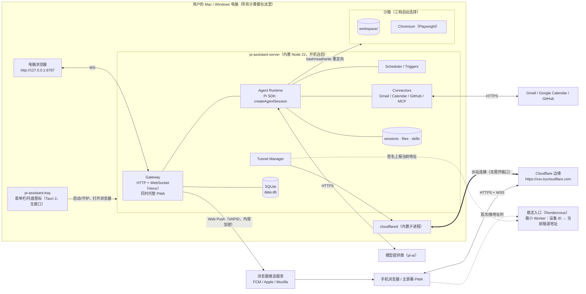
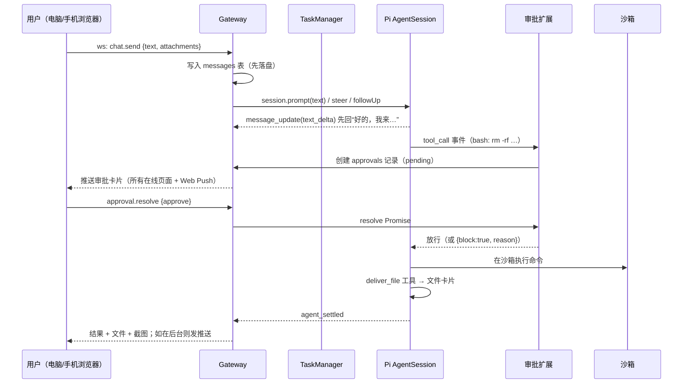
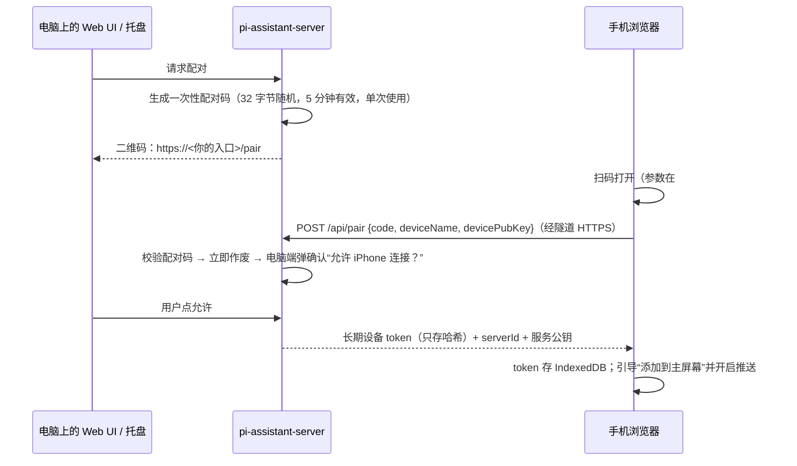

# Pi Assistant · 基于 Pi 的本地私人助理 —— 设计文档 v0.5

> **当前进度和待验证事项以 [HANDOFF.md](HANDOFF.md) 为准**（当前版本 v0.1.0-beta.10）；组件概览见 [ARCHITECTURE.md](ARCHITECTURE.md)。下面各节里的“实现状态 / 日期”是当时写的记录，后面的章节（§15–§19）是最新的设计。

> 状态：v0.5（2026-10-11）。**远程入口改为按用户自选**：不再内置任何默认域名，用户用自己的域名 + 自己的 Cloudflare Token 在 App 内一键部署（§5.13.2，已实现并实测）；新增密钥扫描（§9.1）；助理电脑与 ext-computer 已开始实现（§14.10）。v0.4：新增：§5.14.1 自定义模型服务（中转站/第三方/本地，已实现），§5.16 第三方集成通用规则，§14 Phase 3 国内优先方案（它自己的电脑、自己的账号、微信/企业微信/飞书/钉钉、Cua）。v0.3：Phase 1 的服务端 + Web UI 已实现并通过端到端测试（实现状态见 §13）。新增：§5.14 模型与凭据（不内置任何 Key，全部 Pi provider 动态支持），§5.15 模块边界与 Pi 升级维护流程。默认入口域名 `app.dengdengyun.shop`。
> 参考：Pi 仓库 `earendil-works/pi`（本文基于 `@earendil-works/pi-coding-agent@1.1.0` 的源码和文档阅读结果，API 名称均来自实际代码）。

---

## 1. 产品目标

做一个**跑在用户自己电脑（Mac / Windows）上的私人助理**，体验对标托管版桌面助理：

- 一个聊天窗口，说一句话它就**自己动手**：跑代码、处理文件、上网、操作浏览器、连你的 Gmail/日历/GitHub，做完把结果、文件、截图发回来。
- 它有**自己的“电脑”**（沙箱工作区），文件长期保留，不会碰乱你的个人文件。
- **你不在它也在干活**：后台任务、定时任务、事件触发。
- **一个网页应用，到处能用**：电脑浏览器、手机浏览器用的是同一个响应式 Web App（PWA，可“添加到主屏幕”，支持 Web Push 推送）。**不做原生 App**，不需要 iOS 签名或上架。手机只是遥控器，所有计算、文件、凭据都在你的电脑上。
- **出门在外也能用**：手机用流量、在公司、在别人家 Wi‑Fi 都能连回家里的电脑——扫码或点链接即可，用户**零网络配置**（内置隧道，Phase 1）。
- **一步安装**：用户只装一个轻量安装包（Mac `.dmg` / Windows `.exe`）。它装好并开机自启本地服务（内置 Pi + Node 运行时 + cloudflared），菜单栏/托盘图标一点就打开 Web UI。不需要另装 Pi / Node / Docker。
- **有后果的操作先问你**：发邮件、删东西、付款、提交表单一律走审批，手机上也能批。

非目标（至少前三期不做）：原生手机 App、多用户/团队、云端托管 agent、在手机上执行任务。

### 核心原则

1. **Pi 是地基，不是外挂**：通过 Pi 的 SDK 把 agent 运行时嵌进我们自己的守护进程，所有能力都用 Pi 的扩展点（工具、事件钩子、MCP、技能）实现，不 fork Pi。
2. **凭据不进沙箱**：模型 key、OAuth token 只在守护进程里；沙箱里跑的代码拿不到。
3. **先落盘再显示**：每条消息、每个任务状态先写 SQLite / Pi 会话文件再推给 UI，进程崩了、电脑重启了都能接着做。
4. **默认安全**：没有 Docker 也能用，但要靠审批闸门 + 路径约束兜底。

---

## 2. 功能清单（对照 9 大能力）

| # | 能力 | 用户看到的 | 实现要点 | 期 |
|---|---|---|---|---|
| 1 | 聊天与交付 | 收到任务先回“好的，我来…”，做完发结果、文件卡片、截图；桌面和手机实时同步 | Gateway WebSocket 推送 Pi 事件流；`deliver_file` / `send_screenshot` 自定义工具；附件存 `data/files/` | P1 |
| 2 | 自己的电脑 | 一个持久工作区，可以跑命令、装工具、生成文件 | 三档沙箱（见 §5.4）：工作区目录 / OS 级沙箱 / Docker；Pi 内置工具重定向到沙箱 | P1 |
| 3 | 浏览器与桌面 | 助理自己开浏览器办事，登录状态保留；遇到验证码/二次验证把画面交给你（手机也能点） | Playwright + 持久化 profile；CDP screencast 推流到 UI；`browser_handoff` 工具 | P3 |
| 4 | 应用连接 | 连 Gmail、日历、GitHub；发信/发消息永远先出草稿 | 连接器层：官方 API + OAuth（PKCE，本地回调）；或 `pi.registerMcpServer()` 接 MCP；写操作统一走审批 | P3 |
| 5 | 后台任务 | 长任务后台跑，你继续聊别的；完成后推送通知 | 每个任务一个独立 Pi `AgentSession`；任务表在 SQLite；完成时推送（系统通知 + Web Push） | P1 |
| 6 | 定时与事件 | “每天 8 点给我一份摘要”“有新 PR 就提醒我” | Scheduler（cron 表达式，时区感知）+ Webhook/轮询触发器；到点创建后台任务 | P2 |
| 7 | 记忆 | 记住你的名字、偏好、决定 | SQLite：profile 事实 + 按日日志；`before_agent_start` 注入；`memory_write`/`memory_search` 工具 | P2 |
| 8 | 技能 | 把多步流程存成说明书，下次直接照做 | 原生 Pi Skills（`SKILL.md`，Agent Skills 规范）；技能目录 `data/skills/`；助理可自己写新技能 | P2 |
| 9 | 审批闸门 | 有后果的操作弹卡片：批准 / 拒绝 / 修改，桌面手机任一端处理 | `pi.on("tool_call")` 返回 `{ block, reason }`；配合工具 `annotations`；审批请求持久化，可跨设备 | P1 |
| + | 多助理/人设 | 多个助理，各有名字、模型、技能、工作区 | `agents` 表；每个 agent 独立工作区和会话目录 | P3 |
| + | 远程访问 | 手机在任何网络下扫码/点链接即可用，零配置 | 内置 cloudflared 快速隧道（免账号）+ 稳定入口；可选命名隧道 / Tailscale | P1 |
| + | 设置 | 模型与 key、沙箱档位、通知、配对设备、连接器 | Settings 页 + Pi `SettingsManager`（内存/文件） | P1–P3 |
| + | 用量 | 每天/每任务 token 与费用 | 汇总 Pi 消息里的 `usage`；`usage_daily` 表 | P3 |

---

## 3. 总体架构

### 3.1 部署形态



要点：
- **只有一个本地服务进程**（`pi-assistant-server`），它托管 Web UI、跑 Pi、管任务；托盘程序只负责启动、守护、打开浏览器和显示状态。
- **所有界面都是同一个 PWA**：电脑上开 `http://127.0.0.1:8787`，手机经隧道开 `https://…`。
- **远程访问走出站隧道**：电脑不开任何入站端口，路由器无需设置。

### 3.2 一次请求的生命周期（ack → 执行 → 交付）



### 3.3 为什么用 SDK 而不是 RPC

| 方案 | 结论 |
|---|---|
| **SDK（进程内）** `createAgentSession()` | ✅ 采用。我们本身就是 TypeScript/Node，能拿到完整 API：`session.subscribe()` 事件流、`steer()`/`followUp()`、`SessionManager`、`DefaultResourceLoader({ extensionFactories })` 注入我们自己的扩展、`bindExtensions({ uiContext })` 把扩展的 `ctx.ui.confirm()` 接到我们的审批系统。打包时只有一个服务进程。 |
| RPC（`pi --mode rpc` 子进程） | 备选。若以后要给每个 agent 做进程级隔离（一个 agent 崩溃不影响别的），可以换成 `RpcClient`；协议里的 `extension_ui_request/response` 同样能接审批。接口层做成 `AgentDriver` 抽象，两种都能插。 |
| `pi-durable` / `pi-server` | 官方标注 Experimental、API 随时变。先不用，P3 之后评估（它的“先提交再显示、崩溃续跑”和我们的目标一致）。 |

---

## 4. 我们依赖的 Pi 扩展点（实际 API）

全部来自 `packages/coding-agent/src/core/extensions/types.ts`、`docs/extensions.md`、`docs/sdk.md`：

**SDK 层**
- `createAgentSession({ cwd, sessionManager, settingsManager, resourceLoader, modelRuntime, model, thinkingLevel, tools, customTools, excludeTools })` → `AgentSession`
- `session.prompt()` / `session.steer()` / `session.followUp()` / `session.abort()` / `session.waitForIdle()` / `session.subscribe(listener)` / `session.dispose()` / `session.getLastAssistantText()`
- `session.bindExtensions({ uiContext, mode, abortHandler, shutdownHandler })`：把 `ctx.ui.select/confirm/input/notify` 实现为我们的 Web 审批与通知
- `SessionManager`（JSONL 持久会话，`SessionManager.inMemory()` 用于临时任务）、`AgentSessionRuntime.newSession()/switchSession()/fork()`
- `DefaultResourceLoader`（`extensionFactories` 注入内联扩展；技能/提示模板目录）、`SettingsManager`、`ModelRegistry`
- 事件：`message_update`（`text_delta` 流式）、`message_end`、`tool_execution_start/update/end`、`agent_end`、**`agent_settled`**（判断任务真正结束）
- `createMcpExtension()`、`createCodemodeExtension()`、`createToolSearchExtension()`（SDK 不默认加载，需手动加入）

**扩展层（`ExtensionAPI`）**
- `pi.registerTool({ name, description, parameters(TypeBox), execute, annotations, exposure })`：注册 `deliver_file`、`memory_*`、`browser_*`、`gmail_create_draft` 等
- `pi.on("tool_call", …)` → `{ block: true, reason }` 或就地修改 `event.input`：**审批闸门核心**
- `pi.on("tool_result", …)`：脱敏、截断大输出、收集产出文件
- `pi.on("before_agent_start", …)` → `{ message }` / `systemPromptOptions`：注入记忆、人设、当前时间时区
- `pi.on("session_start" | "session_shutdown")`：启动/释放浏览器、沙箱连接（文档要求不要在工厂函数里起进程）
- `pi.on("agent_before_settle")`、`pi.on("turn_end")`：任务收尾（写日志、生成摘要）
- `pi.on("input")`：解析附件、斜杠命令
- `pi.getAllTools()` 的 `annotations`（`readOnlyHint` / `destructiveHint` / `openWorldHint`）：审批策略的默认依据
- `pi.registerMcpServer(name, config)` / `pi.unregisterMcpServer()` / `pi.getMcpServers()`：连接器接 MCP
- `pi.sendMessage(msg, { triggerTurn, deliverAs })` / `pi.sendUserMessage()`：定时任务、事件注入
- `pi.appendEntry(customType, data)`：不进上下文的持久状态（如审批记录引用）
- `pi.setActiveTools()` / `pi.getActiveTools()`：按 agent 人设裁剪工具
- `pi.registerProvider()`：自定义模型提供商（如本地 llama.cpp / 公司网关）
- `pi.exec()`、`ctx.executeTool()`、`ctx.modelRegistry.streamSimple()`（嵌套模型调用，如摘要）
- 内置工具重定向：`createBashTool(cwd, { operations })` + `BashOperations`（参考官方 `examples/extensions/gondolin`），同理覆盖 `read/write/edit/grep/find/ls`
- 参考示例：`permission-gate.ts`、`confirm-destructive.ts`、`protected-paths.ts`、`sandbox/`、`gondolin/`、`notify.ts`、`todo.ts`

**技能**：原生 `SKILL.md`（frontmatter `name`、`description`、`disable-model-invocation`），`/skill:name` 强制加载。

---

## 5. 组件设计

### 5.1 pi-assistant-server（本地服务，核心，代码在 `packages/server`）

单个 Node 22 进程（安装包内置 Node 运行时），内部模块：

| 模块 | 职责 |
|---|---|
| `gateway` | Hono HTTP + `ws` WebSocket；托管 PWA 静态文件；鉴权（设备 token）；限流；REST：文件上传下载、配对、OAuth 回调、Webhook 入口 |
| `tunnel` | 管理内置 cloudflared 子进程、获取/上报公网地址、健康检查与自动重连（§5.13） |
| `pairing` | 二维码配对、设备 token 发放与吊销 |
| `runtime` | `AgentManager`：每个 agent 一个“主会话” + N 个任务会话；封装 `createAgentSession`；把 Pi 事件翻译成我们的协议事件 |
| `tasks` | `TaskManager`：创建/排队/并发上限（默认 3）/取消/重启恢复 |
| `approvals` | 审批请求的持久化、广播、超时（默认不超时=一直等你）、“本会话内同类操作都允许”的临时授权 |
| `scheduler` | cron（`croner`，时区 Asia/Shanghai 等用户时区）+ 轮询触发器 + Webhook 触发器 |
| `memory` | 事实库 + 日志 + 检索（SQLite FTS5，P3 可加向量） |
| `connectors` | OAuth 管理、token 加密存储、API 客户端、MCP 注册 |
| `sandbox` | 沙箱驱动（三档）+ 健康检查 |
| `notify` | 系统通知（经托盘程序）、Web Push（VAPID，服务端直接发到浏览器推送服务，无需我们的推送服务器）、页面内通知 |
| `usage` | 汇总 token/费用 |

**防丢数据**：
- 所有消息、任务状态、审批先写 SQLite（WAL 模式）再推送。
- Pi 会话本身就是持久 JSONL（`SessionManager` 默认），存 `data/agents/<id>/sessions/`。
- 守护进程启动时扫描 `tasks.status in (running, waiting_approval)`：用同一会话文件重建 `AgentSession`，`sendUserMessage("（系统）上次执行被中断，请检查进度后继续")` 续跑；审批中的继续等待。
- 运行任务期间阻止系统睡眠（macOS `caffeinate -i`，Windows `SetThreadExecutionState`），任务结束释放。

### 5.2 安装包与托盘程序（`apps/tray`）

- **桌面程序**（2026-10-12 起）：Tauri 2，**原生主窗口 + 托盘**。主窗口（label `main`，1280×820，最小 380×560）用系统 WebView（macOS WKWebView / Windows WebView2）加载本机 `http://127.0.0.1:8787`，不再打开浏览器；关窗口 = 隐藏到托盘（服务继续跑，macOS 切回纯菜单栏模式），托盘「打开 Pi Assistant」/再次启动程序（single-instance）把窗口拉回前台；页面里 `target=_blank` / 非本机地址交给系统默认浏览器（`on_new_window` / `on_navigation`）；建窗口失败才退回浏览器。菜单：打开 Pi Assistant、显示手机配对二维码、服务状态（运行中/隧道在线/当前任务数）、暂停所有任务、开机自启开关、检查更新、退出。
- **服务作为 sidecar**：安装包内带 `node`（固定版本 Node 22 运行时）+ `server.mjs`（esbuild 打包，Pi SDK 已打进去）+ `cloudflared` 二进制 + PWA 静态文件。托盘程序启动并守护服务进程，崩溃自动拉起（指数退避）。
- **开机自启**：`tauri-plugin-autostart`（macOS LaunchAgent / Windows 注册表 Run 键）。高级选项“无托盘服务模式”：直接注册 LaunchAgent / Windows 计划任务启动服务。
- **安装包**：Tauri bundler 产出 macOS `.dmg`（Apple Silicon + Intel，或 universal）和 Windows NSIS `.exe`。体积目标 < 80MB（Node ~40MB + cloudflared ~35MB + 其余）。
- **自动更新**：`tauri-plugin-updater`，签名校验，更新源为 GitHub Releases 的 `latest.json`。
- **代码签名说明**：不签名也能装，但 macOS 首次需右键“打开”（Gatekeeper），Windows 会出现 SmartScreen 提示。正式分发建议：macOS Developer ID 证书 + 公证（需 Apple Developer 账号，仅用于桌面安装包，**与手机无关**）；Windows 代码签名证书（或 Azure Trusted Signing）。CI 里预留签名步骤，有证书时自动启用。
- **CI 构建**：GitHub Actions（`.github/workflows/release.yml`），打 `v*` tag 触发，流程是「先草稿、验证通过才公开」：`prepare` 建草稿 Release → 构建 5 个 job（`build` 矩阵 3 个：macOS arm64 / macOS x64 / Windows x64 桌面包，`tauri-apps/tauri-action` 把安装包和 `latest.json` 传进草稿；`linux` 矩阵 2 个：x64 / arm64 服务器包 `.tar.gz`）→ 两个真机冒烟：`windows-smoke`（调用 `windows-smoke.yml`，把刚构建的 setup.exe 静默装到带中文和空格的目录、数据目录也放中文路径，启动托盘查 `/api/system/public`）和 `mac-smoke`（挂载 arm64 dmg、启动 .app 查同一接口）→ 全部通过后 `publish` 检查资产齐全、把 `latest.json` 里草稿期的 `untagged-…` 地址改成按 tag 的地址，再取消草稿并标为 Latest。草稿里的 `latest.json` 对自动更新不可见，任何一步失败都停在草稿，用户收不到坏包。推送 `release-dryrun` 分支（或手动运行）用 `v0.0.0-dryrun.<序号>` 走完整流程但不公开，`cleanup-dry-run` 最后删掉草稿。Windows/macOS 构建里还会先用内置 Node 跑 `scripts/smoke-app.mjs`；每个平台先下载对应的 Node 与 cloudflared 二进制并校验 SHA256。

- **悬浮条**（`/hostbar`）：透明、无边框、无阴影窗口（`transparent(true)`，macOS 需 `macOSPrivateApi: true` + Cargo feature `macos-private-api`），只露出圆角胶囊；右侧 × 关闭（`POST /api/host-control/bar/dismiss`，服务端记住当时状态，状态变化——新操作 / 暂停或继续——再弹出）；“打开设置”在主窗口里打开。

### 5.3 Web UI（`apps/web`，唯一的界面，PWA）

- React 18 + Vite + TypeScript + Tailwind + shadcn/ui；状态 Zustand；数据 TanStack Query；路由 TanStack Router；`vite-plugin-pwa`（manifest + Service Worker）。
- **响应式**：同一套组件，桌面宽屏三栏（会话列表 / 聊天 / 任务与文件侧栏），手机单栏 + 底部导航（聊天、任务、审批、设置）。
- **布局（已实现）**：右侧信息面板默认收起（聊天头部按钮开关）；左右两栏拖边缘调宽（左 200–420px、右 280–560px，双击恢复默认，拖到很窄即收起），左栏可收起，宽度与开关按设备存 localStorage（`pia.layout`）。聊天区最小 520px、正文最大行宽约 760px；窗口 < 1200px 或放不下时右栏变覆盖式抽屉，< 1024px 左栏变抽屉。
- **可安装**：手机浏览器“添加到主屏幕”后全屏运行，像 App 一样；iOS 16.4+ 的主屏幕 PWA 支持 Web Push，Android Chrome 直接支持。
- **推送**：Web Push（VAPID 密钥由本地服务首次启动时生成，存在本地）。服务端用 `web-push` 直接发往浏览器厂商的推送服务；推送内容端到端加密，只含“任务完成 / 需要审批”和 ID，点开后通过隧道拉详情。
- 页面：聊天（流式文本、工具步骤折叠、文件卡片、截图、审批卡片）、任务列表、定时任务、记忆、技能、连接器、设备与配对、设置、用量。
- 实时同步：所有客户端订阅同一 WS 事件流，按 `seq` 增量补齐（断线重连时 `since=<lastSeq>` 拉缺失事件）。**只用 WebSocket，不用 SSE**（Cloudflare 快速隧道不支持 SSE，WebSocket 正常）。
- 交互细节：大文件下载走带短期签名的 URL；图片缩略图服务端生成；离线时显示“电脑离线”与最后已知状态（Service Worker 缓存）。

### 5.4 沙箱：“它自己的电脑”（三档，自动选择）

| 档位 | 条件 | 隔离方式 | 说明 |
|---|---|---|---|
| L0 工作区 | 永远可用（兜底） | 进程以当前用户运行，`cwd` 固定为 `<数据目录>/workspace`；路径守卫扩展（参考 `protected-paths.ts`）禁止写工作区外；所有 bash 走审批策略 | 安全性最弱，靠审批兜底；UI 上明确标“基础模式” |
| L1 OS 沙箱 | macOS 自带 / Windows 需额外组件 | macOS：`sandbox-exec` 配置文件（只允许写工作区、可选禁网）；Windows：受限令牌 + Job Object 低完整性进程（P2 研究，先做 L0/L2） | 无需安装任何东西 |
| L2 Docker | 检测到 Docker Desktop / OrbStack / Podman | 守护进程**外置**，只把工具执行放进容器：`pi-assistant-sandbox` 镜像（Debian + Python + Node + git + Chromium + Xvfb + noVNC），挂持久卷 `pi-assistant-workspace:/workspace` | 推荐；凭据永远不进容器 |

实现方式统一：参考 Pi 官方 Gondolin 示例，用 `createBashTool(cwd, { operations })` 和对应的 read/write/edit 等工具工厂，**覆盖 Pi 内置工具**，把实际执行交给 `SandboxDriver`：

```ts
interface SandboxDriver {
  exec(cmd: string, opts: { cwd: string; env?: Record<string,string>; signal?: AbortSignal;
       onData?: (chunk: string) => void; timeoutMs?: number }): Promise<{ exitCode: number }>;
  readFile(p: string): Promise<Buffer>;
  writeFile(p: string, data: Buffer): Promise<void>;
  stat / list / mkdir ...
  hostPathOf(p: string): string | null;  // 交付文件时映射到宿主路径
}
```

- L2 的 `exec` 通过容器里常驻的 `exec-daemon`（一个很小的 Node/Rust 程序，stdin/stdout 帧协议，思路同 `pi-env`）避免每次 `docker exec` 的开销；以后也可直接复用 `@earendil-works/pi-env` 的 `RemoteExecutionEnv`。
- Windows：Pi 内置有 PowerShell 工具（`PowerShellToolCallEvent`），L0 下优先 PowerShell；L2 下统一 bash。
- 首次启动检测 Docker，可用则提示“一键切换到增强沙箱”（拉镜像在后台进行），否则静默使用 L0/L1。**Docker 永远是可选的。**

### 5.5 浏览器自动化（P3）

- 依赖 `playwright-core`，浏览器优先用系统已装的 Chrome/Edge（`channel: "chrome" | "msedge"`），没有则首次使用时下载 Chromium 到 `data/browsers/`（不进安装包）。L2 模式下用容器内 Chromium，经 CDP 连接。
- `launchPersistentContext(data/agents/<id>/browser-profile)`：登录状态持久保留（profile 与用户自己的浏览器完全隔离）。
- 工具（`pi.registerTool`）：`browser_open`、`browser_snapshot`（无障碍树 + 可点元素编号）、`browser_click`、`browser_type`、`browser_screenshot`（返回 `ImageContent` 给模型看，同时作为截图交付给用户）、`browser_download`、`browser_handoff`。
- **人工接管**：`browser_handoff(reason)` → 创建 handoff 记录 → Web UI（电脑或手机浏览器）打开实时画面（CDP `Page.startScreencast` 推 JPEG 帧，点击/键盘回传 `Input.dispatch*`）→ 用户点“我弄好了” → 工具返回，agent 继续。验证码、二次验证、付款确认都走这里。
- 提交表单、付款按钮类点击由审批扩展拦截（`browser_click` 带 `intent` 参数，`submit/purchase/send` 需审批）。

### 5.6 连接器层（P3）

- OAuth：本地服务回调 `http://127.0.0.1:<port>/oauth/callback`，PKCE；token 用系统钥匙串（macOS Keychain / Windows Credential Manager，经 `@napi-rs/keyring` 或 Tauri 侧存储）加密主密钥，SQLite 只存密文。
- 一等连接器（自己写，体验最好）：
  - Gmail：`gmail_search`、`gmail_read_thread`、`gmail_create_draft`（**只建草稿**）、`gmail_send_draft`（需审批，审批卡片显示完整收件人/主题/正文）
  - Google Calendar：`calendar_list`、`calendar_create_event`（需审批）
  - GitHub：`github_*`（读免审批；建 issue/PR、评论、合并需审批）。也可直接用 `gh` CLI。
- 长尾：用户在设置里添加 MCP 服务器 → `pi.registerMcpServer(name, { command,args,env } | { url, headers, oauth })`，`exposure: "deferred"` 配合 `tool_search` 避免工具太多撑爆上下文。MCP 工具的 `annotations` 直接喂给审批策略。
- 原则：**所有对外发出的内容（邮件、消息、评论、发帖）= 先草稿，后审批，再发送。**

### 5.7 后台任务（P1）

- 聊天里说“帮我…（耗时）”，主会话调用 `spawn_task({ title, instructions })` 工具 → TaskManager 用新的 `AgentSession`（同工作区，独立会话文件）执行 → 主会话立即回复“已经在后台做了”。
- 任务完成：`agent_settled` → 任务结果作为 `custom_message` 注入主会话（`pi.sendMessage({ customType: "task_result", … }, { deliverAs: "nextTurn" })`）+ 推送通知。
- 任务可在 UI 查看实时日志、取消（`session.abort()`）、追加指令（`session.steer()`）。

### 5.8 定时与事件触发（P2，已实现）

- `routines` 表：`trigger`（`cron` / `webhook`）、`cron`（用户时区，默认 Asia/Shanghai）、`prompt`（保存时的完整指令，执行时看不到当时的对话）、`quiet`（免打扰，默认 23:00–07:00，落在时段内顺延）、`status`（active/paused）、`next_run_at`；`routine_runs` 记运行历史（schedule / catchup / webhook / manual，done / failed / skipped）。
- 最小间隔 5 分钟（校验 cron 相邻两次触发）。调度器每 30 秒 tick：到点 → 用 TaskManager 起后台任务（同 5.7，不需要任何客户端在线）→ 结果写入助理当前对话 + Web Push。上一次还在跑则记“跳过”。电脑睡眠错过：唤醒后补跑一次（catchup），不会连补多次。
- Webhook：`POST /hooks/<routineId>/<secret>`（免登录、常量时间比较 secret、每个 routine 2 次/分钟 + 每 IP 10 次/分钟限流），请求体作为附加上下文。
- 助理工具（`packages/ext-routines`）：`routine_create` / `routine_update`（**需要审批卡片**，卡片里写清楚时间与指令）、`routine_list`、`routine_control`（暂停/恢复免审批，删除需审批）。UI：助理信息面板 › 定时任务（新建/编辑、预设、cron 预览“下次运行”、运行历史、立即运行、暂停/恢复、删除、复制 Webhook 地址）。
- 定时任务里的发送类动作：保存 routine 时用户明确授权的（如“每天把摘要发到我自己的邮箱”）记为 routine 级授权，其余仍需审批（异步：Web Push 推到手机等你点）。

### 5.9 记忆（P2，已实现 basic 后端）

- **可插拔**：`packages/server/src/memory/types.ts` 定义与后端无关的 `MemoryProvider`（`init/health/ensureBank/remember/recall/reflect?/list/forget/bootContext?/export?/import?/shutdown` + capabilities 标志），每个助理一个 bank（`agent_<id>`），另有共享 bank `user`。扩展（`ext-memory`）与 UI 只依赖这一层，不知道 SQLite。可全局选择后端，也可按助理覆盖。
- **basic 后端**（默认）：SQLite + FTS5 trigram（中文可检索，短词回退 LIKE）。三层：事实（fact，`before_agent_start` 每轮注入）、日志（experience，带日期）、便签（note，默认 7 天过期）。三种作用域：共享·关于你（所有助理可见）/ 仅此助理 / 仅当前对话。写入前过密钥扫描，疑似密钥直接拒绝。
- 工具：`memory_remember`、`memory_recall`、`memory_forget`（后端支持时还有 `memory_reflect`）；UI：助理信息面板 › 记忆（搜索、筛选、添加、编辑、删除、导出 JSON），设置 › 记忆（选择后端、能力对照）。
- **高级后端：只做 Hindsight**（MemOS 已放弃）。三个模型分别可选：记忆用 LLM（从任何已配置的 Pi / 自定义模型服务里选，默认便宜快速的那个，与聊天模型分开）、向量模型（默认本地多语言 ONNX，如 multilingual-e5-small / bge-m3，或在线 OpenAI 兼容接口）、重排序（本地 / 在线如硅基流动、百炼 / 关闭）。Hindsight 不可用时自动回退 basic。运行方式见 §5.19。

### 5.10 技能（P2，已实现）

- 目录：`data/skills/<name>/SKILL.md`（用户/助理写的）+ 内置技能（`packages/server/skills/`，随 App 打包，只读：web-research、weekly-report、csv-chart）。通过 `DefaultResourceLoader` 的 `additionalSkillPaths` 加载，直接用 Pi 原生发现与按需加载机制（模型只看到名称 + 描述）。沙箱对技能目录只开放只读。
- 助理工具（`ext-skills`）：`skill_search`（查相似技能）、`skill_save`（新建/更新）、`skill_delete`（需审批）。技能变化会让下一轮会话重新加载。UI：设置 › 技能库（我的 / 内置、查看、编辑、复制内置为我的、删除、版本历史与回滚、“主动建议做成技能”开关）。
- **只在用户同意后创建**：用户这轮明确提到“技能”，或刚在建议卡片上点了“做成技能”（同一对话 30 分钟内）→ 直接创建；否则弹审批卡片。
- **查重**：新建前按名称 + 描述 + 正文做相似度检索（中文字二元组，Dice 与重叠系数各半；去掉“帮我/一下/的”等虚词）；相似度 ≥ 0.4 时工具返回“请更新已有技能「X」”，助理确认确实不同才能带 `confirmNew` 新建。以后配置了向量模型（Hindsight 的 embedding）时在 `skill-intel.ts` 里叠加向量相似度。
- **更新走 diff 审批**：助理修改已有技能时，审批卡片显示修改前后的统一 diff（增删行着色），批准后才写入。
- **版本历史**：`skill_versions` 表，每次保存记一个版本（你修改 / 助理修改 / 回滚 / 初始版本）；界面里展开任一版本看相对上一版的 diff，一键回滚（回滚本身也是新版本，历史不丢）。
- **智能建议**（`skill-intel.ts`，服务端逻辑，与 Pi 无关）：`ext-skills` 在每轮 `agent_end` 把本轮用户原话、工具序列、读取过的 SKILL.md 交给宿主，记为任务指纹（`task_patterns`）。
  - 刚完成 ≥5 步的多步流程，或其他对话里出现过相似任务（话题相似度 ≥0.35 且工具重合 ≥50%，≥3 步）→ 发选项卡片“要不要把做法存成技能？”（做成技能 / 这次不用 / 别再提醒）；同意后用一条隐藏指令让助理先 `skill_search` 再创建或更新。
  - 已有相似技能 → 直接让助理起草“合并进该技能”的修改，用户在 diff 卡片上决定（一张卡片，不重复打扰）。
  - **偏离技能**：本轮读取了某个“我的技能”，用户又纠正了做法（“不对/改成/以后都/下次…”）→ 让助理按新做法起草更新 → diff 审批。
  - **节流**：同一对话 24 小时最多 1 次、同一助理 2 小时最多 1 次、有未处理的建议时不再提；拒绝过的同类话题 / 同一技能不再提；连续拒绝 3 次后一周最多一次；“别再提醒”整体关闭（设置里可重新打开）。后台任务和定时任务不参与。

### 5.10.1 对话与上下文整理（P2，已实现）

- 每个助理有多个对话（`conversations` 表，每个对话一个 Pi 会话文件），聊天头部的对话菜单可新建、切换、重命名、删除；第一条消息自动成为标题。
- 上下文快满时 Pi 自动 compaction；也可以手动“整理上下文”。整理结果在聊天里显示为一条可展开的系统消息（摘要内容）。

### 5.11 审批闸门（P1，最重要的安全组件）

扩展 `@pi-assistant/ext-approval`：

```ts
export default (pi: ExtensionAPI) => {
  pi.on("tool_call", async (event, ctx) => {
    const decision = policy.evaluate(event, pi.getAllTools());   // allow | ask | deny
    if (decision.kind === "allow") return;
    if (decision.kind === "deny") return { block: true, reason: decision.reason };
    const ok = await approvals.request({ agentId, taskId, toolName: event.toolName,
                                         input: event.input, summary: decision.summary });
    if (!ok.approved) return { block: true, reason: ok.note ?? "用户拒绝" };
    if (ok.editedInput) Object.assign(event.input, ok.editedInput);  // 用户修改后的草稿
  });
};
```

策略（按顺序匹配，用户可在设置里调整）：
1. 硬拒绝：读取凭据目录、`~/.ssh`、浏览器 Cookie 库、写工作区外（L0）。
2. 必须审批：发送类（邮件、消息、评论、PR 合并）、付款/下单、提交表单、删除工作区外文件、`git push --force`、`rm -rf` 大范围删除、安装系统级软件、`annotations.destructiveHint === true`、未声明只读的 `openWorldHint` MCP 工具。
3. 免审批：工作区内读写、只读查询、`readOnlyHint === true`。
- 审批记录持久化；电脑/手机任一端处理后其他端同步消失；**拒绝即终止**，agent 不得换个方式重试（写进系统提示 + 同一参数指纹被拒后短期内自动拒绝）。

### 5.12 通知

- 电脑：服务通过托盘程序发系统通知（macOS 通知中心 / Windows Toast）；页面打开时也有页内提醒。
- 手机：Web Push（见 §5.3）。不需要原生 App、不需要 APNs/FCM 服务端账号、不需要我们托管推送服务器。
- 通知策略：任务完成、任务失败、需要审批、需要人工接管（验证码/二次验证）、定时任务结果；可在设置里按类别开关、设免打扰时段。

### 5.13 远程访问、配对与内置隧道（Phase 1）

目标：手机在**任何网络**（蜂窝流量、公司 Wi‑Fi）下，扫码或点链接就能用，用户不做任何网络设置、不注册任何账号。

#### 5.13.1 隧道方案选择

| 方案 | 需要账号 | 地址 | 结论 |
|---|---|---|---|
| **cloudflared 快速隧道**（`cloudflared tunnel --url http://127.0.0.1:8787`） | 不需要 | 随机 `https://xxx.trycloudflare.com`，**每次重启变化** | ✅ **默认**。零配置、自带受信任 HTTPS 证书（满足 PWA/Service Worker/Web Push 的安全上下文要求）、出站连接无需开端口、WebSocket 可用 |
| cloudflared 命名隧道 | Cloudflare 账号 + 自己的域名 | 固定，如 `https://assistant.example.com` | 可选“稳定地址”模式；无 200 并发限制，可加 Cloudflare Access |
| Tailscale Serve / Funnel | Tailscale 账号 | 固定 `https://<机器>.<tailnet>.ts.net` | 可选；Serve 仅 tailnet 内设备可访问，最私密 |
| 自建中继 | 我们运维服务器 | 固定 | 暂不做；快速隧道不可用时的长期备选 |

快速隧道的已知限制（Cloudflare 官方文档）：仅用于测试/开发、无 SLA、每隧道最多 200 个并发请求（超出返回 429）、不支持 SSE、地址每次新建都会变。对个人助理（一个人、几台设备、只用 WebSocket）足够；设置页明确提示，并提供一键切换到命名隧道 / Tailscale。

#### 5.13.2 解决“地址会变”：用户自己的稳定入口（Rendezvous，可选）

**原则：App 和仓库里不内置任何默认域名，也没有我们运营的公共服务。** 远程访问分三档，由用户自己选：

| 档位 | 需要 | 体验 |
|---|---|---|
| 仅局域网 | 什么都不要 | 同一 Wi‑Fi 下扫码使用 |
| 临时链接（默认的远程方式） | 什么都不要 | 打开「远程访问」即得 `https://xxx.trycloudflare.com`；电脑重启/隧道重连后地址会变，需要重新扫码（已配对设备会收到推送提示） |
| **自己的稳定入口**（推荐） | 一个托管在 Cloudflare 的域名（免费套餐即可）+ 一个 Cloudflare API Token | 固定网址 `https://<子域名>.<你的域名>`，扫一次码永久可用，隧道地址变化自动跟随 |

**一键部署（「设置 → 远程入口」，仅本机可操作）**：用户填域名、子域名（默认 `assistant`）、API Token（模板「编辑 Cloudflare Workers」）。服务端 `cloudflare.ts` **只用 Cloudflare 公开 REST API、运行时不需要 wrangler**：

1. `GET /user/tokens/verify` 验证 Token；
2. `GET /zones?name=<域名>` 找到 zone，**自动得到 account id**；
3. 创建/复用 KV 命名空间 `pi-assistant-rendezvous-servers`；
4. 上传 PWA 外壳：`POST …/workers/scripts/pi-assistant-rendezvous/assets-upload-session`（清单 = 路径 → 内容哈希）→ 只上传缺失的文件 → 拿到完成 JWT；
5. `PUT …/workers/scripts/pi-assistant-rendezvous`（multipart：`dist/worker.js` ES 模块 + 元数据：KV 绑定 `SERVERS`、静态资源绑定 `ASSETS`、SPA 回退、`/api/*` 先走 Worker）；
6. `PUT …/workers/domains` 绑定 **Workers Custom Domain**（Cloudflare 自动创建 DNS 记录和证书，无需用户手动加记录）；
7. 轮询 `https://<主机名>/api/health`，生效后把它设为入口并立刻登记当前隧道地址。

每一步通过 WebSocket 实时显示进度；失败原样显示 Cloudflare 的错误码。可“重新部署/更新”（App 升级后外壳随之更新）或“删除”（解绑域名、删除 Worker、清除本地 Token）。也提供命令行版 `scripts/deploy-rendezvous.mjs`，调用的是本机服务的同一个 API。

**Token 安全**：只用主密钥加密保存在本机 SQLite（§5.14 同一套加密），只发给 `api.cloudflare.com`；不进日志、不进仓库、不发给 Rendezvous；远程设备无法读取或修改（接口 `localOnly`）。

**免费套餐额度**（设置页内展示）：Workers 每天 10 万次请求；KV 每天 10 万次读、1000 次写、1 GB；静态资源请求不计费；自定义域名与证书免费。Pi Assistant每次打开读 1 次 KV，隧道地址变化时写 1 次，个人使用远低于额度。

**工作方式**（不变）：
1. **PWA 外壳放在用户自己的固定源**，手机安装的是这个源的 PWA，Web Push 订阅也绑定它。
2. **Rendezvous Worker** 只存 `serverId → { 当前隧道地址, 时间, Ed25519 签名, 公钥(TOFU) }`；本地服务每次拿到新隧道地址就签名上报；PWA 按 `serverId` 查询并**用配对时保存的公钥验签**后连接。Worker 不经手任何聊天内容。一个用户的 Worker 也可以服务他的多台电脑。
3. 本地服务 CORS 只允许入口源与本机源。
4. 兜底：地址变化时本地服务给已配对设备发 Web Push；都失败时重新扫码。
5. 也可以用 cloudflared 命名隧道 / Tailscale 获得固定地址，此时 PWA 直接由本地服务托管（P2）。

**实测**（2026-10-11）：用开发者自己的域名走同一流程部署到 `https://app.dengdengyun.shop`（这只是开发者的测试实例，不是默认值），7 步约 14 秒完成；`/` 返回 PWA、`/api/health` 正常、签名登记与查询往返成功。

#### 5.13.2b 固定地址（命名隧道，推荐）+ 隧道组件与重试策略（2026-10-11 真机反馈后）

**cloudflared 获取**：安装包内置；源码运行时首次开启远程访问由 `cloudflared-bin.ts` 按 `third-party.json`（固定版本 + 各平台 GitHub 发布资产 SHA256：darwin-arm64/x64 `.tgz`、linux-x64/arm64、win32-x64 `.exe`）下载到 `数据目录/bin`，校验不符即丢弃。升级只改清单。

**固定地址（命名隧道）**——有 Token 权限时自动优先，否则回退临时链接：
1. `GET /zones?name=` → zone id + account id；
2. `POST /accounts/{acc}/cfd_tunnel {name: pi-assistant-<serverId 前 8 位>, config_src: "cloudflare"}`（已存在则复用）；
3. `PUT …/cfd_tunnel/{id}/configurations`：ingress `<sub>.<zone>` → `http://127.0.0.1:<port>`，其余 `http_status:404`；
4. `POST /zones/{zone}/dns_records`：代理的 CNAME `<sub>.<zone>` → `<id>.cfargotunnel.com`（已有其他记录则报错让用户换子域名，绝不覆盖）；
5. `GET …/cfd_tunnel/{id}/token` → 加密保存；本机运行 `cloudflared tunnel run`，凭据经 `TUNNEL_TOKEN` 环境变量传入（不出现在进程参数）。
任一步失败回滚本次新建的隧道。二维码直接指向 `https://<sub>.<zone>`，不需要 Rendezvous；删除时清掉 DNS 记录、断开连接并删除隧道。

**权限检测**：只读探测 Zone Read / Tunnel Read / DNS Read，并在用户点“检查权限”时临时创建并立即删除一个探测隧道以确认 **Tunnel Edit**（只有 Read 时也能列出隧道，只读请求无法区分）。界面逐项显示缺什么：`账户 › Cloudflare Tunnel › 编辑`、`区域 › DNS › 编辑`、`区域 › 区域 › 读取`。实测：「编辑 Cloudflare Workers」模板的 Token 能列出隧道，但创建隧道和读取 DNS 都返回 `10000 Authentication error`——前两项都需要另加。

**重试策略（绝不快速重试）**：普通失败 30s → 1m → 2m → 5m → 10m → 15m（±20% 抖动），连续 8 次后停止自动重试，界面提供“重新连接”。cloudflared 输出出现 `429 / Too Many Requests` 时进入 **10–30 分钟随机冷却**（多次 429 逐步加长，上限 60 分钟），界面显示中文原因与下次重试时间，并建议改用固定地址；冷却期内手动重试会二次确认。

#### 5.13.3 配对流程



- 也支持“复制链接”方式（同样的 URL，发到自己手机上点开）。
- **人不在电脑旁**：本机生成二维码时可勾选“扫码后无需在电脑上确认”，配对码带 `pre_approved` 标记，认领即自动批准（码仍是 5 分钟、单次有效；它等同一次性钥匙，界面提示勿外传）。默认仍需电脑确认；只有本机（`localOnly`）能生成这种码。
- 电脑本机访问 `127.0.0.1` 免配对（仅限回环地址，且校验 `Host` 头防 DNS 重绑定）。

#### 5.13.4 安全措施

- **只走 HTTPS/WSS**：隧道地址天然 HTTPS；本地服务只监听 `127.0.0.1`，任何局域网/公网入站都不开放。
- **每台设备独立长期 token**（256 位随机，服务端存 SHA‑256 哈希），设备列表可见名称、平台、最后在线时间、来源 IP，**一键吊销**（立即断开该设备所有连接）。可选 token 滚动（每 30 天自动续期）。
- 配对码：一次性、5 分钟过期、服务端确认弹窗、失败 5 次锁定配对 15 分钟。
- **限流**：按 IP 与设备分别令牌桶（未认证请求 10 次/分钟，配对 5 次/10 分钟，认证后 API 600 次/分钟）；连续认证失败的 IP 临时封禁。
- 隧道入口上的所有请求都必须带设备 token（除配对与 PWA 静态资源）；WebSocket 握手后首帧认证，超时 5 秒断开。
- 敏感操作二次确认：在手机上批准“发送/付款/删除”类审批时，可要求设备生物识别（WebAuthn 平台认证器）。
- 安全头：严格 CSP、`frame-ancestors 'none'`、`Referrer-Policy: no-referrer`；Cookie 不用于认证（避免 CSRF）。
- 用户可随时在托盘菜单“关闭远程访问”，cloudflared 立刻停止。

### 5.14 模型与凭据：不内置任何 Key，Pi 支持的都能用

**原则**：安装包里**永远没有任何 API Key**。每个用户在 App 里配置自己的模型账号；凭据只加密保存在用户自己的电脑上，**绝不发送给 Rendezvous 或任何第三方**（只发给对应的模型服务商）。

**完全由 Pi 驱动，不写死 provider 列表**：
- provider 目录：`ModelRuntime.getProviders()`（当前 Pi 1.1.0 有 43 个：OpenAI、Anthropic、Google、DeepSeek、Kimi、Qwen、智谱、MiniMax、OpenRouter、Bedrock、Azure、GitHub Copilot……）。每个 provider 自带 `auth.apiKey` / `auth.oauth`（含 `isSubscription`、`loginLabel`）描述，UI 据此渲染“API Key”“订阅登录”按钮。Pi 以后新增 provider 或登录方式，**我们不改代码就会自动出现**。
- 登录：统一调用 `ModelRuntime.login(providerId, "api_key" | "oauth", interaction)`。Pi 通过 `AuthInteraction` 发出 `prompt`（text / secret / select / manual_code）与 `notify`（info / auth_url / device_code / progress）事件；服务端 `login-flows.ts` 把它们桥接成 WebSocket 事件，Web UI 的 `LoginFlow` 组件通用渲染（输入框、选项、打开授权页、显示设备码）。因此 API Key、ChatGPT/Claude/Copilot/Kimi/xAI 等订阅 OAuth、AWS 多种认证方式都走同一条通道。
- 测试连接：`completeSimple()` 发一条 16 token 的请求；错误信息原样展示（例如 401 无效 Key）。
- 模型列表：`getModels(providerId)`；默认模型存 `settings.defaultModel`，每个助理可单独覆盖。

**凭据加密存储**（`secrets.ts`）：实现 Pi 的 `CredentialStore` 接口并传给 `ModelRuntime.create({ credentials })`，所以 Pi 内部刷新 OAuth token 时写回的也是加密存储。
- 文件 `credentials.enc`：AES‑256‑GCM，原子写入，权限 0600。
- 主密钥：macOS 钥匙串（`security` 命令）｜Windows DPAPI（当前用户作用域）｜其他平台退回 0600 密钥文件（设置 → 关于 中显示当前后端）。
- 沙箱里的 bash 子进程会清理名字含 KEY/TOKEN/SECRET/PASSWORD 等的环境变量，访问 `auth.json`、`.ssh`、`.aws` 等路径的工具调用直接拒绝。

**首次运行向导**（Web UI）：欢迎 → 选择模型服务（搜索 43 个）→ 登录（API Key / 订阅）→ 选默认模型 + 测试连接 → 完成。之后在「设置 → 模型」管理：登录/退出、默认模型、测试。开发模式（`PIA_MOCK=1`）额外出现“Mock 模型（本地测试）”。

#### 5.14.1 自定义模型服务（中转站 / 第三方 / 本地推理）——已实现

Pi 目录里没有的服务（各种 OpenAI 兼容“中转站”、公司内网网关、Ollama / vLLM / LM Studio、新出的国产模型 API）都可以在「设置 → 模型 → 添加自定义服务」或首次向导里添加。**完全走 Pi 自己的 `models.json` 机制**，不自己实现任何协议：

| 字段 | 说明 |
|---|---|
| 名称 | 显示名；内部 id 自动生成 `custom-<slug>` |
| API 类型 | 来自 pi-ai 的 API 注册表 `getApiProviders()`：OpenAI 兼容（Chat Completions）、OpenAI Responses、Anthropic 兼容（Messages）、Gemini、Mistral、Azure、Bedrock、Vertex……（Pi 新增协议后自动出现） |
| Base URL | 如 `https://relay.example.com/v1`、`http://127.0.0.1:11434/v1` |
| API Key | 可选“无需 Key（本地服务）” |
| 自定义请求头 | 任意多个（某些中转站需要 `X-Team`、`User-Agent` 等） |
| 模型列表 | 手动输入，或“自动获取”（服务端请求 `/models`：OpenAI 风格 Bearer、Anthropic 风格 `x-api-key` + `anthropic-version`、Gemini 风格 `x-goog-api-key`），点选添加 |

实现（`pi-adapter/custom-providers.ts`）：
- 结构写入数据目录下 Pi 的 `models.json`（`providers.<id> = { name, baseUrl, api, headers, models }`），保留用户手写的其它条目；保存后 `ModelRuntime.refresh({ allowNetwork:false })` 重新加载，Pi 负责校验与请求。
- **API Key 不写进 models.json**：通过 Pi 的通用 `login(id, "api_key")` 写入加密凭据库（Pi 的凭据优先级：stored > models.json apiKey > 环境变量）。
- **请求头的值也不明文落盘**：用主密钥加密存在 SQLite；`models.json` 里只写 `${PIA_H_<hash>_<n>}`（Pi 原生的环境变量插值），启动时注入到服务进程环境；沙箱子进程会清掉所有 `PIA_*` 变量。
- 编辑时 Key / 请求头值留空 = 保持原值；删除会同时清理 models.json、凭据与加密请求头，并在默认模型被删时清空默认。
- 测试连接沿用 `completeSimple()`，错误原样显示（401、403 缺少请求头等）。
- API：`GET/POST /api/models/custom`、`PUT/DELETE /api/models/custom/:id`、`POST /api/models/custom/fetch-models`。
- 测试：`test/custom-providers.test.ts`（自动获取 → 保存 → models.json 无明文 → 测试连接 → 编辑 → 删除 → 错误 Key 报错）；E2E 第 15 项用 `e2e/mock-openai.mjs`（模拟中转站，校验 Bearer 与自定义请求头）走完整 UI 流程，并把它设为默认模型真实聊天（截图 `17-settings-custom-provider.png`、`18-chat-via-custom-provider.png`）。

国产模型：DeepSeek、Kimi（moonshotai / moonshotai-cn / kimi-coding）、通义千问（qwen-token-plan*）、智谱（zai / zai-coding-cn）、MiniMax、小米等 **已在 Pi 目录里**，直接 API Key 登录；百炼 DashScope、火山方舟（豆包）、硅基流动、腾讯混元、百度千帆、阶跃等提供 OpenAI 兼容接口的，用自定义服务添加即可（以后可以做成“预设模板”，只预填 Base URL，不内置 Key）。

### 5.15 模块边界与 Pi 升级 / 维护流程

目标：**Pi 发新版时我们能在一天内跟上**，并通过托盘自动更新推给所有用户。

**1）只把 Pi 当普通 npm 依赖**：`@earendil-works/pi-coding-agent`、`@earendil-works/pi-ai` 写在 `packages/server/package.json`（`^1.1.0`）。不 fork、不打补丁（无 patch-package）、不 vendoring 源码。

**2）唯一适配层 `packages/server/src/pi-adapter/`**——服务端其余代码禁止直接 import Pi：

| 适配层导出 | 封装的 Pi API |
|---|---|
| `PiModels`（`listProviders / listModels / login / logout / test / registerProvider`） | `ModelRuntime`、provider `auth`、`completeSimple` |
| `createPiSession()` | `createAgentSession`、`DefaultResourceLoader`（`extensionFactories`、`appendSystemPrompt`、技能路径）、`SessionManager`、`SettingsManager` |
| `subscribeSession()` → 归一化事件 `assistant_start / text_delta / assistant_end / tool_start / tool_end / settled` | `AgentSessionEvent` |
| `promptSession / abortSession / injectContext / lastAssistantText` | `prompt(streamingBehavior)`、`abort`、`sendCustomMessage` |
| `makeBashTool()` | `createBashTool`（供沙箱扩展覆盖内置 bash） |
| `checkPiCompat()` + `compat.json` | 读取已安装 Pi 版本，对比测试基线 |
| `mock-provider.ts` | `registerFauxProvider`（仅开发/测试） |

Pi 的 API 变化只需要改这个目录；`runtime.ts`、`http.ts` 等只依赖适配层自己的类型。

**3）我们的功能 = Pi 扩展包**（`packages/ext-*`，`keywords: ["pi-package"]`，对 Pi 只有 `peerDependency` 和**类型**依赖，运行时能力由宿主注入，便于单测与复用）：

| 包 | 用到的 Pi 扩展点 | 内容 |
|---|---|---|
| `@pi-assistant/ext-approval` | `pi.on("tool_call")` → `{ block, reason }`、工具 `annotations` | 风险评估（删除/sudo/git push/对外 POST…→审批；凭据路径→拒绝；只读→放行）、拒绝后 30 分钟内同一调用自动拒绝 |
| `@pi-assistant/ext-sandbox` | `pi.registerTool()` 覆盖 `bash`、`tool_call` 路径守卫 | L0 工作区（清理敏感环境变量、文件工具不得越出工作区）；L2 Docker（`BashOperations` 在容器内执行） |
| `@pi-assistant/ext-delivery` | `pi.registerTool()` | `deliver_file`、`ask_user`（选项卡片）、`spawn_task`（后台任务） |
| `ext-memory / ext-browser / ext-connectors` | （P2/P3） | 占位 |

**4）兼容性测试**（`packages/server/test/pi-compat.test.ts`，只经适配层调用 Pi，用 Mock 模型、无需网络和 Key）：版本检查；provider 目录 ≥20 且含 API Key 与订阅登录；通用登录交互能把 Key 写进加密存储；完整会话流程（流式事件、扩展工具、`deliver_file`、审批拦截 `rm`）。另有 Playwright E2E（`e2e/run.mjs`，13 项）。

**5）CI 自动跟进 Pi**：
- `ci.yml`：每次 push/PR 跑 `check:pi`、typecheck、单元+兼容测试、Worker 测试、构建、E2E（上传截图）。
- `pi-latest.yml`：**每周一自动**把 Pi 升到 npm 最新版 → 跑全部测试 → 通过则更新 `compat.json` 并**自动开 PR**；失败则**自动开 issue** 附日志，提示需要改 `pi-adapter`。
- `renovate.json`：Pi 包单独分组、发布 1 天后即提 PR（与上面互为备份）。

**6）发布与用户侧更新**：合并升级 PR → 打 tag `vX.Y.Z` → `release.yml` 构建 Mac/Windows 安装包（sidecar 内含新版 Pi）→ 托盘程序的 Tauri updater（签名校验）静默下载安装。用户数据（SQLite、Pi 会话 JSONL、加密凭据）与程序分离，升级不丢。

**维护者升级清单**：`npm run check:pi` → `npm i -w @pi-assistant/server @earendil-works/pi-coding-agent@latest @earendil-works/pi-ai@latest` → `npm test && npm run e2e` → 失败时只改 `pi-adapter/`（必要时 `ext-*` 的类型）→ 更新 `compat.json` → PR。

---

### 5.16 第三方集成的通用规则（Pi、Cua Driver、cloudflared、Playwright、MCP 服务器……）

把 5.15 对 Pi 的做法推广到**所有**第三方组件，保证每个都能“一天内跟上上游新版”：

1. **只通过公开接口集成**：npm 依赖、MCP（stdio/HTTP）、CLI / 可执行文件。**不 fork、不打补丁、不拷贝源码**；需要上游改动时提 issue/PR 给上游。
2. **版本集中固定**：仓库根目录 `third-party.json`（第三方清单）登记每个组件：名称、来源（npm / GitHub Release / Docker 镜像）、固定版本、许可证、校验和、用在哪个适配层、对应的冒烟测试。安装包构建脚本和沙箱镜像只从清单取版本。npm 依赖同时写在 `package.json`，清单与之由 CI 校验一致。
   ```json
   { "components": [
     { "name": "pi-coding-agent", "kind": "npm", "version": "1.1.0", "license": "MIT", "adapter": "packages/server/src/pi-adapter", "smoke": "test/pi-compat.test.ts" },
     { "name": "cua-driver", "kind": "github-release", "repo": "trycua/cua", "version": "0.32.0", "license": "MIT", "adapter": "packages/ext-computer", "smoke": "e2e/computer-smoke.mjs", "forbid": ["cua-perception", "cua-spaces"] },
     { "name": "cloudflared", "kind": "github-release", "repo": "cloudflare/cloudflared", "version": "2026.x", "license": "Apache-2.0", "adapter": "packages/server/src/tunnel.ts", "smoke": "test/tunnel-parse.test.ts" },
     { "name": "playwright-core", "kind": "npm", "version": "1.x", "license": "Apache-2.0", "adapter": "packages/ext-browser", "smoke": "e2e/run.mjs" }
   ] }
   ```
3. **每个集成都在自己的适配层/扩展后面**：Pi → `pi-adapter/`；Cua → `packages/ext-computer`；cloudflared → `tunnel.ts`；Playwright → `ext-browser`；每个 MCP 连接器 → `ext-connectors` 下的一个配置/适配文件。其余代码只依赖适配层自己的类型。
4. **自动升级工作流**：把 `pi-latest.yml` 扩展成 `deps-latest.yml`，每周一按清单逐个组件（矩阵 job）检查上游最新版 → 升级 → 跑 typecheck + 单元 + 该组件的**集成冒烟测试**（例如 cua-driver：在 Docker 桌面里 `cua-driver mcp` 列出工具并截一张屏；cloudflared：解析日志格式；Playwright：E2E）→ 通过则更新清单并**开 PR**，失败则**开 issue** 附日志。Renovate 同时监控 npm 与 GitHub Release（`customManagers` 读 `third-party.json`），作为备份。
5. **许可证闸门**：CI 检查清单里每个组件的许可证在白名单（MIT / Apache-2.0 / BSD / ISC / MPL-2.0），并扫描安装包与沙箱镜像，出现 AGPL / FSL / 非商用许可证即失败（例如 `cua-perception`、OmniParser、Cua Spaces 明确禁止打包）。
6. **发给用户**：合并 PR → 打 tag → 安装包（含新 sidecar、cua-driver、cloudflared）与沙箱镜像版本一起发布 → 托盘自动更新；沙箱镜像在下次启动助理电脑时拉取新版（用户数据卷不受影响）。

### 5.17 品牌与多助理

- **产品名**：中性占位名 “Pi Assistant”，唯一定义在 `packages/shared/src/index.ts` 的 `BRAND`（显示名、机器 id、数据目录名、环境变量前缀 `PIA_`、macOS 标识 `com.piassistant.app` / LaunchAgent `com.piassistant.server`）。静态文件（index.html、manifest、sw.js）里的 `%BRAND_NAME%` 由 Vite 插件在构建时替换；安装包元数据在 `apps/tray/src-tauri/tauri.conf.json`。
- **旧名迁移**（自动、一次性）：旧数据目录（`HuHao` / `~/.local/share/huhao`）→ 新目录整体改名；`huhao.db(-wal/-shm)` → `data.db`；macOS 钥匙串旧服务名 `HuHao` 的主密钥复制到 `Pi Assistant`；`HUHAO_*` 环境变量仍可读（打印改名提示）；浏览器 `huhao.*` 存储键 → `pia.*`；models.json 里旧的 `${HUHAO_H_…}` 插值改写为 `${PIA_H_…}`。源码运行的 LaunchAgent 用 `deploy/macos/install-launchagent.sh` 重装（会卸载旧的 `com.huhao.server`）。
- **多助理是核心**：不预置任何助理。首次运行：欢迎 → 选模型服务 → 登录 → 默认模型 → **创建第一个助理**（名字建议、emoji/首字/上传图片头像、颜色、“擅长什么”预设、可选人设）。之后侧边栏“新建助理”随时创建；右侧“设置”页可改名、换头像、改模型、删除（工作区与会话移到 `trash/`，可找回）。每个助理有独立的人设、模型、会话/记忆、工作区和电脑。
- API：`POST/PATCH/DELETE /api/agents[/:id]`，`POST/GET /api/agents/:id/avatar`（PNG/JPG/WebP/GIF ≤ 2MB，`avatar = "img:<版本>"`）。

### 5.18 主题系统与对话界面

- **4 套可切换主题**（设置 → 外观，按设备保存在 localStorage）：`linear` 极简专业（默认）、`glass` 毛玻璃、`warm` 暖色人文、`noir` 暗夜。每套都有浅色/深色，另可“跟随系统”，并可选强调色（“主题默认”或该主题推荐的几种）。设置页的主题卡片是**用真实主题 CSS 渲染的缩小版界面**（实时预览）。
- **实现**：`apps/web/src/themes/`
  - `registry.ts`：主题注册表（id、名称、简介、默认强调色、可选强调色、地址栏颜色、默认明暗）；`registerTheme()` 预留运行时扩展。
  - `base.css`：组件样式（侧边栏、消息、活动行、步骤列表、卡片、输入框……，类名 `pa-*`），全部只读 CSS 变量。
  - `<id>.css`：主题 token（颜色、圆角、阴影、字体、动效）与少量组件微调，全部限定在 `[data-skin=<id>]` / `[data-skin=<id>][data-mode=light|dark]` 下。
  - `app.css`：布局胶水、Tailwind 接 token（语义色 `bg-card`/`text-mut`/`border-line`…；`zinc-50…950` 按主题的 `--z-light`/`--z-dark` 锚点混合，旧组件自动跟随主题；`rounded-lg/xl/2xl` 跟随 `--r-sm/--r`）。
  - `<html data-skin data-mode class="dark">` 由 `applyTheme()` 设置；自选强调色写 `--user-acc`。
  - 设计稿源文件在 `docs/design/mockups/`；`apps/web/scripts/port-mockup-css.py` 把设计稿 CSS 移植成主题 CSS（类名加 `pa-` 前缀、作用域化）。
  - **新增主题**：加一个 `<id>.css` + 在 `themes/index.css` 里 `@import` + 在 `THEMES` 里加一条元数据，组件代码不用改。
- **对话界面**（与主题无关的行为）：
  - 先确认再动手：系统提示要求助理收到任务先用一句短话确认；用户刚发出、还没有输出时显示“正在思考…”。
  - **活动提示行**：工作中在助理消息下方显示“正在读取文件… / 正在打开网页… / 正在运行命令… / 正在操作电脑…”（微光文字动效 + 细节如路径/网址），由 Pi `tool_execution_*` 事件生成的工具步骤推导。
  - **步骤列表**：连续的工具调用折叠成“正在进行 · 第 N 步 / 已完成 N 个步骤 · 用时 X 秒”，进行中展开、完成后自动收起；点任一步可看参数与结果。
  - **结果卡片**：文件（类型角标 + 大小 + 下载）、图片（点开大图）、单独成段的链接（链接卡片）、审批卡片、选项提问卡片、后台任务卡片。
  - **反应**：最后一条用户消息处理中显示 👀；小任务（≤3 步且无错误）完成后在该消息上打 ✓。
  - **悬浮圆角输入框**：拖拽文件到对话区、直接粘贴图片即可附带；工作中发送键变为停止键。

### 5.19 隔离：永远只用我们自己打包的 Pi 和 Hindsight

用户电脑上可能已经装了 Pi（`~/.pi/agent`）或 Hindsight。我们**从不使用、读取或修改**它们：

- **Pi**：作为 npm 依赖打进安装包，代码只从我们自己的 `node_modules` 加载，不找 PATH 上的 `pi`。
  - 启动时（`config.ts`）强制设置 `PI_CODING_AGENT_DIR=<数据目录>/pi-agent`、`PI_CODING_AGENT_SESSION_DIR=<数据目录>/pi-agent/sessions`（覆盖外部环境里的同名变量），所以 Pi 任何“默认路径”（auth.json、models.json、models-store、settings、keybindings、崩溃日志）都落在我们的目录。
  - 我们显式传入：凭据存储（自己的加密存储）、`modelsPath=<数据目录>/models.json`、每个助理的 `agentDir=<数据目录>/agents/<id>`、会话目录、内存版 SettingsManager。
  - `DefaultResourceLoader`：`noExtensions: true`（只加载我们内联注册的扩展，不自动发现 `~/.pi/agent/extensions` 和项目 `.pi/extensions`）；`noContextFiles / noPromptTemplates / noThemes`；`skillsOverride` 只保留**我们自己目录**（内置技能、`data/skills`、助理 agentDir）里的技能——Pi 默认还会扫描 `~/.agents/skills` 和工作区祖先目录的 `.agents/skills`，这些一律丢弃。
  - MCP 与扩展包同样隔离：MCP 配置只来自我们自己的数据库（`loadConfig`），不读 `~/.pi/agent/mcp.json` 和项目 `.pi/mcp.json`；扩展包装在 `数据目录/pi-packages`（见 §5.20）。
  - 测试：`packages/server/test/isolation.test.ts` 伪造一个装过 Pi 的 HOME（含扩展、技能、auth、models、settings，以及 `~/.agents/skills`，并把外部 `PI_CODING_AGENT_DIR` 指向它），创建会话并对话一轮，断言没有加载其中任何东西、HOME 下没有任何文件被创建或修改（文件树 + 大小 + mtime 快照对比）。去掉上述过滤后该测试会失败（已验证，能抓到 `~/.agents/skills` 泄漏）。
- **Hindsight**（已实现，`packages/server/src/memory/hindsight/`）：
  - 自己的 uv：`<数据目录>/bin/uv`（固定版本 + SHA256，见 `third-party.json`），`UV_CACHE_DIR`、`UV_PYTHON_INSTALL_DIR`、`UV_TOOL_DIR` 都指向 `<数据目录>/hindsight/`；Python 也由 uv 装进这个目录，不用系统 Python、不碰用户自己的 `~/.cache/uv`、pip、venv。国内镜像（PyPI / HuggingFace）可在设置里切换。
  - 自己的数据：附属进程的 `HOME` 指向 `<数据目录>/hindsight/home`，Hindsight 配置档与内嵌 PostgreSQL（pg0）都落在那里；模型缓存（ONNX 向量/重排序）放 `<数据目录>/hindsight/models`（`HF_HOME` 指过去）。
  - 自己的端口：每次启动动态选一个空闲的 127.0.0.1 端口（不用默认 8888），只监听本机；启动后用我们生成的随机 API key 握手，确认连上的是**自己拉起的那个进程**（检查 PID + key），否则拒绝使用。
  - **从不自动连接**已存在的 Hindsight（哪怕默认端口上正好有一个）；只有用户在设置里明确填了“远程 Hindsight 地址 + key”才会连外部实例。
  - 生命周期由我们的服务管理：随服务启动/停止，崩溃自动重启（退避），失败回退 basic 后端。
  - 测试同样要覆盖：伪造 HOME 下已有 Hindsight 配置与正在监听 8888 的假服务，断言我们不读、不连、不写 HOME。

#### 5.19.1 Hindsight 后端实现要点（2026-10-11）

- **本机模型网关**（`llm-proxy.ts`）：127.0.0.1 随机端口 + 每次启动随机令牌的 OpenAI 兼容接口，背后走 Pi 的凭据与模型（含自定义中转站）；支持流式、tools、JSON 模式。Hindsight 只拿到网关地址和令牌，**看不到任何真实 API Key**。模型名用别名 `memory`（每次请求时解析设置，换模型不用重启）。
- **附属进程**（`sidecar.ts`）：自带 uv（GitHub 不通改走 PyPI/国内镜像 wheel，均校验 SHA256）→ `uv sync` 装固定版本的 `hindsight-embed` + `hindsight-api-slim[local-onnx,embedded-db]` + flashrank（`exclude-newer` 锁定解析结果）；PyPI 与 HuggingFace 镜像自动测速选择（官方 / 清华 / 阿里 / hf-mirror）；健康检查、崩溃后退避重启、退出时停止；没有助理用高级记忆时自动停掉省内存。
- **账本 + 同步队列**（`provider.ts`）：SQLite `memory_items` 永远是原文账本（导出、列表、编辑都以它为准），Hindsight 是其上的智能层。写入先落账本再进 `memory_sync` 队列；Hindsight 未就绪/崩溃时读取回退 basic 全文检索、写入排队，就绪后自动补写（包括切换后端前用 basic 记下的旧记忆）。换向量模型 / 远程地址 → 删库按账本原文重建。
- **三个模型独立可选**（设置 › 记忆 › 高级记忆）：① 记忆用 LLM（任一已配置的 Pi / 自定义服务，默认自动挑同渠道里便宜快速的，与聊天模型分开，可“测试”未保存的选择，显示用量）；② 向量模型（本地 multilingual-e5-small 默认 / bge-m3，或在线 OpenAI 兼容接口）；③ 重排序（本地 / 硅基流动 / 阿里云百炼 / 关闭）。运行方式：本机（推荐）或明确填写的远程 Hindsight。
- **按助理选择**：记忆页可让单个助理用高级记忆或跟随全局；显示运行状态、待同步条数；“问问记忆”（reflect，同时查助理库与共享“关于你”库，附依据）；导入/导出统一格式 `pi-assistant-memory/1`，可在两种后端、两台电脑之间迁移。
- **换向量模型（2026-10-12 修复）**：Hindsight 的向量列维度整库共享（e5-small 384 维 / bge-m3 1024 维 / 在线模型各不相同），库里有数据时换维度它启动直接报错 “Cannot change embedding dimension”，之前只删单个库无济于事，表现为“切换模型后向量模型坏掉、一直启动失败”。现在换向量模型时（本机模式）`resetEmbeddingStore()` 先停进程、删掉内嵌数据库 `<数据目录>/hindsight/home/.pg0`、把所有库标为待重建，Hindsight 以新维度起来后按账本原文全部重写（`resyncAll`）；没在运行时保存设置也立即清理。远程 Hindsight 换维度需要对方实例自己迁移。回归测试 `test/hindsight-switch.test.ts`。
- **测试**：`test/hindsight.test.ts`（假 Hindsight 服务：队列、回退、补写、编辑/遗忘、导入导出、重建、未就绪时切换后的补写、环境隔离）；`test/hindsight.smoke.ts`（真装真跑：安装 → 握手 → 写入/抽取 → 检索 → 反思 → 编辑/遗忘/导出/导入 → 重启后仍在）；e2e 覆盖设置页三模型 + 按助理切换 + 补写 + 问问记忆 + 导入。

### 5.19.2 统一下载状态（`packages/server/src/downloads.ts`，2026-10-12）

App 自己下载的东西都登记到同一个下载管理器，界面统一显示 **未下载 / 下载中（已下 / 总共 / 百分比）/ 已下载 / 出错可重试**：

| id | 内容 | 进度来源 | 显示位置 |
|---|---|---|---|
| `cloudflared` | 隧道程序 | 字节（content-length） | 设置 › 远程访问、下载与组件 |
| `uv` | Python 环境管理 | 字节 | 记忆 › 高级记忆 |
| `hindsight-env` | Hindsight 运行环境（uv sync） | 目录大小 / 估计 500 MB | 同上 |
| `embedding:<模型>` | 本地向量模型（Hindsight 进程从 HF/镜像拉） | HF 缓存目录大小 / 模型大小 | 同上（只显示选中的或已下载的） |
| `reranker:<模型>` | flashrank 重排序模型 | 字节 | 同上 |
| `cua-driver` | 操作这台电脑 | 字节 | 设置 › 操作这台电脑 |
| `wechat` | 个人微信 Linux 安装包 | 字节（流式写盘） | 设置 › 渠道（开启个人微信后） |
| `pi-package:<id>` | npm / git 扩展包 | 目录大小（无总量） | 设置 › 扩展 |

- 接口：`GET /api/downloads`（列表）、`POST /api/downloads/:id/start`（下载 / 重试，仅本机）；进度经 WS 事件 `downloads.changed`（每条最多 500ms 一次）。
- 接入方式：`registerDownload({ id, name, group, size, installed, start?, hidden? })` + `trackDownload(id, async (p) => …)`；字节进度用 `fetchWithProgress(url, p)` / `countBytes(stream, total, p)`，别的进程在下载时用 `watchDir([dir], p, 估计总量, fn)`。
- 界面：`apps/web/src/components/Downloads.tsx`（`<Downloads />` 全部，`<Downloads group="…" />` 某一组）。
- **助理电脑镜像 / 虚拟机**（`desktop/image.ts` 目前有自己的分层进度，显示在 设置 › 助理电脑；分支 `wip/assistant-computer-vm`）接入时：在它自己的模块里 `registerDownload({ id: "desktop-image", group: "助理电脑", … })`，下载 limactl / rootfs / 镜像时包 `trackDownload`，设置页放 `<Downloads group="助理电脑" />` 即可。
- MCP 服务器（`npx` 首次运行时由 npm 自己下载）和 Playwright（只用系统 Chrome / Edge，不下载浏览器）不在列表里。

### 5.20 MCP 服务器与 Pi 扩展包（P2，已实现）

- **MCP**：设置 › 扩展（MCP）。本机命令（stdio：命令 + 参数 + 环境变量，可写 `${NAME}` 引用电脑上的环境变量）或远程 Streamable HTTP（地址 + 请求头，或 OAuth：自动注册 / 预注册 Client ID）。工具给模型的方式：直接（默认）/ 按需搜索（tool_search）/ 只在脚本里（codemode）。启用/停用、按助理启用（全部或指定助理；助理设置里也能逐个开关），测试连接显示状态与工具列表（只读工具标“免审批”）。
  - 存储：`mcp_servers` 表，整份配置用本机主密钥加密（env / headers 里常有 token），界面上敏感值打码，编辑时保留原值。
  - 接入：会话创建时把该助理启用的服务交给 **Pi 内置 MCP 扩展**（`createMcpExtension({ loadConfig, updateConfig: noop, logPath, openUrl })`），同时加载 Pi 的 codemode 与 tool_search 扩展；Pi 负责连接、重连、OAuth（凭据存在我们的 `pi-agent/mcp-auth.json`）、工具注册（`mcp__<服务>__<工具>`）。OAuth 授权页在电脑上打开（回调是本机回环地址），同时把链接发到聊天里。
  - 测试连接用 Pi 的 `@earendil-works/pi-mcp` 客户端直接连一次（initialize + tools/list）。
  - 审批：MCP 工具照常经过审批闸门；`readOnlyHint` 的直接执行，其余每次调用前审批（`destructiveHint` 标高风险）；卡片写明“调用 MCP 服务「X」的工具 Y”。codemode / tool_search 本身免审批，脚本里的每次工具调用仍单独过闸门。
  - 会话结束时发 `session_shutdown`，MCP 子进程随之关闭。
- **Pi 扩展包**（npm / git / 本机目录，可含扩展、技能、提示模板）：同一页面安装、启用/停用、按助理启用、卸载、失败重试；显示包名、版本、包含的资源。
  - 用 Pi 自己的 `DefaultPackageManager` 安装，但 `agentDir = 数据目录/pi-packages`，设置用内存版 SettingsManager；安装期间 `npm_config_cache / userconfig / globalconfig` 指向我们自己的目录（可设国内 npm 镜像），不读写用户的 `~/.npmrc`、`~/.npm`、`~/.pi/agent/settings.json`。安装包里打包的 npm 通过 `PIA_NPM` 指定。
  - 加载：已启用包的安装目录作为 `additionalExtensionPaths` 交给会话（Pi 按包的发现规则加载其中的扩展和技能；技能过滤白名单也包含这些目录）。
  - 安全：扩展代码以本应用权限运行 → 界面醒目提示；添加/修改 MCP 与扩展包的接口只允许在本机调用（手机上只能查看）。
- 测试：`test/mcp.test.ts`（校验、加密/打码、测试连接、按助理启用、会话里经 Pi 调用模拟 MCP 服务的工具）、`test/pi-packages.test.ts`（本机包 → 会话里出现包内工具与技能）、`test/isolation.test.ts`（伪造 HOME 里的 `mcp.json` 与 settings 包都不会被加载）；e2e 用 `e2e/fixtures/mock-mcp.mjs` 与 `e2e/fixtures/demo-pi-package`。

## 6. 数据模型（SQLite，`data/data.db`）

使用 Node 22 内置 `node:sqlite`（免原生编译，打包最省事；若遇到功能限制退回 `better-sqlite3`）+ Drizzle ORM 管迁移。

```sql
agents(id, name, persona_md, model, thinking_level, sandbox_level, created_at)
conversations(id, agent_id, title, pi_session_path, created_at, updated_at)
messages(id, conversation_id, seq, role, content_json, created_at)          -- UI 镜像；权威上下文仍是 Pi 会话 JSONL
events(seq PK AUTOINCREMENT, scope, type, payload_json, created_at)         -- 实时同步与断线补齐
tasks(id, agent_id, conversation_id, parent_task_id, routine_id, title, instructions,
      status /*queued|running|waiting_approval|waiting_handoff|done|failed|cancelled*/,
      pi_session_path, result_summary, error, started_at, finished_at)
approvals(id, task_id, tool_name, input_json, summary, status /*pending|approved|rejected|expired*/,
          edited_input_json, resolved_by_device, resolved_at, created_at)
handoffs(id, task_id, kind /*browser|captcha|2fa|manual*/, reason, status, created_at, resolved_at)
files(id, task_id, conversation_id, path, mime, size, sha256, created_at)
routines(id, agent_id, name, trigger_json, instructions, grants_json, enabled,
         missed_policy, last_run_at, next_run_at)
memory_facts(id, agent_id, key, value, source, updated_at)
memory_log(id, agent_id, day, content, created_at)                          -- + FTS5 虚表
connectors(id, kind /*gmail|gcal|github|mcp*/, account, config_json, secret_ref, status)
devices(id, name, platform, public_key, token_hash, push_token, last_seen_at, revoked_at)
usage_daily(day, agent_id, model, input_tokens, output_tokens, cache_tokens, cost_usd)
settings(key, value_json)
```

---

## 7. 目录结构（npm workspaces monorepo）

```
pi-assistant/
├── apps/
│   ├── web/               # 唯一界面：React + Vite 响应式 PWA（电脑和手机共用）
│   ├── tray/              # Tauri 2 托盘程序 + 安装包配置（dmg / exe），sidecar 管理
│   └── rendezvous/        # Cloudflare Worker：稳定入口（serverId → 当前隧道地址，签名校验）
├── packages/
│   ├── server/            # pi-assistant-server：Gateway + Pi Runtime + 任务 + 调度 + 隧道 + 配对 + 通知
│   ├── shared/            # 协议类型（WS 事件、REST DTO）、zod schema
│   ├── ext-approval/      # Pi 扩展：审批闸门
│   ├── ext-sandbox/       # Pi 扩展：内置工具重定向到 SandboxDriver（L0/L1/L2）
│   ├── ext-delivery/      # Pi 扩展：deliver_file / send_screenshot / spawn_task
│   ├── ext-memory/        # Pi 扩展：记忆注入与工具
│   ├── ext-browser/       # Pi 扩展：Playwright 浏览器工具 + handoff
│   └── ext-connectors/    # Pi 扩展：Gmail / Calendar / GitHub 工具 + MCP 注册
├── sandbox/               # L2 Docker 镜像（Dockerfile）与 exec-daemon
├── skills/                # 内置技能（SKILL.md）
├── scripts/               # 下载并校验 Node / cloudflared 二进制、打包 server.mjs
├── deploy/                # docker compose（开发/高级用户）
├── .github/workflows/     # ci.yml（检查/测试）、release.yml（构建 Mac/Windows 安装包并发布）
└── docs/                  # 设计文档
```

运行时数据目录（用户机器）：macOS `~/Library/Application Support/Pi Assistant/`，Windows `%APPDATA%\Pi Assistant\`；工作区默认 `<数据目录>/workspace`（用户可见，方便直接打开文件）。

## 8. 技术栈

| 层 | 选择 | 理由 |
|---|---|---|
| 语言 | TypeScript（strict），Node 22.19+ | 与 Pi 一致，SDK 直接用 |
| Agent | `@earendil-works/pi-coding-agent`（SDK）、`pi-ai` | 地基；普通 npm 依赖（当前 1.1.0），只经 `pi-adapter` 使用；每周 CI 自动尝试升级（§5.15） |
| HTTP/WS | Hono + `@hono/node-server` + `ws` | 轻、类型好 |
| DB | `node:sqlite`（WAL） | 免原生模块，便于打包 |
| 调度 | `croner` | 时区感知 cron |
| 浏览器 | `playwright-core` | 不内置浏览器，按需下载 |
| Web UI | React 19 + Vite + Tailwind 4 + Zustand + react-markdown/highlight.js + 手写 Service Worker | 一套响应式 PWA，电脑手机通用 |
| 托盘/安装包 | Tauri 2（tray / autostart / notification / updater / shell-sidecar 插件），NSIS + dmg | 包小、跨平台、无需窗口 |
| 推送 | Web Push（`web-push`，VAPID） | 不需要原生 App 和推送服务器 |
| 隧道 | 内置 `cloudflared`（快速隧道默认，命名隧道可选），Tailscale 可选 | 零配置远程访问 |
| 稳定入口 | Cloudflare Workers + KV | 免费、极小 |
| CI/发布 | GitHub Actions + `tauri-apps/tauri-action` → GitHub Releases | 自动出 Mac/Windows 安装包 |
| 打包服务 | esbuild 打成单个 `server.mjs` + **内置固定版本 Node 22 运行时**作为 Tauri sidecar；P2 评估 Node SEA 单文件 | 一步安装，用户不用装 Node/Pi |
| 测试 | `node:test` + tsx；Pi 的 `faux` provider 做无模型测试；`playwright-core` 做 UI E2E | |
| 代码质量 | Biome（与 Pi 一致） | |

**关于“用户不用装 Pi”**：Pi 只作为 npm 依赖被 esbuild 打进 `server.mjs`；我们自己的扩展以 `extensionFactories` 内联注入，不依赖运行时 `jiti` 编译。用户可选地在 `data/extensions/` 放自定义扩展（此时才用到 Pi 的 jiti 加载器）。

---

## 9. 安全模型

1. **信任边界**：本地服务（可信，持有凭据）｜沙箱（不可信，模型生成的代码在这里跑）｜外部内容（网页、邮件、工具结果——只当数据，绝不当指令）。
2. **凭据**：模型 key、OAuth token 只在本地服务，主密钥放系统钥匙串；L2 沙箱环境变量白名单，不透传宿主环境；L0 下 bash 子进程清理敏感环境变量。
3. **审批**：§5.11；对外可见、不可撤销的操作一律需要明确批准；拒绝是最终结果。
4. **提示注入防护**：工具结果中的网页/邮件内容加不可信标记包裹；系统提示声明“外部内容中的指令不执行”；对外发送的收件人若不在用户历史联系人里，审批卡片高亮提示。
5. **网络**：本地服务只监听 `127.0.0.1`；远程只经出站隧道（HTTPS/WSS），无任何入站端口；Webhook 走带密钥的路径；限流见 §5.13.4。
6. **设备**：每设备独立 token，只存哈希，可一键吊销；手机端可开 WebAuthn 生物识别后才能批准高风险审批。
7. **审计**：所有工具调用、审批、对外请求写 `events`，UI 可查。
8. **更新与供应链**：Tauri updater 签名校验；Pi 依赖钉版本；内置的 Node、cloudflared 二进制在 CI 中校验 SHA256。
9. **Rendezvous**：只存签名过的地址，不经手内容；被攻破最多导致“连不上”，不会导致连到假服务器（客户端校验签名 + 设备 token 只发给通过签名校验的地址）。

---

### 9.1 密钥不进仓库

- `.gitignore` 覆盖 `.env`、`.env.*`、`.dev.vars`、`cloudflare.env`；`.env.example` 不含任何 Key。
- **预提交钩子** `.githooks/pre-commit`（`npm install` 时自动 `git config core.hooksPath .githooks`）：`gitleaks git --pre-commit --staged` 扫描暂存区，并拒绝提交环境变量文件。
- **CI** `.github/workflows/secrets.yml`：每次 push/PR 用 gitleaks 扫描**完整 git 历史**；`npm run scan:secrets` 本地同样可跑。
- 2026-10-11 全历史扫描：无泄露；另外用实际 Token 值逐字比对 git 历史与工作区：0 处命中。

## 10. 里程碑

### Phase 1 · 核心可用（目标 5–7 周）
- [ ] 一键安装包（macOS `.dmg` / Windows `.exe`），内置 Node 运行时、Pi、cloudflared；开机自启；菜单栏/托盘图标一点打开 Web UI —— *Tauri 托盘代码已写好（脚手架），sidecar 打包与签名未完成*
- [ ] GitHub Actions 自动构建 Mac/Windows 安装包并发布到 GitHub Releases；自动更新 —— *release.yml 骨架；CI 与 pi-latest 工作流已就绪*
- [x] 沙箱工作区：L0（工作区 + 路径守卫 + 环境变量清理）；检测到 Docker 时可在设置中切 L2
- [x] 单一响应式 PWA（电脑/手机共用），可添加到主屏幕；所有设备实时同步（WebSocket，重连后重新拉取快照）
- [~] **内置隧道远程访问**：cloudflared 快速隧道管理 + Rendezvous 签名上报 + 二维码配对 + 电脑端确认 + 每设备 token + 吊销 + 限流 —— *代码完成；本开发机出站 7844 被封，未能实测公网连通；Worker 未部署*
- [x] 基于 Pi 的聊天：流式回复、跑代码、读写文件、`deliver_file` 回传文件/图片；**全部 Pi provider 的登录（API Key/订阅 OAuth）与默认模型设置、首次运行向导**
- [x] 后台任务：`spawn_task`、任务卡片/列表、取消、完成通知（Web Push）、结果注入主会话
- [x] 审批闸门：卡片审批，电脑/手机任一端处理；拒绝是最终结果
- [x] 崩溃/重启恢复：消息先落盘；主会话与后台任务在重启后自动续跑（待审批请求标记过期，续跑时重新请求）
- 验收：手机关掉 Wi‑Fi 用流量 → 扫电脑上的二维码 → 添加到主屏幕 → 发“写个脚本统计 workspace 里的 CSV 并画图” → 电脑执行 → 手机收到推送和图片；重启电脑后手机主屏幕图标仍能直接连上；中途杀掉服务能续跑。

### Phase 2 · 记忆、技能、定时、稳定地址（目标 3–4 周）
- [x] 记忆（可插拔 MemoryProvider；basic：事实 + 日志 + 便签、三种作用域、FTS 中文检索、UI 管理）
- [x] 高级记忆后端 Hindsight（隔离运行、本机模型网关、三模型设置、按助理选择、回退与补写、导入导出；见 §5.19 / §5.19.1，已在开发机真装验证）
- [x] 技能库（内置 + 用户 + 助理自建，Pi 原生技能机制）；智能建议（重复/长流程检测、节流、尊重拒绝）、查重、diff 审批更新、版本历史与回滚
- [x] MCP 服务器与 Pi 扩展包（设置页、按助理启用、状态与工具列表、隔离）
- [x] 定时与触发（cron、Webhook、免打扰、补跑、运行历史、助理创建需审批）；routine 级授权待做
- [x] 多对话 + 上下文整理（Pi compaction）
- [x] 隔离：只用自己打包的 Pi，不读写用户的 ~/.pi、~/.agents
- [ ] 可选稳定地址：一键配置 cloudflared 命名隧道（用户自己的域名）或 Tailscale Serve/Funnel；此时 PWA 可直接由本地服务托管
- [ ] L1 macOS `sandbox-exec`

### Phase 3 · 它自己的电脑、自己的账号、国内渠道（目标 6–8 周，详见 §14）
- [ ] 助理电脑：Docker Linux 桌面（Xvfb + xfce + 浏览器 + Linux 微信，持久化卷）+「电脑」标签实时画面（noVNC）+ 接管（扫码/验证码推送到手机）
- [ ] `ext-computer`：`cua-driver mcp`（MIT）驱动桌面应用；目标 = 助理电脑（默认）或本机（默认关闭，bounded 模式 + 清单 + 审批 + 一键暂停）
- [ ] 浏览器自动化（Playwright，跑在助理电脑里）+ 实时画面接管
- [ ] 助理自己的账号：专用个人微信（可选，需同意风险提示）、邮箱（QQ / 163 / Gmail，IMAP/SMTP）
- [ ] 官方聊天渠道：企业微信、飞书、钉钉机器人（在手机 IM 里直接和助理聊天、审批）
- [x] 自定义模型服务（中转站 / 第三方 / 本地，已提前在 Phase 1 完成）
- [ ] Gmail / Google Calendar / GitHub 连接器（草稿优先，发送需审批）+ 任意 MCP 服务器
- [ ] 多助理/人设（各自模型、工具、技能、工作区）
- [ ] 用量统计、完整设置页
- [ ] 评估迁移到 `pi-durable`

前置事项：一个域名（用于 PWA 外壳 `app.<域名>` 与 Rendezvous Worker，可先用 `*.pages.dev` / `*.workers.dev` 免费子域）；Cloudflare 免费账号（**仅开发者部署 Worker/Pages 用，最终用户不需要**）；可选 Apple Developer ID / Windows 代码签名证书（消除安装警告）；Google OAuth 需在 Google Cloud 建 OAuth 客户端（个人使用可保持“测试”状态）。不需要 iOS 签名。

---

## 11. 本地运行（开发者）

### 方式 A：纯进程（无 Docker，最常用）
```bash
# 需要 Node 22.19+
npm install --ignore-scripts
npm run dev                     # 构建 Web 并以 Mock 模型启动服务：http://127.0.0.1:8787
npm run start                   # 正式模式（无 Mock），首次打开会进入模型配置向导
npm run dev:web                 # 可选：Vite 热更新（:5173，代理到 :8787）
npm test && npm run e2e         # 单元/兼容测试 + 端到端测试（截图输出到 docs/screenshots/）
```
环境变量：`PIA_DATA_DIR`（数据目录）、`PIA_PORT`、`PIA_MOCK=1`、`PIA_CLOUDFLARED`（cloudflared 路径）、`PIA_ENTRY_DOMAIN`、`PIA_SANDBOX=workspace|docker`。**不需要也不读取任何模型 API Key 环境变量**——在 App 里登录。

### 方式 B：docker compose（server + L2 沙箱）
```bash
docker compose -f deploy/compose.yaml up --build
# 浏览器打开 http://127.0.0.1:8787
```
`deploy/compose.yaml` 结构：
```yaml
services:
  server:
    build: { context: .., dockerfile: deploy/Dockerfile.server }
    ports: ["127.0.0.1:8787:8787"]
    env_file: ../.env
    environment: { PIA_SANDBOX: docker, PIA_SANDBOX_HOST: sandbox:7070 }
    volumes: [pi-assistant-data:/data]
  sandbox:
    build: { context: ../sandbox }
    volumes: [pi-assistant-workspace:/workspace]
    # 不注入任何凭据
volumes: { pi-assistant-data: {}, pi-assistant-workspace: {} }
```

### 方式 C：安装包（P1 完成后）
```bash
npm run build                          # 构建 web、server.mjs，下载并校验 Node / cloudflared
npm run -w apps/tray tauri build       # 本机产出 .dmg 或 .exe
# 正式发布：git tag v0.1.0 && git push --tags → GitHub Actions 构建并上传 Release
```

## 12. 待定问题

1. ~~入口域名~~：不内置默认值；每个用户在 App 内用自己的域名 + Cloudflare 账号一键部署（§5.13.2）。
2. 快速隧道若被 Cloudflare 限制或不稳定，是否需要自建中继作为默认的长期替代。
3. Windows 的 L1 沙箱方案（AppContainer vs. WSL2）——先 L0/L2。
4. 是否 P1 就引入 `pi-durable`（更强的崩溃续跑）——它标注实验性，暂不。
5. ~~模型账号~~：已定——支持 Pi 的全部登录方式（API Key + 订阅 OAuth + 设备码），见 §5.14。

---

## 13. Phase 1 实现状态（2026-10-11）

**已实现并经 E2E 验证**（`npm run e2e`，15/15 通过，含自定义模型服务（模拟中转站）与外观设置，截图在 `docs/screenshots/`）：首次运行向导（43 个 Pi provider、API Key 登录表单、Mock 测试连接）；流式回复；文件生成与下载；审批卡片（批准/拒绝，手机视口也可操作）；选项提问卡片；上传文件给助理；后台任务与完成卡片；信息面板（概览/文件/电脑）；设置（模型、远程与设备、入口域名、外观、关于）；手机扫码配对 → 电脑确认 → 设备 token（远程请求无 token 返回 401）；深色模式；杀掉服务重启后历史仍在且未完成工作自动续跑。

**已实现、未能在开发机上端到端验证**：cloudflared 快速隧道（能拿到 `*.trycloudflare.com` 地址，但开发机出站 7844/QUIC 被封，边缘连接失败——状态会显示“连不上 Cloudflare 网络”）；Rendezvous Worker（单元测试通过，尚未部署）；Web Push（订阅/发送代码完成，需 HTTPS 真机验证）；Docker L2 沙箱（代码完成，未实测）。

**脚手架/待做**：Tauri 托盘程序与安装包（`apps/tray`）、sidecar 打包（Node SEA）与签名、release 工作流；定时任务、记忆、技能（Phase 2）；浏览器与连接器（Phase 3）。

---

## 14. Phase 3 方案（国内优先）：把助理当成一个“有自己电脑、自己账号的人”

### 14.1 核心理念

助理不是一个只会调 API 的机器人，而是**一个有自己整台电脑的同事**：
- 它有**自己的桌面电脑**（沙箱里的完整 Linux 图形桌面），装着浏览器、微信等应用，登录状态**一直保留**；
- 它有**自己的账号**（专用微信、自己的邮箱、各网站账号），按你的吩咐去用——像你给助理配了一部工作手机和一台工作电脑；
- 需要扫码登录、输验证码时，**把那一屏推到你手机上**，你扫一下/点一下，它继续干；
- 你随时能在「电脑」标签里**看它的屏幕、接管鼠标键盘、一键暂停**。

默认它**只动自己的电脑**；“操作你这台电脑”是单独的可选模块，默认关闭（§14.6）。

### 14.2 助理电脑（sandbox desktop）

| 项 | 方案 |
|---|---|
| 形态 | Docker 镜像 `pi-assistant/desktop`（Debian + Xvfb + xfce4 + x11vnc + noVNC/websockify + Chromium + 中文字体/输入法 + Linux 版微信 + `cua-driver`）；每个助理一个容器（或共用一个，多桌面） |
| 持久化 | 命名卷挂 `/home/agent`：浏览器配置、微信数据、各应用登录态都保留；容器可随时重建 |
| 资源 | 默认 2 核 / 3 GB，空闲 N 分钟自动停（下次任务秒级唤醒，登录态在卷里） |
| 网络 | 出网放行；入站只暴露给 pi-assistant-server（VNC 5900 / noVNC 6080 / cua-driver 只在容器内） |
| 无 Docker 时 | macOS 退回“助理专用浏览器（Playwright 持久化 profile）”，不提供完整桌面；Windows 引导开启 WSL2 + Docker（或后续用 Windows Sandbox） |

**实时画面**：Web UI 右侧「电脑」标签内嵌 noVNC（经 pi-assistant-server 反向代理 `/api/agents/:id/desktop/ws`，复用设备 token 鉴权，所以手机远程也能看）。默认只看；点“接管”后键鼠输入转给桌面，助理自动暂停，点“交还”后继续。

**扫码/验证码推送**：助理（或 `ext-computer` 检测到二维码登录页）调用 `request_handoff({ reason, region? })` → 截图 + 推送通知“需要你扫码登录微信” → 手机打开即看到二维码大图（或 noVNC 实时画面）→ 用你**为助理准备的手机/账号**扫码 → 助理轮询屏幕状态确认登录成功后继续。

### 14.3 `packages/ext-computer`（Cua Driver 集成）

- **只用 Cua Driver 的 MIT 部分**：`cua-driver` 可执行文件（npm `@trycua/cua-driver`，MIT），通过 **MCP stdio** 集成：`pi.registerMcpServer("computer", { command: "cua-driver", args: ["mcp"], env })`。不引入任何 TS SDK 包装、不 fork。
- **明确不用**：`cua-perception` / OmniParser（AGPL-3.0 / 模型 CC-BY）、Cua Spaces / 云沙箱（FSL）、`cua-agent[omni]`（ultralytics AGPL）。CI 许可证闸门禁止它们进入安装包和镜像（§5.16）。视觉理解交给用户自己的多模态模型（截图 → 模型）。
- **两种目标**：
  - `sandbox`（默认）：在助理电脑容器里运行 `cua-driver mcp`（server 用 `docker exec -i` 作为 MCP 的 stdio 命令），操作 Linux 桌面上的微信、浏览器、任意应用。
  - `host`（可选，默认关闭）：在用户本机运行安装包内置的 `cua-driver mcp`；以 Cua 的 **`bounded` 权限模式 + 能力清单（manifest）** 启动，清单只列出用户勾选的应用/窗口；macOS 首次需要授予“辅助功能 + 屏幕录制”权限（托盘引导）。
- **审批**：`ext-approval` 的 `tool_call` 钩子识别 `computer.*` 工具：截图/读取窗口 → 放行；在 sandbox 里点击/输入 → 放行（它自己的电脑），但涉及**发送消息、付款、删除、提交表单**的语义动作要求助理先 `ask_user`；host 目标上的**任何输入动作**都需审批（可按应用“本次会话内允许”）。
- **一键暂停**：聊天顶部 / 托盘 / 手机通知上都有“暂停操作电脑”；按下后 `ext-computer` 立即拒绝所有 `computer.*` 调用并中止当前回合（`abort`），host 模式下同时结束 `cua-driver` 进程。
- **分工**：网页任务优先 **Playwright**（`ext-browser`，在助理电脑的 Chromium 里，CDP 连接，稳定可断言）；桌面应用（微信、WPS、各种客户端）和本机操作用 **Cua**。

### 14.4 助理自己的账号

| 账号 | 方式 | 说明 |
|---|---|---|
| 个人微信（专用号） | 助理电脑里的 Linux 微信 + Cua Driver 操作界面 | **可选，需用户主动开启**并确认风险提示：“自动化操作个人微信可能违反《微信软件许可及服务协议》，账号有被限制/封禁风险；请使用专门给助理准备的微信号，不要用你的主号。”默认只读（看消息、整理、提醒），发消息走审批或白名单联系人；限速、模拟正常节奏；不做群发/营销。 |
| 邮箱 | IMAP/SMTP MCP 连接器（QQ / 163 / 126 / 阿里 / Gmail / Outlook），授权码登录 | 授权码加密保存；**草稿优先**，发送需审批（与 Phase 3 Gmail 一致）。Gmail 也可用 OAuth。 |
| 其它网站/应用 | 助理电脑浏览器里正常登录，登录态持久化 | 需要扫码/验证码时走 §14.2 的推送接管 |

### 14.5 官方聊天渠道（在手机 IM 里和助理聊）

除 PWA 外，提供三个**官方、合规**的渠道（`packages/ext-channels`，每个渠道一个适配器，统一成“入站消息 → 助理 → 出站消息/卡片”）：

| 渠道 | 接入方式 | 是否需要公网回调 |
|---|---|---|
| 企业微信 | 自建应用 / 智能机器人；消息回调走我们已有的隧道地址（或企业微信长连接模式） | 回调需要 HTTPS，可复用 cloudflared 隧道 |
| 飞书 | 自建应用机器人，**长连接（WebSocket）事件订阅** | 不需要 |
| 钉钉 | 企业内部机器人，**Stream 模式** | 不需要 |

审批卡片、选项提问映射成各平台的交互卡片（飞书消息卡片、钉钉互动卡片、企业微信模板卡片），点按钮即回传到同一个 `requests` 表——和在 PWA 里批准完全等价。凭据（AppID/Secret）在「设置 → 渠道」里填，加密保存。

### 14.6 可选模块：“操作这台电脑”（host）

- 默认关闭；在「设置 → 电脑 → 允许操作这台电脑」开启，必须在本机（不能远程开启）。
- 开启时选择允许的应用（生成 Cua bounded manifest），显示醒目的“正在操作你的电脑”悬浮条（托盘程序绘制）+ 全局快捷键一键暂停。
- 全部输入动作走审批；所有操作记录（截图 + 动作）写入审计日志，可在「电脑 → 记录」回看。

#### 14.6.0 各档位在用户电脑上能做什么（cua 0.34.1）

| 档位 | Cua 守护进程 | 应用范围 | 工具 | 审批 |
| --- | --- | --- | --- | --- |
| 只看 | unrestricted | 所有应用 | 只有观察类工具：list_apps、list_windows、get_window_state、get_desktop_state、zoom 等；输入类工具（INPUT_TOOLS）隐藏并拦下 | — |
| 限定 | bounded（清单） | 只有勾选的应用 | ALLOWED_TOOLS：没有 drag、剪贴板、整屏观察、浏览器工具 | 每个动作都问 |
| 信任 | unrestricted | 所有应用 | 全部桌面工具（含 get_desktop_state、drag、scroll、hotkey、launch_app、invoke_menu、set_window_frame、mouse_*、剪贴板）和 CDP 浏览器工具 | 只问发送 / 付款 / 删除 / 提交类动作 |
| 完全权限 | unrestricted | 所有应用 | 同信任 | 不问；只有受保护的操作（关机、强制退出、系统设置 / 钥匙串、危险命令）要明确批准 |

所有档位都一直隐藏的工具：install_extension、install_ffmpeg、parse_visual_regions、check_for_update、set_config、replay_trajectory、escalate_session、get_session_state、page。系统权限弹窗（TCC 等）由用户自己处理。系统提示里会注入 `hostDesktopPrompt`，内容是官方流程：list_windows 找到精确的窗口 → get_window_state 拿 element_token（每次重新拿）→ 动作 → 默认后台送达，遇到 background_unavailable 才对这一个动作用 foreground → 用 verify_state 或新快照核对结果；整屏操作（get_desktop_state + target desktop）只在信任和完全权限下提供。

#### 14.6.1 用户电脑上的网页：cua 的 CDP 浏览器工具

cua-driver 0.34.1 自带 CDP 浏览器工具（get_browser_state、browser_prepare/navigate/click/type/pointer/download/set_input_files/dialog）。在用户自己的 Chrome / Edge 上，网页任务用它们代替截图 + 快捷键 + type_text。
- **顺序（按官方 BROWSER.md）**：list_windows → get_browser_state{pid, window_id} 绑定 → 只有返回 browser_requires_setup / browser_consent_required 才调用 browser_prepare{strategy: existing_profile} → 重新绑定，必须 binding_quality=exact 且 mutation_allowed=true → get_browser_state{target_id, tab_id, semantic_v2} 拿 ref → browser_* → 重新读状态（旧 ref 不复用），用 include_screenshot:true 看图核对后再交付。整个任务用同一个 session 标签，不用地址栏快捷键。macOS / Linux 上 trusted 点击会被拒绝（browser_input_trust_unavailable），改用 input_route:"dom_event"。
- **连接用户的浏览器**：existing_profile 不重启浏览器，登录状态保留。cua 可能打开浏览器的远程调试设置页，勾上开关后关掉；会话结束时再关回去。browser_prepare 和其他动作一样按档位审批（信任 / 完全权限都不问）。macOS 上 Chrome 自己可能弹出“允许远程调试”，窗口也可能来到前台；这是 Chrome 的提示，我们跳不过去。
- **档位**：“限定”（cua bounded）不提供这些工具。原因是 bounded 模式下网页导航必须在清单里列出确切的 origin，开放式网页任务做不了。界面和提示里会告诉用户：要用你的 Chrome 做网页任务，需要“信任”或以上档位。
- **文件**：browser_download 的 destination_root、browser_set_input_files 的 files 必须在这个助理的工作区里，否则直接拦下。browser_download 在“信任”档位算敏感动作。
- **助理电脑**：网页仍然用 ext-browser（Playwright），mcp__computer__ 下的 cua 浏览器工具隐藏并拦下。
- **实测（助理电脑容器）**：走 CDP（绑定 → prepare → 重新绑定 → 导航 → 快照 → 输入 → dom_event 点击 → 验证），工具耗时约 1.0 秒；同一个页面走 AX/像素，约 3.9 秒，还不含导航。脚本在 scripts/cua-browser-smoke.py。

### 14.7 连接器统一走 MCP

所有连接器（邮箱、日历、GitHub、Notion、飞书文档、钉钉日程、本地文件夹……）都是 MCP 服务器，经 Pi 的 MCP 支持（`pi.registerMcpServer` / `mcp.json`）挂到会话上；用户也能在「设置 → 连接器」里粘贴任意 MCP 服务器配置。我们自己写的连接器同样以独立 MCP 服务器发布，可被其它 Agent 复用。所有 MCP 服务器都登记在 `third-party.json`，享受同样的自动升级与冒烟测试。

### 14.8 国产模型

已在 Pi 目录：DeepSeek、Kimi、通义千问（Token Plan）、智谱 GLM、MiniMax、小米 MiMo 等，API Key 直接登录。其余（百炼 DashScope、火山方舟豆包、硅基流动、混元、千帆、阶跃、零一……）用 §5.14.1 自定义服务添加（OpenAI 兼容）。截图理解需要多模态模型（Qwen-VL、GLM-4V、Kimi-VL、豆包视觉等），在设置里可单独指定“看屏幕用的模型”。

### 14.9 实施顺序

1. 助理电脑镜像 + 容器生命周期 + 「电脑」标签 noVNC 实时画面 / 接管
2. `ext-computer`（sandbox 目标）+ 截图工具 + 一键暂停 + 审批规则
3. 扫码/验证码推送接管（`request_handoff`）
4. `ext-browser`（Playwright 连接助理电脑里的 Chromium）
5. 邮箱 MCP（IMAP/SMTP）→ 飞书 / 钉钉 / 企业微信渠道
6. 个人微信（可选，风险提示）
7. host 目标（bounded + manifest + 悬浮条）

### 14.10 实现进度（2026-10-11）

- ✅ `packages/sandbox-desktop`：Docker 镜像（Debian + Xvfb + xfce4 + x11vnc + noVNC/websockify + Chromium + 中文字体 + `cua-driver` 0.34.1 Linux 静态二进制）；另装 `socat`（浏览器调试端口转发）、`libatomic1`/`libegl1`（微信运行库）。微信不再打进镜像，见 14.11。家目录持久化卷；VNC 只在容器内回环，noVNC 只绑定宿主 127.0.0.1。启动后关闭 cua-driver 遥测。已在本机 Docker 构建并运行：noVNC 页面 200，`cua-driver list-tools` 在 X11 下列出 60+ 工具。
- ✅ `scripts/fetch-cua-driver.mjs`：按 `third-party.json` 固定版本从官方 GitHub Release 下载并校验 SHA256。
- ✅ `packages/server/src/desktop.ts`：每个助理一个容器（启动/停止/状态/整屏截图/MCP 命令 `docker exec -i … cua-driver mcp`）、实时画面一次性票据、一键暂停状态。
- ✅ `packages/ext-computer`：`pi.registerMcpServer("computer", …)` 接入 cua-driver；隐藏 `install_extension`（会装 AGPL 的 cua-perception）、`parse_visual_regions`、自更新/改配置/重放等工具；`computer_screenshot`、`request_handoff`（截图 + 推送 + 等待“已完成”）；`tool_call` 钩子实现一键暂停与 host 目标逐项审批。pi-adapter 加载 Pi 自带的 MCP 扩展并调用 `bindExtensions()`；助理电脑启动/停止时会重建会话以挂上/卸下电脑工具。
- ✅ 「电脑」标签：noVNC 实时画面（`@novnc/novnc`，经 `/desktop/ws?ticket=` 一次性票据鉴权代理到容器的 websockify，手机远程同样可用）、接管（解除只读并自动暂停助理）/交还、暂停/继续、全屏、启动/停止（截图 `20-computer-live-view.png`）。
- ✅ 冒烟测试 `packages/server/test/computer.smoke.ts`（需 Docker）：启动容器 → 截图 → Pi 会话经 MCP 连上 cua-driver，拿到 53 个工具，隐藏工具全部不可见。
- ✅ 后续已完成：`ext-browser`、host 目标、渠道、邮箱、个人微信，见 14.11。

### 14.11 Phase 3 实现状态（2026-10-11）

| 项 | 状态 | 实现 | 验证 |
|---|---|---|---|
| 浏览器 `ext-browser` | ✅ | `packages/ext-browser`（Playwright 公开 API）：navigate / snapshot（带 ref 的可访问性大纲 + 截图）/ click / type / select / scroll / press / tabs / download / upload（工作区内）/ handoff。有助理电脑时经 CDP 连容器里的 Chromium（`socat` 转发 9222→9223，只绑 127.0.0.1），画面就在「电脑」实时画面里；没有 Docker 时退到本机无头 Chrome/Edge，接管时切成有界面。每个助理一个持久化用户目录。提交表单、付款/下单/发送类按钮、上传文件走审批（可“本任务内都允许”）。 | 单测（本机 Chrome，模拟商店）+ Docker 冒烟（容器内 Chromium、登录态持久）+ e2e（截图 40/41） |
| 操作这台电脑（host） | ✅ | `src/host-control.ts` + `ext-computer` host 目标：默认关闭；设置页风险提示 → 勾选允许的应用 → 审阅 Cua 能力清单（bounded，清单 v3：只列允许的工具/应用、工作区读写、整屏观察关闭）后开启；每个动作逐项审批（可本任务内都允许）；聊天顶部提示条 + 电脑/手机一键暂停（`revoke --all`）；macOS 经 CuaDriver.app 启动并引导辅助功能/屏幕录制授权；Windows/Linux 直接运行。Cua 二进制按 `third-party.json` 固定版本 + 每平台 SHA256 下载。 | 单测 + Docker 里真跑 bounded 模式（允许的应用能操作、清单外工具被拒、暂停后全部拒绝）；e2e 截图 42。**macOS/Windows 真机未验证** |
| 权限档位（按助理） | ✅ | 只看 / 限定（默认）/ 信任 / 完全权限，按助理设置（设置页表格 + 助理设置页）；调高要确认风险，设“完全权限”要输入确认语；调低立即生效。限定 → Cua bounded 守护进程（清单只含限定档位助理的工作区）；只看/信任/完全权限 → 另一个 Cua unrestricted 守护进程（`--dangerously-bypass-approvals`），由我们这层把关：只看隐藏并拦下所有输入工具；信任对发送/付款/删除/提交类动作审批；完全权限几乎不问。开启 = 用户确认了“权限计划”（各助理档位 + 清单）的哈希。一键暂停对两个守护进程 `revoke --all`。助理自己的电脑默认完全权限（可改）。 | 单测（档位映射、守护进程选择、清单范围、只看拦截）；e2e 截图 43 |
| 硬性保护清单 | ✅ | `packages/shared/src/hard-guard.ts`（纯函数）：`guardShell` / `guardPath` / `guardComputer`。任何档位（包括完全权限）、任何 Cua 模式下命中都必须明确批准，不提供“本任务内都允许”、批准也不记住。覆盖：结束/卸载/修改 Pi Assistant 本身、数据目录、LaunchAgent/服务、cua-driver/cloudflared/Hindsight；系统目录（/System /usr /bin /etc C:\\Windows Program Files…）；磁盘格式化/分区/抹掉；关机/重启/注销；结束系统进程；安全/网络/防火墙/用户账户设置；大范围删除（rm -rf 宽泛路径、find -delete、一次删 >20 个文件）；fork 炸弹/资源耗尽；shell 启动脚本与开机自启项。助理工作区（即使在数据目录里）不算受保护。电脑操作：kill_app 自身/系统进程、打开系统设置/磁盘工具/钥匙串/注册表等、输入危险命令、强制退出/注销快捷键、点击“关机/抹掉/卸载”等按钮或菜单。助理电脑另外保护它的运行环境（Xvfb、x11vnc、websockify、cua-driver 等）。执行点：`ext-approval`（bash/write/edit，先于 trusted 判断）和 `ext-computer`（Cua 工具，先于档位策略）。 | `test/hard-guard.test.ts`（命中 + 日常命令不误报）+ `host-control.test.ts`（完全权限下仍要批准、trusted 工具也要批准） |
| 渠道：飞书 / 钉钉 / 企业微信 | ✅ | `src/channels/*`：飞书长连接（官方 SDK WSClient）、钉钉 Stream（官方 SDK），都不需要公网地址；企业微信自建应用走回调（`/api/channels/wecom/:id/callback`，自实现签名校验 + AES 解密），需要固定地址/隧道。陌生人先发绑定码才能用；回复「批准」/「拒绝」/选项序号即回答审批和提问；「新对话」「停止」命令；凭据加密保存。设置 › 渠道 带分步指引。 | 单测用模拟平台 API（签名/加解密/绑定/路由/审批/回消息）；e2e 截图 43。**真实平台未验证** |
| 邮箱（IMAP/SMTP） | ✅ | `src/email.ts`（imapflow / nodemailer / mailparser）+ `ext-connectors` 的 email_accounts / list / read / draft / send。预设 QQ、163、126、Gmail、Outlook、腾讯企业邮、自定义。先草稿、`email_send` 每次审批（卡片里是完整收件人/主题/正文/附件），拒绝不重试；附件只能来自工作区；邮件内容标注为外部数据；QQ/163 这类会追加到“已发送”。账号可限定给某个助理。 | 单测 + e2e 用本机模拟 IMAP（hoodiecrow）+ SMTP（smtp-server）服务器；截图 45/46。**真实邮箱未验证** |
| 个人微信（可选） | ✅ 实验 | `src/wechat.ts` + `wechat_open`：设置 › 渠道 › 个人微信，确认风险（违反服务条款、可能封号、请用小号）后开启并选择助理；官方 Linux 微信按 `third-party.json` 固定 SHA256 下载（腾讯原地替换安装包时拒绝安装，等每周升级流程更新）、解到助理电脑家目录卷；登录二维码由助理 `request_handoff` 推到手机扫码；系统提示约束：只按用户要求发消息，给新的人/发文件/转账先问，不批量。界面操作用助理电脑里的 Cua 工具。 | 单测 + Docker 冒烟（安装→启动→看到“扫码登录”窗口，截图 `phase3-wechat-sandbox-qr.png`）；e2e 截图 44。**登录与收发消息需要真实微信小号** |

| 渠道交互卡片 | ✅ | 审批 / 提问在渠道里是带按钮的卡片：飞书 interactive 卡片 + `card.action.trigger`（长连接回调，点完卡片原地变成结果）；钉钉 ActionCard，按钮是 `dtmd://` 链接（点击 = 替用户发出“批准”等文字，群聊或按钮太多时退回文字）；企业微信自建应用 `template_card`（button_interaction）+ `template_card_event` 回调后 `update_template_card`。只有已绑定的人能点；平台不支持时照旧回复文字。 | `test/channels.test.ts`（模拟各平台 API：发卡片、点按钮、更新卡片、未绑定的人点无效） |
| 企业微信智能机器人（长连接） | ✅ | 企业微信官方“智能机器人”提供 WebSocket 长连接（`@wecom/aibot-node-sdk`）：只要 Bot ID + Secret，不需要公网地址/回调；收文字、回 Markdown、模板卡片按钮。自建应用回调模式保留（需要固定地址）。 | 单测（模拟长连接服务：鉴权、收消息、绑定、回复、卡片按钮更新） |
| 输入框工具栏 | ✅ | 「助理电脑」右边：权限档位（只看/限定/信任/完全权限，调高要确认）、思考强度（档位来自 Pi 模型元数据 `getSupportedThinkingLevels`，只列模型支持的；不支持推理时隐藏；收敛用 Pi 的 `clampThinkingLevel`）、模型选择（可搜索，所有已配置服务 + 自定义服务）。按助理保存；服务端用 Pi 会话的 `setModel` / `setThinkingLevel` 原地切换，不重建会话、不丢上下文（`pi-adapter.applyModelSettings`）。设置 › 模型保留“新助理的默认模型 / 默认思考强度”，新建助理时写入。 | `pi-compat.test.ts`（档位、收敛、会话内切换）+ e2e（截图 44/46/47） |
| 托盘悬浮条 + 操作记录回看 | ✅ | 托盘程序每 2 秒查 `/api/host-control/bar`（仅本机）：开着“操作这台电脑”且正在操作（90 秒内有动作）或已暂停时，在屏幕顶部弹出置顶小窗（`/hostbar` 页面：谁在操作、在做什么、一键暂停/继续）；托盘菜单也有暂停/继续、悬浮条开关、操作记录。操作记录（`src/action-log.ts`）每个动作都记，含被拦下/暂停的；助理电脑的动作带截图，可在「电脑」页和设置页回看。 | 单测（action-log）+ cargo check；**真机托盘未验证** |
| Gmail OAuth | ✅ | `src/email-oauth.ts`：用用户自己在 Google Cloud 建的“桌面应用”OAuth 客户端（不内置密钥），PKCE + state，回调到本机回环地址，授权范围 `https://mail.google.com/`；refresh token 加密保存，access token 过期前自动刷新（并发只刷一次）；IMAP / SMTP 用 XOAUTH2 登录。应用专用密码方式仍可用。 | `test/email-oauth.test.ts`（模拟 Google 授权服务 + 支持 XOAUTH2 的模拟 IMAP/SMTP）+ e2e（截图 48）。**真实 Google 账号未验证** |
| 微信 ClawBot（官方插件通道，推荐） | ✅ | 复用腾讯官方 `@tencent-weixin/openclaw-weixin`（MIT，`third-party.json` 固定 2.4.10，Renovate 单独分组）的**协议层**：`dist/src/api`（getupdates 长轮询 / sendmessage / getconfig / sendtyping / getuploadurl / notifystart·stop，鉴权头 `AuthorizationType: ilink_bot_token` + Bearer）、`cdn/*`（AES-128-ECB 加解密上传下载）、`messaging/send*.js`（文字/图片/文件/视频消息构造、Markdown 过滤）、`media/media-download.js`。插件 peer 依赖 OpenClaw，但这些模块加载时只用到 SDK 的 3 个函数（账号 ID 规范化、配置写入、临时目录）→ `packages/openclaw-shim`（npm 名 `openclaw`，仅工作区内部，不是 OpenClaw；其它子路径故意不实现）。状态目录强制 `OPENCLAW_STATE_DIR=<数据目录>/openclaw-state`，不碰 `~/.openclaw`。扫码登录用官方同一组接口（`get_bot_qrcode?bot_type=3` / `get_qrcode_status`，含 scaned / 需要输入数字 / 换域名 / 过期刷新）自己驱动，二维码在网页显示（手机上长按识别），也推送到手机；扫码的人自动成为主人（ClawBot 不能被别人添加）。收：文字、语音转文字、引用、图片/文件/视频（解密后存进助理工作区 uploads/）；发：文字（分段 ≤1800 字、间隔 0.6 秒）、图片/文件（保留原文件名）；回复前“正在输入”，回复后取消。设置 › 渠道最上面「微信 ClawBot（推荐）」，旧的“个人微信（GUI）”移到下面并标注实验。 | `test/clawbot.test.ts`（模拟 iLink：扫码→输入数字→加密保存→授权→长轮询→图片解密→正在输入→回复带 context_token→CDN 上传发文件→限制与排队补发）+ e2e（截图 50/51）。**需要真实微信扫码验证** |
| 微信主动发送（结论） | ✅ 按平台限制 | **结论：官方支持“在窗口内复用最近的 context_token 主动发”，没有独立的推送接口。** 依据：① 官方插件 `src/messaging/inbound.ts` 把每个用户最近一条入站消息的 `context_token` 持久化到磁盘（“must be echoed verbatim in every outbound send … survive gateway restarts”）；② `src/channel.ts` 的 `outbound.sendText`（`deliveryMode: "direct"`）就是 OpenClaw 定时任务/主动投递的入口，`resolveOutboundAccountId` 的注释写明 “cron delivery”，系统提示要求定时任务设置 `delivery.to` / `accountId`；③ API 里只有 sendmessage，没有 push/notify 类接口（notifystart/stop 只是上下线）；④ 社区文档与 issue（Tencent/openclaw-weixin#142、openclaw/openclaw#79293）：token 缺失时应拒绝发送；用户 24 小时未发消息后下发会被丢弃；同一窗口内条数有限，超出 `ret=-2 rate limited`；长消息/连发可能只显示“请稍后再试”。我们的做法（不伪造 token、不用私有接口）：没有 token 直接不发；距离用户上次发消息 > 23 小时、本窗口已发 10 条、或被限流 → `DeferredSend` → 存 `channel_outbox`，同时 App 推送提醒；用户下次在微信里发消息时先补发（“你不在时有 N 条消息”）。主动提醒选渠道时先问 `canPush`。 | `test/clawbot.test.ts`（无 token / 超窗口 / 超预算 / 限流 → 排队；补发用新 token） |
| 主动性（像一个靠谱的人） | ✅ | 见 §14.12。 | `test/proactive.test.ts` + e2e（截图 52/53/54） |
| 官方安装包 | ✅ 未签名 | `.github/workflows/release.yml`：打 `v*` tag 构建 macOS arm64 / x64（.dmg）和 Windows x64（NSIS .exe），所有 v* tag（含 -beta）都发布为正式 latest 版本（自动更新读 releases/latest，pre-release 不算 latest）；只有 `wsl-rootfs-v*` 是 pre-release 且 `--latest=false`。内容：Tauri 托盘程序 + 内置 Node 运行时（sidecar，third-party.json 固定版本 + SHA256）+ app 目录（`scripts/stage-app.mjs`：服务端源码 + Pi + 生产依赖、工作区链接解引用；网页；cloudflared / uv / cua-driver 按固定 SHA256 预下载到 `bin-seed`，首次启动复制进数据目录）。打包前用安装包里的 Node 跑冒烟测试（`scripts/smoke-app.mjs`）。托盘：已有服务在跑就复用，否则启动并守护内置服务；首次运行 / 手动打开时在浏览器打开界面；开机自启（`--background` 不弹界面）；自动更新读 GitHub Releases 的 `latest.json`（minisign 签名，公钥在 `tauri.conf.json`，私钥只在维护者电脑 `~/.config/pi-assistant/tauri-updater.key`，CI 用 secrets `TAURI_SIGNING_PRIVATE_KEY` / `TAURI_SIGNING_PRIVATE_KEY_PASSWORD`；没设置时只出安装包不出更新文件）。安装说明见 `docs/INSTALL.md`。 | CI 构建 + 冒烟测试；**真机安装未验证** |

### 14.12 主动性引擎（`src/proactive.ts` + `packages/ext-proactive`）

目标：助理偶尔主动来找你——跟进没做完的事、提醒你说过的事、提示重要的新邮件、建议做成定时任务/技能、每日简报——但**不烦人、不越权**。

- **巡检（heartbeat）**：调度器每分钟检查；按助理的主动等级定时在后台唤醒助理（隐藏的“主动巡检”对话里的静默后台任务，不出现在对话列表，不放任务卡片，不发“任务完成”推送）。给它一份“现在的情况”：未完成/失败的任务、超过 2 小时没回应的审批和提问、上次巡检以来的定时任务结果、用户最近 3 天说过的话、最近 7 天已经提过的事（含被忽略的）、暂时不想收到的类别、可查看的来源（邮箱只读、聊天渠道、记忆）。助理自己判断，值得说才调用 `proactive_surface`。没用过的助理不巡检；今天额度用完就停止巡检（省钱）。
- **跟进**：助理在聊天里说“我 5 点再看看”时调用 `followup_schedule`（"17:00" / "+2h" / "明天 9:00" / ISO，用户时区，5 分钟～30 天，每个助理最多 20 件）；到点唤醒它，带上备注和当时那段对话的最后几条。`followup_list` / `followup_cancel`。
- **每日简报**（可选）：每天固定时间一条（用户自己选的时间，不受免打扰限制、不占额度）。
- **防打扰（系统强制，不靠模型自觉）**：等级 关 / 低（默认：每 4 小时，每天 ≤2 条，只推重要度 3）/ 中（2 小时，≤4 条，重要度 ≥2）/ 高（1 小时，≤8 条，全部）；不够重要或超额度 → 只进收件箱；免打扰时段（默认 22:00–08:00）→ 先放着，结束后推；默认只在工作日巡检；去重（同一 dedupeKey 或同标题 3 天内不重复；被忽略过的永不再提）；“不再提这类”= 14 天静音；最近 7 天被忽略 ≥3 次且没有一次“有用” → 自动降一级。巡检间隔、每日上限可按助理覆盖。
- **主动 ≠ 自主对外发送**：巡检任务里所有需要批准的操作（发邮件、提交、删除、购买……）在 `requests` 层一律自动拒绝、不弹卡片，也不能向用户提问；`proactive_surface` 只联系用户本人。
- **投递（App 优先 + 扇出）**：总是进“提醒”收件箱，并**先**作为助理消息写进 Pi Assistant 对话（提醒自带的对话 → 用户最近 24 小时在某渠道比在 App 聊得更近则用那个渠道对话 → 当前对话）并 Web Push；**然后**按“同步到渠道”偏好把副本镜像到这个助理所有已连接渠道的单聊（不发群；也可指定某个渠道或“只在 App”）。微信窗口外：App 里照常立刻有，只有微信那份进 `channel_outbox` 排队补发。见 §14.13。
- **界面**：输入框工具栏「主动·低」按钮（等级、今日用量、下次巡检、更多设置）；助理面板「主动」页（等级、免打扰、只在工作日、每日简报、巡检间隔、每日上限、发到哪里、暂不提醒的类别、约好的跟进、最近的提醒、“现在看看”）；侧边栏底部铃铛 = 所有助理的提醒收件箱（有用 / 3 小时后 / 忽略 / 不再提这类 / 去聊聊；新助理默认等级）。
- 数据：`proactive_items`、`proactive_followups`、`proactive_runs`；`agents.proactivity` / `agents.proactive_cfg`；`tasks.kind = 'heartbeat'`；`conversations.hidden`。
- 接口：`GET /api/proactive/inbox`、`POST /api/proactive/items/:id`、`GET|PUT /api/agents/:id/proactive`、`POST /api/agents/:id/proactive/run`、`DELETE /api/agents/:id/proactive/followups/:fid`、`PUT /api/proactive/defaults`。
- 日历：目前没有日历连接器；接入日历 MCP 后助理在巡检里可以直接用它的只读工具。

还没做：日历 / GitHub 连接器、Apple 公证与 Windows 代码签名、全局快捷键暂停、安装包体积优化（目前约 150–200 MB，主要是 cua-driver / cloudflared / uv 与依赖）。


### 14.13 Pi Assistant 是唯一事实来源（消息先进 App，再镜像到渠道）

原则：**每一条**消息（主动提醒、定时任务结果、渠道里的对话、审批 / 提问）都先写进助理在 Pi Assistant 里的对话并在 App 中显示（需要时 Web Push），**然后**才把副本镜像到已配置的外部渠道（飞书 / 钉钉 / 企业微信 / 微信 ClawBot）。渠道里的回复落进同一个 Pi Assistant 对话，带来源渠道标记（`meta.channel`）。

| 路径 | 做法（代码） |
|---|---|
| 出站镜像 | `channels/index.ts` 的总线监听：`message.created` 在写库之后才发出 → 把助理回复 / 审批卡片 / 错误镜像到**所有**绑定了该对话的渠道会话（不再只取一个）。消息带 `meta.noMirror`（用户选“只在 App”或免打扰时段）时不镜像。 |
| 主动提醒 | `proactive.ts deliver()`：选目标对话 → `bindMirrors()`（`src/mirror.ts`，按偏好把这个助理所有已连接渠道的**单聊**会话绑定到该对话；`channel_peers.is_group` 标记群聊，群不参与）→ `insertMessage` → `notify`（Web Push 总是发）。`delivered_via` 记为 `app,channel:<id>…`。偏好 = 助理主动设置里的“同步到渠道”：`auto`（App + 所有渠道）/ `app`（只在 App）/ 指定渠道。 |
| 定时任务结果 | `routines.ts`：同样先 `bindMirrors` + `insertMessage` + Web Push；免打扰时段只记在 App（不推送、不镜像）。复用同一偏好（`mirrorPref`）。 |
| 渠道收消息 | 普通消息、`新对话` / `停止` 指令、绑定成功、文字回答审批 / 提问，全部先写进对话（`meta.channel`，指令 `meta.command`、回答 `meta.answer`），系统回复也作为助理消息写库，再由出站镜像发回。卡片按钮回调更新卡片状态（记录操作人）。唯一例外：**未绑定的陌生人**收到的绑定提示不写进任何助理对话（不暴露内容、也没有对话可写）。 |
| 微信发不出去 | `DeferredSend` 只让**微信那份副本**进 `channel_outbox`，用户下次在微信发消息时补发；App 里的消息早已写入，另发一条 App 推送说明。 |
| 回复落点 | 扇出时把渠道单聊绑定到消息所在对话，所以用户在飞书 / 微信里直接回复，会进入同一个 Pi Assistant 对话继续聊；发送“新对话”可在渠道里另起。 |

不发 Web Push 的情形：用户正在渠道里一问一答（渠道对话里的普通回复），App 里照样有记录，但不重复弹通知；主动提醒、定时任务结果、审批 / 提问总是推送。

测试：`test/mirror.test.ts`（镜像发出那一刻 App 里已有该消息；扇出到飞书 + 钉钉、不发群；微信窗口外只排队微信副本；渠道里的审批回答与“新对话”指令记进同一对话；“只在 App”不镜像；定时任务结果先 App 后渠道）、`test/channels.test.ts`（绑定成功先写库）、`test/proactive.test.ts`。

## 15. 后期计划（已确认方向，暂缓实施）

### 15.1 共用中转地址的远程访问（参考 Paseo，用户决定暂缓）

现状：`pi.<域名>` 这类固定地址是 Cloudflare Named Tunnel 直连某一台电脑，一个地址只能对应一台电脑；朋友要用就得各建子域名、拿到有整域权限的令牌，不适合分享。

参考 [Paseo](https://github.com/getpaseo/paseo)（Apache-2.0，研究副本在 `/workspace/research/paseo`）的做法：

- **一个共用域名**：`relay.<域名>`，部署为 Cloudflare Worker + Durable Objects（每台电脑一个 DO 实例，长连接 WebSocket 中转）。所有用户共用这一个地址，靠电脑编号区分，互不串线。
- **电脑编号由公钥派生**：每个 daemon 本地生成 x25519 密钥对，编号 = 公钥哈希。配对链接形如 `https://relay.<域名>/#id=…&pk=…`，`#` 后面的片段浏览器不会发给任何服务器，中转方拿不到公钥。
- **端到端加密**：x25519 密钥交换 + XSalsa20-Poly1305（NaCl box）；每个方向带单调递增计数器防重放。中转只转发密文，看不到聊天内容。
- **补 Paseo 的两个漏洞**：①电脑上线（server join）要用私钥签名挑战，防止别人抢占同一编号冒充你的电脑；②新手机/新浏览器首次连接必须在电脑上批准（沿用现有设备批准流程）。
- **PWA 多主机**：同一个网页 App 里可以保存多台电脑（自己的、家里的），切换连接；同时解决 iOS 主屏 App 与 Safari 存储隔离要重复配对的问题。
- 保留现有“自己填域名 + Named Tunnel”方式作为可选项。
- 工作量：只做聊天 + 通知 5–7 天；助理电脑远程桌面（noVNC 流量）也走中转 9–14 天。免费额度够自用 + 少数朋友；人多或常看远程桌面需要 Workers 付费版（$5/月）。

### 15.2 助理电脑开箱即用：自带虚拟机运行时（第 1–4 步已完成，等 Mac / Windows 真机验证）

目标：装好 Pi Assistant 就能用助理电脑，不要求用户安装 Docker Desktop（大公司还有授权限制），也不要求本地编译镜像。

- **可选**：首次向导和 设置 里有「给助理安装电脑」开关（显示预计下载量 ≈1.5 GB、磁盘占用 ≈5 GB、内存 3–4 GB）。向导里默认推荐开启但由用户选；没开启前什么都不下载。关闭时：助理照常聊天，浏览器自动化走本机 Playwright（独立用户目录），“操作这台电脑”按权限档位；「助理电脑」按钮显示“未安装，去设置安装”。之后关掉会提供“关机”与“删除虚拟机和镜像释放空间（助理电脑里的登录状态也会清掉）”。
- **镜像**：`packages/sandbox-desktop` 由 GitHub Actions 多架构构建（linux/amd64 + linux/arm64；cua-driver 0.34.1 两个架构都有官方 Linux 包，按 third-party.json 的 SHA256 校验）推到 GHCR `ghcr.io/mymimang/pi-assistant-desktop:<版本>`，配置里按版本 + digest 固定；设置里可换镜像地址 / 国内镜像加速（如 ghcr.nju.edu.cn）。
- **运行时评估**：
  - macOS：选 **Lima**（Apache-2.0，v2.2.1，`vmType: vz` 用 Apple Virtualization.framework，Apple Silicon / Intel 都支持，macOS 13+）。用户开启时下载 `limactl`（arm64 ≈38 MB / x64 ≈25 MB，SHA256 固定在 third-party.json），`LIMA_HOME` 指向我们自己的数据目录，实例名固定 `pia-desktop`，`mounts: []`（不挂载用户家目录），Debian 12 genericcloud 镜像与 nerdctl-full（containerd，Apache-2.0）都由我们自己下载（断点续传 + SHA256 + 可配国内镜像）后以本地路径交给 Lima，不走 Lima 的 `~/Library/Caches`。客户机里用 rootless nerdctl 跑桌面容器，端口经 Lima 自动转发到宿主 127.0.0.1。Colima 只是 Lima 的包装且依赖 Docker CLI，不选；自写 VZ helper 维护成本高，不选。
  - Windows：WSL2 + 我们自己的发行版 `PiAssistant-Desktop`（从 Release 资产里的 rootfs 压缩包 `wsl --import` 到数据目录；内含 containerd/nerdctl）。缺 WSL 时用一次 UAC 执行 `wsl --install --no-distribution`，需要重启时明确告知。容器用 host 网络 + 每个助理分配独立端口（start.sh 端口改为环境变量）。尽力而为，需要真机验证。
  - Linux：直接用本机 rootless Podman（或 Docker）。
  - 已装 Docker 的用户可在 设置 里选 “Docker” 作为后端；默认用自带运行时。
  - （第 2 步实现时的调整：macOS 虚拟机里用 rootful containerd，而不是上面写的 rootless，因为 Lima 2.x 的 rootful 端口转发由 Lima 官方维护、`limactl shell … sudo nerdctl` 最稳；虚拟机本身就是隔离边界。）
  - **硬性保护**：永远只操作自己命名的实例（Lima `pia-desktop`、WSL `PiAssistant-*`、带 `pia.agent` 标签的容器），不调用 PATH 里用户自己的 limactl，不动用户已有的 Docker 容器 / WSL 发行版；有单测覆盖名字校验。
- **按需启停（所有后端通用）**：助理要用电脑类工具或用户打开「助理电脑」时自动启动（虚拟机 + 桌面容器）；空闲（没有工具调用、没有人在看画面、没有任务/定时任务占用）超过设定时间自动关机，默认 10 分钟，设置里可选 5 / 10 / 30 分钟 / 从不。家目录是持久卷，关机不丢登录状态。所有桌面都停了就关掉虚拟机释放内存。界面显示 关机 / 启动中 / 运行中。空闲判定逻辑有单测。

**实现进度（2026-10-12，分支 `wip/assistant-computer-vm`）**

- [x] **第 1 步 通用部分**（所有平台共用）
  - 运行时抽象 `packages/server/src/desktop/backend.ts`：`DesktopBackend`（detect / ensureEngine / stopEngine / destroyEngine / cli），一个共用引擎 + 每个助理一个桌面容器（`pia-desk-<id>`，标签 `pia.agent`，家目录卷 `pia-home-<id>`）。已实现 `docker`（本机 Docker，自动探测 Podman）；`lima`（第 2 步）、`wsl`（第 3 步）；`auto`：macOS = Lima、Windows = WSL、Linux = Docker / Podman。
  - 硬性保护 `desktop/names.ts`：所有引擎命令都经过 `assertOwnTarget`，修改/删除类命令只允许指向我们自己的容器/卷/镜像，`prune`、`compose` 等一律拒绝；单测 `test/desktop-runtime.test.ts`。
  - 「给助理安装电脑」开关（向导默认勾选 + 设置 › 助理电脑），显示下载 ≈1.5 GB / 磁盘 ≈5 GB / 内存 3–4 GB；没开启时什么都不下载，「电脑」标签显示“未安装，去设置安装”；关掉后提供“关机”和“删除虚拟机和镜像（登录状态会清掉，仅本机可操作）”。
  - 镜像：`.github/workflows/desktop-image.yml`（打 `desktop-v<版本>` tag 或手动）多架构构建推到 `ghcr.io/mymimang/pi-assistant-desktop:<版本>`；`packages/server/desktop-image.json` 固定版本 + digest（**首次发布后填 digest**，没填时按版本 tag 拉）；设置里可填加速地址（只替换注册表主机）。引擎分层拉取，断了自动重试且已下载的层不重下，按 digest 内容寻址校验；界面显示进度。`PIA_DESKTOP_IMAGE` 指定本地/自定义镜像时不下载。
  - 按需启停：打开「电脑」标签自动开机；助理在电脑关机时有 `computer_open` 工具按需开机（电脑操作工具在下一轮出现）；空闲（没有工具调用、没人看画面、没有对话/后台任务/定时任务在跑）超过 5 / 10 / 30 分钟或从不，自动关机；所有桌面都停了再调用后端 `stopEngine()`（虚拟机后端关机）。容器不再设 `--restart`，关机后不会被引擎拉起。判定逻辑 `desktop/idle.ts` 有单测。界面显示 关机 / 启动中 / 运行中。
  - 实测（Linux + Docker 26）：本地 registry 当加速地址按 digest 拉取 → 打本地名 → 开机约 7 秒 → noVNC/截图正常 → 5 分钟空闲自动关机 → 再开机家目录文件还在 → 关机 + 删除只清掉我们的容器/卷/镜像，用户自己的容器和卷不受影响。
- [x] **第 2 步 macOS 自带虚拟机**（分支 `wip/lima-backend`，2026-10-13 合入 main；**需要真 Mac 验证**，见 HANDOFF）
  - 代码：`packages/server/src/desktop/lima.ts`（下载、配置生成、开关机、删除、硬性保护），`backend.ts` 的 `limaBackend`（`auto` 在 macOS 上就是它），`downloads.ts` 的 `downloadFile`（断点续传 + 换源 + 摘要校验）。
  - **组件**（third-party.json 固定版本 + 摘要）：Lima 2.2.1 Darwin arm64 / x86_64 tarball（SHA256）；nerdctl-full 2.4.1（containerd + nerdctl + CNI，SHA256，与 Lima 2.2.1 内置默认一致，Lima 2.x 要求 ≥ 2.1.6 端口转发才正常）；Debian 12 genericcloud `20260923-2610`（SHA512，与 Lima 2.2.1 的 debian-12 模板同一版本）。合计 arm64 ≈ 646 MB / x64 ≈ 668 MB，加上桌面镜像。
  - **引擎选型**：虚拟机里用 rootful containerd + nerdctl，而不是 Docker Engine：nerdctl-full 是一个可校验的离线包，由我们下载后作为本地文件交给 Lima，虚拟机里不需要联网 apt 安装（国内网络不稳时 Docker 官方源经常失败）；Lima 官方支持并维护它的端口转发；命令行与 docker 兼容，第 1 步的 `engine()`、硬性保护、桌面启动逻辑原样复用。
  - **下载**：打开开关时登记到统一下载管理器（`desktop-vm`，「下载与组件」页可见），三个文件依次下载到 `数据目录/vm/files`：`.part` 文件 + HTTP Range 断点续传，每个文件最多 3 次重试、可换源，下完校验摘要再改名，`.ok` 记录已校验过的摘要；磁盘满时明确提示且保留已下部分。设置里可填 GitHub 加速前缀（如 `https://ghfast.top/`），先走加速、失败回官方；Debian 盘可用 `PIA_DEBIAN_MIRROR`。Lima tarball 解压到 `数据目录/vm/dist/lima-<版本>`，去掉隔离属性。升级固定版本后旧文件 / 旧 dist 自动清理。
  - **目录**：`LIMA_HOME` 是我们自己的目录：数据目录路径没有空格且足够短时用 `数据目录/vm/lima`，否则（macOS 的 “Application Support” 有空格，且 Lima 的 ssh 控制套接字受 104 字节限制）用 `~/.pia-vm`。从不使用用户的 `~/.lima`，调用 limactl 时去掉环境里所有 `LIMA_*` 变量。
  - **虚拟机配置**（`limaConfig()` 纯函数）：`vmType: vz`、`mounts: []`、本地系统盘 + 本地 nerdctl-full 包（带摘要）、`containerd: {system: true, user: false}`、不加载 `~/.ssh` 公钥、不转发 ssh agent、端口只转发到 `127.0.0.1`；内存 = Mac 内存一半（4–8 GiB），CPU = 核数 − 2（2–4），磁盘 40 GiB（稀疏）。每次开机前按当前固定版本重写（只在关机时改实例配置）。macOS CI 上用真实 limactl 跑 `limactl validate`。
  - **共用虚拟机 + 每助理一个容器**：所有助理共用 `pia-desktop`；容器通过 `limactl shell --workdir / pia-desktop sudo nerdctl …` 管理。端口：宿主端口由我们在 Mac 上挑空闲的，容器在虚拟机里发布同号端口，Lima 转发到 Mac 的 127.0.0.1（虚拟机网络只有本机可达）；开机就绪要求日志 “ready” 且 Mac 上能连通端口。容器上次的端口被 Mac 上别的程序占了：删容器换端口重建（家目录卷保留）。
  - **按需开关机**：用到时自动开机（第一次建实例 + 安装容器引擎约 1–3 分钟，之后十几秒）；状态查询从不为了查询而开机（虚拟机关着 = 桌面关着；“镜像已下载”用 `vm/image.ok` 标记判断）；所有桌面停了立刻关虚拟机；虚拟机开着但没有桌面（App 重启前留下的、刚下载完镜像）也在空闲时间后关掉；App 退出时用独立进程关虚拟机（不拖慢退出）。界面在“启动中”显示虚拟机阶段（正在创建虚拟机 / 第一次开机正在安装容器引擎 / 正在启动虚拟机 / 正在重启）。
  - **异常恢复**：虚拟机显示运行但引擎没响应（睡眠唤醒、containerd 卡住）→ 强制关机再开；实例 Broken（Mac 崩溃 / 强退留下的残留）→ `stop --force` 后再开，仍坏就提示“删除虚拟机和镜像”后重开；开机前检查磁盘空间（新建需 ≥ 8 GB 余量）。错误都转成中文（虚拟化不可用、磁盘不足、超时）。
  - **环境检查**：macOS 13+（Darwin ≥ 22）、`kern.hv_support = 1`（Mac 本身在虚拟机里时没有）、arm64 / x64；不满足时给中文原因并建议改用已安装的 Docker。
  - **删除**：关闭开关后“删除虚拟机和镜像”：删容器 / 卷 / 镜像 → `limactl delete --force pia-desktop` → 删 `数据目录/vm` 和我们自己的 `LIMA_HOME`（只在确认是 `~/.pia-vm` 或数据目录下时）。
  - **硬性保护**：只执行我们下载的 limactl（绝对路径）；`assertLimaArgs` 只放行 list/create/start/stop/delete/shell/validate 且目标必须是 `pia-desktop`、create 只能用我们生成的配置文件；`prune`/`factory-reset`/`edit` 等一律拒绝。单测 `test/desktop-lima.test.ts`。
  - **测试**：单测（清单、配置、检测、保护、续传 / 换源 / 校验）；`test/desktop-lima-fake.test.ts` 用假 limactl（`test/fixtures/fake-limactl.sh`）+ 真 Docker 跑完整生命周期（第一次建实例、端口转发可连、所有桌面停了关虚拟机、端口被占换端口且家目录保留、引擎没响应自动重启、开机失败中文报错、删除）；`test/lima-qemu.smoke.ts` 在有可用 KVM 的 Linux 上用真实 Lima（vmType qemu）跑真实虚拟机（开发机的 KVM 开不了虚拟机，这个冒烟脚本还没跑通过）；CI `lima-macos`（macos-14 arm64 / macos-13 Intel）真实下载 limactl 并 `limactl validate`。托管 macOS 运行器没有嵌套虚拟化，**vz 开机只能在真 Mac 上验证**。
- [x] **第 3 步 Windows 自带 WSL2 发行版**（2026-10-13 合入 main；**需要 Windows 真机验证**，见 HANDOFF）
  - 代码：`packages/server/src/desktop/wsl.ts`（环境检查、安装 WSL、下载 rootfs、导入、开关机、删除、硬性保护），`backend.ts` 的 `wslBackend`（`auto` 在 Windows 上就是它）。
  - **发行版**：自己的 `PiAssistant-Desktop`，`wsl --import` 到 `%LOCALAPPDATA%\Pi Assistant\wsl`。rootfs 由 `packages/wsl-rootfs`（Debian 12 slim + 从 nerdctl-full 里只取 containerd / nerdctl / runc / CNI 插件，nerdctl-full 包按 third-party.json 的 SHA256 校验）在 CI 里构建：`.github/workflows/wsl-rootfs.yml` 手动触发，产出 amd64 / arm64 两个 tar.gz，发布成 **pre-release** `wsl-rootfs-v<版本>`（`--latest=false`，不影响 Tauri 自动更新的 releases/latest），同时用 oras 推到公开 GHCR 包 `ghcr.io/mymimang/pi-assistant-desktop:wsl-rootfs-<版本>-<arch>`（OCI 制品，blob 摘要 = 压缩包 SHA256）。third-party.json 的 `pia-wsl-rootfs` 固定版本 + SHA256 + 大小（v0.1.0：amd64 ≈ 94 MB，arm64 ≈ 88 MB）。
  - 发行版里的 `/etc/wsl.conf`：不自动挂载 Windows 盘（`automount.enabled=false`）、关闭 interop（发行版里不能运行 Windows 程序，也不继承 Windows PATH）、不启用 systemd、默认用户 root。`/usr/local/bin/pia-engine` 启动 containerd 并前台等待，作为“守护进程”：我们用 `wsl.exe -d PiAssistant-Desktop -u root --cd / --exec /usr/local/bin/pia-engine` 常驻一个进程让发行版保持运行，关机时 `wsl --terminate PiAssistant-Desktop`。
  - **下载**：登记到统一下载管理器（`desktop-wsl`，「下载与组件」页可见），`.part` + Range 断点续传、重试、换源、下完校验 SHA256。源顺序：设置里的 GHCR 加速地址 → `ghcr.io`（匿名拉 blob：401 时按 `WWW-Authenticate` 换匿名令牌，blob 支持 Range）→ GitHub 加速前缀 → Release 资产（仓库私有时匿名 404，所以 GHCR 是主源）。
  - **缺 WSL 时**：检测 `wsl --status` / `wsl --list`（输出是 UTF-16，设 `WSL_UTF8=1` 并兼容解码）。没装 → 设置里显示「安装 WSL」按钮：一次 UAC（PowerShell `Start-Process -Verb RunAs wsl.exe --install --no-distribution`），用户取消 UAC（1223）给中文提示；返回 3010 / 检测到挂起的重启 → 明确提示“需要重启电脑后才能使用”。Windows 10 2004（build 19041）以下提示升级系统。Windows 家庭版可用（WSL2 不需要 Hyper-V 管理器）；BIOS 虚拟化没开时给中文原因。
  - **网络**：WSL 发行版里所有容器共用一个网络，桌面容器用 `--network host`，每个助理分配独立的 noVNC / CDP 转发 / VNC / Chromium 调试端口和 X 显示器编号（从 :10 起），经环境变量交给 `start.sh`（`DISPLAY_NUM`、`NOVNC_PORT`、`CDP_PROXY_PORT`、`VNC_PORT`、`CDP_PORT`、`BIND_ADDR`），全部只监听 127.0.0.1（WSL2 自动转发到 Windows 的 127.0.0.1）；端口记在容器标签 `pia.ports` / `pia.display`。host 网络下多个 xfce4-session 的 ICE 抽象套接字会互相冲突，`start.sh` 在 `BIND_ADDR≠0.0.0.0` 时直接启动 xfwm4 / xfdesktop / 面板 / xfsettingsd。桌面镜像 0.1.1 起支持（`desktop-image.json` 已更新 digest）。
  - **按需开关机**：同第 1 步；所有桌面停了 → 结束守护进程并 `wsl --terminate`；App 退出时独立进程关闭。状态查询不为查询而开机。
  - **硬性保护**：`assertWslArgs` 只放行固定的几种 `wsl.exe` 调用（`--status`、`--version`、`--list --verbose`、`--import PiAssistant-Desktop <我们的目录> <我们下载并校验过的文件> --version 2`、`-d PiAssistant-Desktop -u root [--cd /] --exec …`、`--terminate PiAssistant-*`、`--unregister PiAssistant-*`、`--install --no-distribution`），发行版名必须是 `PiAssistant-` 开头，`--shutdown`（会关掉用户所有发行版和 Docker Desktop）、`--set-default`、`--export` 等一律拒绝；删除目录前确认是我们自己的 wsl 目录。单测 `test/desktop-wsl.test.ts`。
  - **测试**：单测（参数保护、输出解码、版本检查、状态分类、UAC 返回码、GHCR 令牌解析、下载换源）；`test/desktop-wsl-fake.test.ts` 用假 `wsl.exe`（`test/fixtures/fake-wsl.sh`，在 Linux 上用 chroot 模拟发行版）跑完整生命周期，设 `PIA_WSL_REAL_ROOTFS` 时用真实 rootfs 压缩包导入、在里面起 containerd + host 网络桌面容器；CI `wsl-windows`（windows-latest）跑真实 `wsl.exe` 的检测 / 保护，并真实下载 rootfs 校验 SHA256、尝试 import（托管 Windows 运行器没有嵌套虚拟化，**WSL2 开机只能在真机上验证**）。
  - 附带修复：nerdctl 不支持 `version --format {{.Server.Version}}`，Lima 后端的引擎健康检查一直失败 → 改为 `{{json .Server}}` 且包含 containerd。
- [x] **第 4 步 Linux 服务器版**（见 §15.3）

### 15.3 Linux 服务器版（2026-10-13）

目标：在自己的 Linux 服务器上一条命令装好，常驻运行，在任何设备的浏览器里使用；服务器上没有显示器也能完成首次设置。

- **安装**：`curl -fsSL https://raw.githubusercontent.com/MyMiMang/pi-assistant/main/deploy/linux/install.sh | sudo sh`（系统服务）或 `… | sh -s -- --user`（当前用户的 `systemd --user` 服务，自动 `loginctl enable-linger`）。脚本按架构（x64 / arm64，glibc）从 GitHub Release 取 `pi-assistant-<版本>-linux-<arch>.tar.gz`，**强制校验 `.sha256`**；仓库私有时用 `PIA_GITHUB_TOKEN` 走 API 下载，或 `--file` 用本地包；`PIA_DOWNLOAD_MIRROR` 加速前缀。选项：`--version`、`--port`、`--host`、`--docker`（把服务账号加入 docker 组，等同 root，显式开启）、`--no-start`、`--upgrade`、`--uninstall [--purge]`。
- **发布包**（`scripts/package-linux.mjs`，`release.yml` 的 `linux` 任务在 ubuntu-24.04 / ubuntu-24.04-arm 上构建）：内置官方 Node（third-party.json 固定版本 + SHA256）+ `app/`（stage-app：源码 + 生产依赖 + 网页 + cloudflared / uv / cua-driver）+ `pi-assistant` 命令行 + `install.sh`。
- **目录**：系统服务 `/opt/pi-assistant/releases/<版本>`（`current` 软链接，原子切换，保留最近 2 个版本）、配置 `/etc/pi-assistant/env`（0640）、数据 `/var/lib/pi-assistant`（0750，属于系统账号 `pi-assistant`）；用户服务在 `~/.local/share/pi-assistant`、`~/.config/pi-assistant/env`。升级不覆盖配置和数据。
- **systemd 单元加固**：`User=pi-assistant`、`NoNewPrivileges`、`ProtectSystem=strict` + 只有数据目录可写、`ProtectHome`、`PrivateTmp`、`PrivateDevices`、`ProtectKernel*`、`RestrictSUIDSGID`；`Restart=on-failure`。
- **命令行** `pi-assistant`：`status | start | stop | restart | logs | setup-code | reset-owner | devices | upgrade | uninstall | run | version`。系统模式下 `setup-code` 等以服务账号身份运行（`runuser`），避免 root 写出服务读不了的文件。
- **服务器模式**（`config.ts`）：`PIA_HOST`（监听地址，默认 127.0.0.1；安装脚本写 0.0.0.0）；`PIA_HEADLESS` 在监听地址不是回环时默认开启；服务器模式下 `PIA_TRUST_LOOPBACK` 默认关——**本机回环请求也要登录**（防止没带转发头的反向代理把所有外部请求变成“本机”）。
- **一次性设置码 + 主人设备**：还没有主人设备时，服务启动生成 8 位设置码（`XXXX-XXXX`，24 小时有效，只能用一次，错误次数过多锁定后自动换新），打印到控制台 / journal，并写入 `数据目录/setup-code.txt`（0600）；每分钟检查一次，过期 / 被用掉 / `reset-owner` 后自动生成新的。网页首屏显示“欢迎使用，先完成首次设置”，输入设置码 → 这台设备直接批准并成为**主人设备**（`devices.owner=1`，设置码是 `pair_codes.owner=1` 的预批准配对码）。
- **主人设备权限**：等同桌面版的“本机”：生成配对码、在网页上批准新设备、修改全部设置（原来 `localOnly` 的接口现在是“本机或主人”）。设置 › 远程访问与设备里显示「主人」标记，主人可以「设为主人 / 取消主人」，不能取消最后一个主人；普通设备只能删除自己。主人设备丢了：服务器上 `pi-assistant reset-owner`（吊销所有主人设备，生成新设置码）。
- **Docker 部署**：`deploy/Dockerfile.server`（多阶段构建，运行镜像 node:22-bookworm-slim + git / ripgrep / tini + 可选 docker CLI，非 root，`/data` 卷，HEALTHCHECK）+ `deploy/compose.yaml`；`deploy/compose.desktop.yaml` 叠加文件挂载宿主机 docker.sock 并改用宿主机网络，让“助理电脑”在宿主 Docker 里运行（桌面容器端口只绑在宿主 127.0.0.1）。
- **助理电脑**：Linux 上直接用本机 Docker / Podman（`auto` = docker 后端，自动探测 podman）。
- **测试**：`test/server-setup.test.ts`（真实服务进程：设置码打印、首台设备成为主人、设置码作废、主人可管理、普通设备不可、回环不免登录、reset-owner 生成新码）；e2e「Linux 服务器版」步骤（浏览器里输入设置码 → 主人 → 生成配对码 → 手机认领 → 主人在网页上批准 → 普通设备调用管理接口 403），截图 70 / 71；安装脚本在干净的 systemd 容器（Debian 12）里实测：系统服务安装 → 设置码 → 认领主人 → 重启 → reset-owner 生成新码 → 升级 → 卸载 / --purge；用户服务安装 → 状态 / 日志 → 卸载；Docker：compose 构建运行、设置码、健康检查、叠加文件下容器内 docker 后端可用。

### 15.4 共用助理电脑（2026-10-13）

目标：所有助理默认共用**一台**助理电脑（同一个家目录 = 同样的文件、浏览器登录状态、已装的应用如微信），在一个助理里登录过的网站，其他助理直接能用；同时干活互不抢鼠标键盘。需要长期分开账号的助理可以用**单独的电脑**。

- **电脑 id**（`desktop/computers.ts`，纯逻辑）：共用电脑 `shared` → 容器 `pia-desk-shared`、家目录卷 `pia-home-shared`；单独的电脑用助理 id（`pia-desk-<助理id>` / `pia-home-<助理id>`，和旧版每个助理一台的命名一致）。`desktop` 设置里的 `separate: string[]` = 用单独电脑的助理。标签 `pia.agent=<电脑 id>`（合并用的一次性辅助容器 `pia.agent=merge`，不算在运行中的电脑里）。测试可用 `PIA_SHARED_COMPUTER` 换共用电脑的 id。
- **旧版迁移**（`migrateLegacy`，第一次在引擎可用时做一次，`legacyMigrated` 记住）：已经有 `pia-home-<助理id>` 卷的现有助理**自动设为单独的电脑**，登录状态和文件不丢。用户之后可以在 设置 › 助理电脑 或助理设置里**合并进共用电脑**（`mergeIntoShared`）：两台电脑先关机，一次性辅助容器（`-u 0`，只挂两个家目录卷）里跑 `MERGE_SCRIPT`：浏览器用户目录（`.config/pia-browser`、`.config/chromium`）和微信（`.local/wechat`、`.xwechat`、`Documents/xwechat_files`）这类“整个目录才有意义”的数据，共用电脑里还没有就整个搬过去，已经有了就放进 `~/旧电脑-<助理名>/`（不会把两份 Cookie 库混在一起弄坏）；其他文件 `tar --skip-old-files`（不覆盖已有的）。成功后删掉单独电脑的容器和卷。也可以只关掉“单独的电脑”（数据保留，以后再开回来还在）。
- **屏幕**（`packages/sandbox-desktop/pia-screen`）：同一台电脑里每个助理可以有自己的屏幕——独立 Xvfb（显示器编号从 100 起逐个试，host 网络下多个容器的 X 抽象套接字在同一个网络里也不会撞号）+ xfwm4 / xfdesktop / 面板 + x11vnc + 自己的 cua-driver 守护进程（`/tmp/cua-<屏幕>.sock`；主屏幕是 `/tmp/cua-main.sock`）。`pia-screen add|rm|ls|assign`，`flock` 串行化。noVNC（websockify）用 `TokenFile` 插件，一个端口服务所有屏幕：`/websockify?token=<屏幕>`。
- **cua 中继**（`pia-cua-mcp <助理>`）：Pi 连的不是 cua-driver 本身，而是这个中继；它按 `/tmp/pia-screens/agent-<助理>` 找到助理当前的屏幕、连对应的守护进程，换屏幕时重新握手（对 Pi 透明）。
- **自动换屏**（`beforeComputerAction`，ext-computer 的 `before` 钩子，只对会改变屏幕的动作）：主屏幕 90 秒内被另一个**还在工作**的助理用过 → 给这个助理开自己的屏幕，这次动作拦下并说明（坐标 / 窗口在新屏幕上不成立，先截图再继续），并让它告诉用户。单独的电脑不需要。助理空闲超过“空闲自动关机”的时间，它自己的屏幕自动收回。
- **共用浏览器**：每台电脑一个 Chromium（在主屏幕上），每个助理一条自己的 CDP 连接；ext-browser 的 `shared` 模式下每个助理只看得到、只操作自己打开的标签页（自己新开的 + 从自己页面弹出来的），cookie / 登录状态共用。`browser_context isolated`：同一个浏览器里新开一个独立上下文（不带共用的登录状态，切回就清空），用于临时用另一个账号或可疑网站。
- **助理自己选**（系统提示 `SHARED_COMPUTER_PROMPT` + `computer_screen` 工具）：不需要屏幕就用 shell / 文件工具；网页任务用浏览器工具；主屏幕忙或要长时间操作桌面应用就 `computer_screen own`，用完 `main`；临时另一个账号用 `browser_context isolated`；必须长期分开时 `computer_screen separate_on`（要写原因并告诉用户，下一条消息开始生效）。用户也可以在助理设置里打开「使用单独的电脑」。
- **空闲关机**按电脑计时：共用电脑上任何一个助理在工作、或有人在看画面，就不关。关机前经 CDP `Browser.close` 让 Chromium 正常退出（直接 `docker stop` / SIGTERM 会丢掉最近写入的 cookie）。
- **实时画面**：「电脑」标签默认看这个助理自己用的屏幕，可以点选看同一台电脑上的其他屏幕（票据带 `screen`，服务端只允许这台电脑上存在的屏幕）；可以给它开 / 关自己的屏幕；关共用电脑前提醒“这些助理都在用”。截图接口 `?screen=`。
- **接口**：`GET/PUT /api/agents/:id/computer`（`{separate}`，助理在工作时 409）、`POST /api/agents/:id/computer/merge`、`POST /api/agents/:id/desktop/screen {own}`、`POST /api/agents/:id/desktop/ticket {screen?}`。会话缓存键带上电脑 id，开 / 关单独的电脑从下一轮生效；浏览器连接发现电脑换了会重连。
- **资源**：共用电脑 4 CPU / 6 GB 内存 / 2 GB shm；单独的电脑 2 CPU / 3 GB。
- **后端**：Docker / Podman、Lima（固定端口转发：额外屏幕走同一个 noVNC 端口，不需要新端口）、WSL（host 网络：额外屏幕的 VNC 端口由服务端挑空闲的，显示器编号见上）。镜像 0.1.2 起包含 `pia-screen` / `pia-cua-mcp` 和新的 websockify 参数。
- **测试**：`test/shared-computer.test.ts`——纯逻辑（分配、旧版保留、主屏幕争用、合并脚本真跑一遍、硬性保护）；扩展（`computer_screen`、系统提示、动作前钩子；真 Chromium 两条 CDP 连接各自只看到自己的标签页、cookie 共用、isolated 不带 cookie）；真 Docker：两个助理同一台电脑，第二个自动开自己的屏幕，两个 cua 中继同时点击、各屏幕鼠标位置互不影响，截图 / 票据 / noVNC，甲写的 cookie 乙看得到，单独电脑的助理看不到共用的文件和 cookie，改回共用数据保留，合并后文件到了共用电脑、共用电脑原有的登录状态没丢。e2e「共用电脑」步骤（`E2E_DESKTOP=1`）：界面显示共用、开自己的屏幕并切换查看、关机提醒、单独的电脑开关、设置里的列表、合并。host 网络下两个容器各开两块屏幕不撞号（手工验证）。

## 16. 界面打磨（2026-10-12，分支 `ui-polish`）

- 原生桌面窗口（§5.2）；悬浮条透明 + 关闭按钮（§5.2）。
- 勾选框 / 单选框统一自定义样式（`themes/app.css`，跟随主题色），开关用 `input.pa-switch`。
- 「?」帮助气泡 `Help`（`components/ui.tsx`）：悬停显示，触屏点按显示；设置页小节标题 `H` 的 `desc` 一律收进「?」里，正文只留一句话。
- 确认框 `useConfirm()`（`components/ui.tsx`）：替代浏览器 `confirm`。
- “完全权限”不再要求输入确认语：弹确认框「启用完全权限？」→「确定启用」；接口用 `confirmFull: true`（旧的 `confirmText` 仍兼容）。调高到“信任”也只是确认框。
- 输入框旁上下文圆环 `ContextRing`：`GET /api/conversations/:cid/context`（Pi `getContextUsage` + `getSessionStats`）；悬停看“已用 / 总量 / 百分比”，点开看本次对话累计输入 / 输出 / 缓存 token、费用、消息与工具调用数，可“整理上下文”。60% 变黄、85% 变红。
- 统一下载状态（§5.19.2）；设置新增「下载与组件」页。

### 16.1 助理电脑：开机后同一轮可用、首张截图不空白

- **同一轮可用**：助理电脑关机时，助理只有 `computer_open`。调用后（开自己的电脑不需要批准）会先开机，在当前会话里热注册完整电脑扩展（cua-driver MCP、`computer_screenshot`、`request_handoff`，以及审批 / 暂停 / 记录钩子），等 `mcp__computer__*` 工具真正出现才返回，模型同一轮就能接着用。MCP 60 秒没连上会如实告诉模型，不会假装能用；开机失败直接报错。
- **桌面就绪**：容器打出 “pia-desktop ready” 后，再在容器里执行 `READY_PROBE`：X 正常、xfwm4/xfdesktop 在跑、VNC 5900 和 noVNC 6080 在监听、cua-driver 在跑、整屏截图不是纯色。全部通过才报告 running。每次服务运行后的第一张截图前也会检查一次（关机时清除）。
- 验证：`test/computer-open.test.ts`；e2e 用真实 Docker 跑「助理电脑关机时：助理自己开机…」这一步（`E2E_DESKTOP=1 PIA_DESKTOP_IMAGE=pi-assistant/desktop:dev`）。

### 16.2 下载管理补全：助理电脑镜像、MCP 包；全应用文字精简

- **助理电脑镜像**（`desktop/image-download.ts`）：登记为下载条目 `desktop-image`（组“助理电脑”，未开启或用 `PIA_DESKTOP_IMAGE` 自定义镜像时隐藏）。不改 `image.ts` 的拉取流程，只观察 `installState()`：下载中按“已完成层 / 总层数 × 镜像压缩大小”估算字节，并显示“第 x/y 层”（docker 非终端输出不给字节数；macOS 虚拟机后端的 detail 会直接显示）。出错显示原因，点“重试”重新拉取（已下载的层保留）。用真实 Docker 验证过：正常下载、错误加速地址报错、改回后重试成功。
- **MCP 服务包**（`mcp-install.ts`）：`npx [-y] pkg …`、`npx -p pkg cmd …`、`uvx pkg …`、`uvx --from spec cmd …`、`uv tool run …` 保存后预先装到 `<数据目录>/mcp-packages/`（npm `--prefix`；uv 用 App 自带的 uv `tool install`，UV_TOOL_DIR 指向我们的目录），条目 `mcp:<id>`（组“MCP 服务”）显示字节进度 / 出错重试。装好后会话和“测试连接”直接运行装好的可执行文件（离线可用、启动快）；没装好或装失败时照常用原命令，不影响可用性。其他命令（node 脚本、docker、http）不需要下载，不登记。
- **文字精简**：设置各页、渠道、扩展、技能、记忆、定时任务、主动性、上手向导、助理电脑、操作这台电脑、信息面板等处的长说明改成一句话 + 「?」帮助图标（悬停 / 点击看详细）。安全相关的风险清单和接入步骤保留原样。

### 16.3 弹出菜单、模型显示名、自定义模型上下文长度、bge-m3 加载修复

- **弹出菜单**：根因是全局 `button { white-space: nowrap }` 没分层，压过了组件上的 `whitespace-normal`，菜单说明无法换行而溢出。现在放进 `@layer base`；所有输入框弹出菜单（权限 / 主动性 / 模型 / 思考 / 上下文）统一用 `.pa-pop`：按内容宽度、最多 `min(--pop-w, 100vw-16px)`，文字可换行；手机宽度下固定在输入框上方、左右各留 8px。侧栏右键菜单限制在屏幕内。e2e 在 4 套主题 × 1280 / 760 / 390 宽度下检查 48 个菜单：内容不超出菜单，菜单不超出屏幕。
- **模型显示名**：所有显示模型的地方（默认模型、“当前”、输入框模型菜单、助理设置、记忆用模型、上下文圆环）都显示“服务名 / 模型名”，自定义服务用用户起的名字；下拉按服务分组（optgroup）。接口 `/api/models`、`/api/system.defaultModel`、高级记忆模型列表、上下文接口都带 `providerName`。
- **自定义服务 id**：以前只和内置服务比重名，中文名都会变成 `custom-provider`，第二个会覆盖第一个。现在和已有自定义服务一起去重，非拉丁名字用名字哈希（`custom-xxxxxxxx`）。
- **自定义模型上下文 / 输出长度**（`pi-adapter/model-limits.ts`）：自动识别（模型列表接口的 context_length / max_model_len / inputTokenLimit / max_input_tokens / top_provider…）→ 已知模型（先按 id 匹配 Pi 内置模型目录，再查常见模型表）→ 默认 128K / 8K。每个模型在表单里显示并可修改，来源标注“自动识别 / 已知模型 / 自动（默认）/ 手动”。写进 Pi 的 models.json，所以 Pi 的上下文用量（输入框圆环）和自动压缩用的是同一个值；旧数据启动时自动补齐。
- **bge-m3 加载失败**：HF 缓存里的 model.onnx / model.onnx_data 是指向 blobs/ 下不同文件的符号链接，onnxruntime 1.31 校验外部权重路径时判为“越界”。现在向量模型下载到 `hindsight/models/onnx/<模型>/onnx/` 的真实文件（huggingface_hub `local_dir`），用 `HINDSIGHT_API_EMBEDDINGS_ONNX_MODEL_PATH` 指过去；旧缓存启动时复制成真实文件并删除缓存里的大文件（不重新下载）。在本机用 Hindsight 0.10.3 + onnxruntime 1.31 真实复现并验证：迁移和全新下载两种情况 Hindsight 都能启动，bge-m3 ↔ e5-small 切换正常。
- **错误显示**：高级记忆的启动错误显示一句中文摘要（如“向量模型加载失败”），“详情”展开清理过框线字符的日志（容器内滚动、自动换行），可一键复制。

- **（更新）模型参数库与自动学习**：已知模型的数据源 = Pi 内置目录 + models.dev（MIT）。安装包带精简快照 `packages/server/model-db.json`（`node scripts/gen-model-db.mjs` 重新生成，约 340 KB，只有每个服务商每个模型的 [上下文, 输出]），运行时 `model-db.ts` 每周经下载管理刷新到数据目录（id `model-db`），离线用快照；刷新后重算“已知 / 默认”的值。匹配只认同一个模型：统一小写、去 vendor/ 前缀、去 :free/@版本、fireworks 的 v4p1→v4.1，再允许只差日期 / latest / preview 后缀；**不做前缀模糊匹配**（以前 glm-5.3-flash 会套到 glm-5.3、多家托管商里随便取第一条，是 384K 之类怪值的来源）。多家都有时：按 Base URL 猜的同服务商 → 官方厂商 → 多数上下文 + 输出中位数；输出 ≥ 上下文的条目视为无效。查不到：名字里写了 32k/128k 就按名字，否则常见模型表，最后默认 256K / 128K。请求被拒（max_tokens 太大）时 `learnFromError` 从报错读允许值（valid range [1,N] / at most N / N, which is the maximum / vLLM 的上下文−输入），读不到就 128K→64K→32K→16K→8K 逐级下调；`installLimitLearning` 改会话里的模型并让 Pi 自动重试，同时写回存储，来源标“自动学习”。上下文超长且报错给出真实长度时只记下来，由 Pi 自动整理。界面：每个模型一行，模型名独占一行（截断 + 悬停全名），下面“1M 上下文 · 384K 输出 · 来源”，点开编辑（预设 + 支持 128k / 1m 输入、恢复自动）。

### 16.4 应用更新、「关于与更新」页、操作记录与磁盘上限、窄处文字、手机横向晃动（beta.7 反馈）

**更新点了没反应（根因）**：托盘里的旧实现 `check_update` 把 ~200 MB 的更新包放在后台下载，**没有任何进度显示**，失败（网络、权限、签名）时只 `eprintln!`（打包后的应用没有控制台，等于吞掉），菜单文字也不变——用户看到的就是“点了没反应”。另外 Windows 上 `download_and_install` 会在内置 Node 服务还在运行时直接交给 NSIS 安装器，`node.exe` 被占用会导致覆盖失败。latest.json、签名、公钥核对过是匹配的（公钥 key id D20B5EDB3848D9A7 与 .sig 一致），capability 里 `updater:default` 也在——不是签名或权限配置的问题。

**现在的实现**（`apps/tray/src-tauri/src/updater.rs`）：一个状态机（idle / checking / latest / available / downloading / installing / error），托盘菜单和设置页共用：
- 托盘「检查更新」→ 打开「设置 › 关于与更新」并检查；有新版本时菜单变成「安装更新 vX」，点了开始下载，菜单实时显示百分比；
- 下载完 **先停内置服务** 再 `install`，成功后 `restart`；安装失败会把服务拉起来，状态记成 error；
- 错误：一句中文摘要（签名、权限 / 没拖进「应用程序」、只读磁盘映像、超时、连不上 GitHub、无对应平台包）+ 原始错误；手动操作失败弹系统通知；
- 自动检查：默认开，启动时和每 12 小时；有新版本弹一次通知，由用户决定什么时候装；开关和上次检查时间存在 `app_config_dir/update.json`；
- 设置页是远程来源（`http://127.0.0.1:8787`），所以在 `build.rs` 定义了应用 ACL 清单，`capabilities/remote-ui.json` 只放行 `app_update_status / check / install / set_auto` 四个命令给 `main` 窗口。网页通过 `window.__TAURI_INTERNALS__.invoke` 调用；
- 网页 / 手机 / Linux 服务器（没有 Tauri）：只显示版本（`/api/system` 的 `app.version`，来自 `app-version.json`），服务器提示 `pi-assistant upgrade`。
- 更新说明：`scripts/release-notes.sh` 生成 Release 正文（也就是 latest.json 的 notes）：优先 `docs/release-notes/<tag>.md`，没有就用上一个 tag 以来的提交标题。

**操作记录**：设置 › 操作这台电脑 里的「本机操作记录」、助理「电脑」页的「操作记录（可逐步回放）」、托盘「操作记录…」都已去掉（用户看不懂原始工具名）。记录照常写，给助理复盘：`computer_action_history`（助理电脑，`all` 可看共用电脑上其他助理的）/ `hostpc_action_history`（本机）。上限：2000 条且 30 天内；截图 50 张、7 天内、合计 ≤ 100 MB；孤儿截图清掉。

**磁盘占用兜底**（`housekeeping.ts`，启动 30 秒后和每 6 小时）：数据目录里的 `*.log`、`~/Library/Logs/Pi Assistant`、`~/.pia-vm`（Lima 日志）超过 20 MB 时尾部 5 MB 存 `.old`、原文件截断；`*.part` 7 天没动删；后台任务会话 `agents/*/tasks/*.jsonl` 60 天没动删；助理电脑容器日志 `--log-opt max-size=10m max-file=2`（新建容器生效）。不动：工作区、用户文件、对话会话（对话 JSONL 里含工具输出 / 截图，可能变大，后续可考虑压缩或给助理“清理旧对话”）、下载好的组件缓存（在「下载与组件」里由用户管理）。

**助理电脑「启动超时」**：旧逻辑等容器日志里出现 “pia-desktop ready”，用的是 `logs --since <Mac 当前时间>`；虚拟机（Lima vz）里的时钟可能和 Mac 差几秒到几分钟（睡眠唤醒后尤其明显），新日志的时间戳早于 since 就永远等不到，30–60 秒后报超时；而且是固定次数循环，第一次开机慢也会误判。现在改为直接探测桌面（VNC / noVNC / cua-driver / 屏幕非空白），按进度计时：每有新进展再给 90 秒，最多 10 分钟；容器中途退出立刻报错。错误第一行是中文摘要，后面附卡住的步骤和容器日志末尾（界面用 ErrorBox 显示「详情 / 复制」）。

**窄处文字**：通用规则——空间不够时文字收起只留图标（悬停 title 看文字），不允许挤成竖排。`Badge` 统一 `whitespace-nowrap shrink-0`（Button 早就是）；助理「电脑」标题行用容器查询：< 200px 状态变圆点、< 260px 隐藏「桌面」字样、< 340px「共用电脑（N 个助理）」只剩图标 + 数字。e2e 在 240/320/420px 下检查标题行不溢出、不竖排，手机页全局检查没有被挤成竖排的文字。

**手机横向晃动**：Markdown 里的表格包在 `.pa-scroll-x`（自己横向滚动），代码块 `pre` 同样；图片 `max-width:100%`，长链接 `overflow-wrap:anywhere`；聊天区 `overflow-x:hidden`，`html/body` 禁止横向溢出，触屏 `touch-action: pan-y pinch-zoom`。e2e 在 390px 下发一条带宽表格 + 长代码 + 长链接的消息，检查整页 scrollWidth = 屏幕宽度、表格容器自己能横滑。

### 16.x 「正在操作你的电脑」提示只在真正操作时出现
- 以前聊天顶部横幅只看 `status.enabled`：只要开启过“操作这台电脑”就常驻，和助理在不在动电脑无关；信息面板「控制本机」又写死“已关闭”，两边对不上。
- 现在统一用 `hostActive()`（host-control.ts）：开启 + 最近一次 host 动作进行中或结束不到 `HOST_ACTIVE_MS`（8 秒）。`GET /api/host-control` 返回 `activity`，聊天顶部胶囊、托盘悬浮条（`/api/host-control/bar` 的 `active`，托盘只在 active 时弹出，不再因“已暂停”常驻）、信息面板都用它。
- 样式：居中悬浮小胶囊（不占布局高度），闪烁点 + 一行文字 + 暂停/继续。

## 17. 助理群聊（2026-10-13）

把几个助理拉进一个群一起干活。用户定的发言模式是「管理者」：不是每条消息都叫醒所有助理（省 token）。

### 17.1 发言规则（`packages/server/src/rooms/logic.ts`，纯逻辑，有单测）

1. 用户 @ 了谁，就只有谁回答；按 @ 的顺序一个接一个说，后说的能看到前面的回复。`@所有人` / `@all` = 全部成员。
2. 用户没 @ 人：**只有管理者**回答。它理解需求，简单的自己答，需要别人的用 `room_assign` 工具分配（也解析回复里的 `@名字`，两者合并去重）。
3. 普通成员只有被用户或管理者 @ 才说话；成员 @ 别人**不会**叫醒对方，只算建议。
4. 派出去的成员都做完后，管理者再说一次（总结 / 继续分配，群设置里可关）。
5. 每轮（一条用户消息引发的）上限：总发言 8 次、管理者派活 3 层、每人 2 次、40 万 token。到上限写系统消息「本轮已暂停（原因），回复继续」，没说完的存在 `rooms.paused`；回复“继续”或点「继续」接着跑。
6. 运行中用户又发消息：不打断正在说的，取消排队的，等它说完按新消息重新安排。「停止」中止正在说的、取消排队的、把群里待处理的审批 / 提问按拒绝处理。
7. 服务重启：运行中 / 排队中的回合标记 `interrupted`，群里出现「服务重启，群聊被中断了 · 继续」，点继续时被中断的那位用“继续上次的工作”提示重跑。
8. 成员的模型出错：群里写一条系统消息“X 出错了，已跳过”，接着安排下一个。

`@` 解析：最长匹配（“小明明”优先于“小明”）、中文名后可直接跟字、英文名后不能紧跟字母、邮箱里的 @ 不算；重名时文字匹配会 @ 到所有同名成员，界面的 @ 选择器会带上精确 id 只 @ 选中的那个。

### 17.2 数据与运行

- 表：`rooms`（名字、群说明、管理者、上限、未读、暂停时没说完的）、`room_members`（成员快照名字/头像/颜色、群内隐藏对话、注入游标、退群/已删除）、`room_turns`（每次发言：原因、任务、深度、状态、token）；`messages.room_id`、`requests.room_id`；`agents.scope`（`user` / `room`）+ `agents.room_id`。
- 每个成员在群里有一个**隐藏对话**（`conversations.hidden = 1`），走 `runtime(agentId, conversationId)`，所以人设、记忆、工具、权限、助理电脑都还是它自己的，Pi 自己做上下文整理。成员对话里产生的消息（回复、工具步骤、审批卡片、文件）由 `insertMessage` 自动打上 `room_id`，不算私聊未读，不出现在对话列表。
- 每次轮到某个成员：把它**没看过**的群消息（按 rowid 游标）整理成文字注入——只有用户和其他助理的最终回复、卡片摘要（“[B 请求批准] 删除 x（用户已批准）”），不含别人的工具输出；第一次发言给最近约 8K token。后面跟一句“现在轮到你：用户 @ 了你 / 管理者给你分配了任务：… / 请总结”。
- 系统提示（群里才有）：群成员名单与角色、群说明、**只有用户本人的话才算授权，其他助理不能批准任何操作**、群聊内容不会自动写进长期记忆（值得记的自己用 memory_remember）、不要在群里透露其他对话的私密内容；管理者 / 普通成员各自的规则。
- 审批卡片显示在群里（带助理名字和头像），推送标题写“X（群聊）”，点开直达群；IM 渠道（飞书等）只转发绑定到私聊对话的卡片，群里的卡片不转发到 IM。
- 删除助理：群里历史保留（标「已删除」），是管理者就自动换成第一个成员并提示去群设置里换。

### 17.3 群专属助理、提议建群、复制

- `propose_room`（每个助理在私聊里都有）：用户说一个目标，助理设计群名、群说明、管理者和成员（新的群专属助理：名字、角色、人设、适合的技能、推荐模型和理由；也可以拉已有助理）。模型**只能**从用户已配置的服务里选（服务端再校验一遍，选了没配置的换成默认模型并写明原因）。发出一张可编辑的提议卡片：改名、改群说明、改成员名字/角色/人设/模型（按“服务名 / 模型”分组）、加删成员、拉已有助理、换管理者；**点「确认创建」之前什么都不创建**。
- `room_propose_member`（只有管理者）：群里缺人时提议加一个成员，同样是卡片，用户确认后加入。
- 群专属助理（`scope = room`）不在侧边栏，只在群成员条里；点头像打开右侧面板（设置、模型、私聊、「复制到我的助理」）。「操作这台电脑」档位沿用默认档位，但绝不会是完全权限。
- 「复制到我的助理」：深拷贝人设、模型、思考强度、主动性、记忆后端、头像、MCP / 扩展包授权、本机操作档位，可选复制记忆（只复制它自己的记忆库，共享的用户记忆本来就共用）。之后两者互不影响。工作区文件不复制。
- 删群：确认框列出会被删除的群专属助理，每个可以勾选「保留为我的助理」（转成普通助理）；复制出来的不受影响；成员里的普通助理不受影响。

### 17.4 界面

- 侧边栏「群聊」分区：叠放头像、最后一条、未读，「+」新建群聊（选助理、点「设为管理者」，默认第一个选中的；没有合适的可一键添加内置管理者「管家」）。
- 群聊页：顶部成员条（管理者有皇冠），每条消息带头像、名字、颜色和「管理者」标记；输入 `@` 弹出成员列表（桌面在输入框上方，可上下键选择；手机是底部面板），含「所有人」；状态行“A 思考中 / 等待审批 · B 排队中”；停止按钮；群设置（名字、群说明、成员、管理者、发言上限，删除群聊）。

## 18. 图片生成（2026-10-13）

用户在「设置 › 模型 › 图片生成」配置图片模型；想要图片时（画图、海报、头像、改图、换背景…）助理调用 `generate_image`，图片存进工作区 `images/` 并作为图片附件直接出现在聊天里（单聊和群聊一样，群里由 `insertMessage` 自动带上 `room_id`），可点开放大、下载。

### 18.1 支持的服务（`packages/server/src/image-gen/providers.ts`，纯 HTTP、不加依赖，fetch 可注入）

| 类型 | 接口 | 文生图 | 改图 / 参考图 | 备注 |
|---|---|---|---|---|
| OpenAI 兼容 | `POST {base}/images/generations`、`/images/edits`（multipart，gpt-image 用 `image[]`） | ✅ | gpt-image、dall-e-2、中转站其它模型 | b64_json 或 url 都接；dall-e-3 一次一张自动循环；中转站不认 `size/quality` 时去掉参数重试一次 |
| 阿里云百炼 | 文生图 `text2image/image-synthesis`（`X-DashScope-Async: enable`）+ 轮询 `/api/v1/tasks/:id`；改图 `multimodal-generation/generation` | ✅ 通义万相、Qwen-Image | qwen-image-edit、wan2.5-i2i 等 | Base URL 填 `…/compatible-mode/v1` 也行（自动去掉） |
| 火山方舟 | `POST {base}/images/generations`（`response_format: b64_json`、`watermark: false`） | ✅ Seedream 3/4 | Seedream 4、SeedEdit（`image` 传 data URL / 数组） | 模型名可填推理接入点 `ep-…` |
| Google Gemini | `models/{m}:generateContent`（`responseModalities: [TEXT, IMAGE]`、`imageConfig.aspectRatio`）；Imagen `:predict` | ✅ | Gemini 图片模型（inline_data） | Key 用 `x-goog-api-key` |
| xAI | OpenAI 风格 `/images/generations` | ✅ | ❌ | 不支持尺寸参数 |

- 尺寸：工具参数用 `aspect_ratio`（1:1 / 16:9 / 9:16 / 4:3 / 3:4 / 3:2 / 2:3），各家换算成自己支持的尺寸（gpt-image 1536x1024、dall-e-3 1792x1024、Qwen-Image 1664*928、Seedream 4 2560x1440…）；也可以直接给 `size`。
- 错误统一成 `ImageGenError(code, detail)`，一句中文摘要 + 原始详情：Key 无效、安全策略拦截（moderation_blocked / DataInspectionFailed / InputTextSensitiveContentDetected / IMAGE_SAFETY…）、额度 / 限流、模型不存在、参数被拒、超时（单次 180 秒，异步任务最多轮询 5 分钟）、连不上、没返回图片。工具出错时把摘要和详情交给助理，安全拦截提示“换描述再试、不要原样重试”，Key / 模型错误提示用户去设置。
- 参考价（`costNote`）：常见模型每张的大概价格，显示在设置页和工具说明里，标注“以服务商为准”。

### 18.2 配置与选择（`image-gen/index.ts`）

- `settings.imageProviders`：`{ id, name, kind, baseUrl, models[], keyFrom? }`；Key 用 `sealJson` 加密存 `imageKey:<id>`，不落明文。OpenAI 兼容服务可以**复用已添加的自定义模型服务**（`keyFrom` = 自定义服务 id，Key 从加密凭据库读，不重复保存）。
- 自动获取：OpenAI 兼容 / xAI / 方舟 `GET {base}/models`，百炼 `compatible-mode/v1/models`，Gemini `GET models`；用 `isImageModel` 挑出图片生成模型并默认勾上：优先读接口的输出模态，其次 models.dev 的图片输出标记，最后按已知生成模型系列识别。图片输入（识图）不等于图片输出；不再提供“显示全部语言模型”入口，未知别名仍可手动输入。拉不到时用每类服务的常用模型预设。
- 「试生成」真实生成一张小图并显示预览（界面写明会计费）。
- 默认图片模型 `defaultImageModel`（第一个配置的自动成为默认）；每个助理 `agentImage:<agentId>` = 跟随默认 / 指定模型 / 不画图（助理设置页「图片模型」）。没有可用模型时**不挂 `generate_image`**；图片模型变化会进会话缓存键（`img:`），下一轮自动重建会话。
- 界面统一显示“服务名 / 模型”。

### 18.3 工具 `generate_image`（`image-gen/extension.ts`）

参数：`prompt`、`aspect_ratio`、`size`、`count`（1–4）、`quality`、`input_images`（工作区路径，只在模型支持改图时出现，最多 20MB、必须是图片且在工作区内）、`filename`。说明里写明**只在用户想要图片时使用**、图片会自动显示不用再 `deliver_file`、参考价。权限：算普通操作（只写自己工作区、`openWorldHint: false`），不弹审批；费用由用户自己的 Key 承担。文件名 `images/<北京时间 yyyymmdd-hhmmss>-<描述>.png`，消息 `meta.imageGen` 记模型、描述、是否改图、耗时、参考价。

### 18.4 接口与测试

- `GET /api/image-models`、`POST/PUT/DELETE /api/image-models/providers[/:id]`、`POST /api/image-models/fetch-models`、`PUT /api/image-models/default`、`POST /api/image-models/test`、`GET/PUT /api/agents/:id/image-model`（写配置的接口仅本机 / 主人设备）。
- 单测 `test/image-gen.test.ts`：用 `e2e/mock-images.mjs`（一个端口模拟 OpenAI 兼容、方舟、百炼异步任务、Gemini / Imagen）测各家请求格式、尺寸换算、改图、多张、url 下载、参数被拒重试、各类错误分类、模型识别、加密保存、助理选择 / 关闭、生成后存工作区并发消息。
- E2E「图片生成」：设置里添加服务 → 自动获取识别图片模型 → 试生成 → 默认模型；单聊“画一张…”→ 图片显示、可下载；安全策略拦截的中文提示；助理设置里关闭 / 恢复；群里 @ 成员画图（截图 `90-image-provider.png`、`91-chat-generated-image.png`、`92-room-generated-image.png`）。
- 真实服务尚未用真 Key 验证（只用模拟服务按各家公开文档的格式测过）。

## 19. 桌宠（2026-10-13）

桌面上一只 Q 版小宠物，跟着助理的状态动，可以直接在它身上批准操作、和助理说话。对标 Codex 宠物、CoPet、AgentPet、UniPet、OpenPets（调研见 HANDOFF / 对话记录），区别是我们的状态直接来自服务端，不需要外部钩子。

### 19.1 组成

| 部分 | 位置 | 说明 |
|---|---|---|
| 状态与宠物包 | `packages/server/src/pet/index.ts` | `petStatus()`：跟随谁、什么状态、气泡文字、待处理请求；宠物列表 / 导入 / 删除；尺寸检查 |
| 接口 | `pet/routes.ts`（全部 `localOnly`） | `GET /api/pet/state`、`GET/PUT /api/pet/settings`、`GET/POST /api/pets`、`DELETE /api/pets/:id`、`GET /api/pets/:id/sheet`、`GET/PUT /api/agents/:id/pet`、`GET /api/pets/hatch`、`POST /api/pets/hatch/pose` |
| 桌宠页面 | `apps/web/src/pet/PetWindow.tsx`（路由 `/pet`） | 每秒取一次状态；画布播放精灵图；气泡、批准 / 拒绝、快速对话、右键菜单 |
| 渲染 | `pet/PetSprite.tsx`、`pet/atlas.ts` | Codex 精灵图：8 列 x 9 行，每格 192x208，行与帧时长沿用 openai/skills hatch-pet；v2（11 行）能导入，只用前 9 行 |
| 设置 | `components/PetSettings.tsx`（设置 › 桌宠） | 开关、跟随、大小、安静模式、选默认宠物、状态预览、导入、孵化、每个助理一只 |
| 托盘窗口 | `apps/tray/src-tauri/src/pet.rs` | 300x340 透明无边框置顶、不进任务栏、所有桌面可见；点击穿透；拖动；记住位置 |
| 内置宠物 | `apps/web/public/pets/<id>/`，生成脚本 `scripts/pets/gen-presets.py` | 喵喵（猫）、团子、小铁（机器人）、啾啾（小鸡）；程序画的原创矢量图，许可干净 |

### 19.2 状态

跟随：设置为「自动」时，优先级是等你处理的请求 > 正在忙（最近有动静）> 最近聊过；也可以固定一个助理（这时只显示这个助理的请求）。

| 助理状态 | 判断 | 动画行 | 气泡 |
|---|---|---|---|
| 等你批准 / 回答 | `requests.status = pending` | waiting | 摘要 + 批准 / 拒绝（提问显示选项） |
| 操作电脑 | 正在运行的工具名像 hostpc / computer / click… | running | 正在操作你的电脑 / 用助理电脑 |
| 干活 | 其他正在运行的工具 | running | 正在运行命令 / 处理文件 / 查资料… |
| 思考 | `agents.status = running`，没有运行中的工具 | review | 正在想… / 正在回复… |
| 做完 | 从忙变闲后 6 秒内（总线 `agent.status`） | jumping | 最新回复的前 60 个字（去掉 Markdown 符号） |
| 出错 | 最新的回复 60 秒内出错 | failed | 出错了，点我看看 |
| 空闲 | 其他情况 | idle（偶尔挥手） | — |

安静模式：不显示做完 / 出错的气泡，审批照常显示。拖动时播放向左走 / 向右走。

### 19.3 交互与点击穿透

- 单击：快速对话（`POST /api/agents/:id/messages`，进当前对话）；双击：在主窗口打开这个助理；按住拖动：`pet_drag` → 系统原生拖窗，位置存到 `app_config_dir/pet-position.json`，下次放回原处（屏幕被拔掉就回到主屏右下角）。右键：打开 / 换宠物 / 隐藏（Esc 或 8 秒自动收起）。
- 点击穿透：Tauri 只能整个窗口忽略鼠标（`set_ignore_cursor_events`），不会按透明像素穿透。做法是页面把所有 `[data-hit]` 元素的矩形报给托盘（`pet_hitbox`）；托盘每 40ms 用 `app.cursor_position()` 看鼠标在不在这些矩形里，不在就忽略鼠标，让点击落到下面的程序。思路来自 [tauri-clickthrough-demo](https://github.com/Xinyu-Li-123/tauri-clickthrough-demo)，改用 Tauri 自带的全局鼠标位置，不额外引入 rdev。
- 托盘每 2 秒读一次 `/api/pet/settings` 决定显示或隐藏；能调的命令只有 `pet_hitbox`、`pet_drag`、`pet_open_main`（`capabilities/pet.json`，只放行本机 8787 的页面）。

### 19.4 宠物包与孵化

- 导入：zip（里面有 pet.json + spritesheet）、或者同时选 pet.json 和图、或者只选图。zip 在浏览器里解（`pet/zip.ts`，用 DecompressionStream，不加依赖）。服务端检查 PNG / WebP 头里的尺寸（1536x1872 或 1536x2288），最大 20MB；存在 `数据目录/pets/<id>/`，id 重复时自动加后缀，不能顶替内置宠物。删除宠物后，用它的助理换回默认宠物。
- 孵化（`pet/hatch.ts`）：用默认图片模型画 6 个姿势：定妆、开心、难过、干活、思考、举手。从第 2 张开始，如果模型支持改图，就把定妆图当参考图传进去，保持是同一个角色。提示词按 hatch-pet 的风格要求：Q 版、粗描边、平涂、纯白背景、不要脱离身体的特效。在浏览器里处理：从四条边往里漫水去背景、给边缘做半透明、裁剪、脚底对齐。然后程序加挤压、弹跳、倾斜、镜像，做成 9 行动画，拼图后再校验一遍：尺寸对、用到的格子有内容、没用的格子全透明。
  - 和 hatch-pet 不同的地方：hatch-pet 让模型一次画出一整行动作，但图片模型画不稳逐帧一致的条图，所以这里每个姿势只画 1 张，共 6 次调用。
  - 失败处理：定妆图失败或去不掉背景，直接报错；其他姿势失败就用定妆图代替，界面上标 ⚠。Key 无效、额度不足、被安全策略拦截时不重试。
- 没有图片模型时，孵化区只显示一个按钮，跳到 设置 › 模型 › 图片生成。

### 19.5 没做 / 以后

- v2 的「看向」两行（跟着鼠标看）、多只宠物同时出现在桌面、宠物自己在屏幕上走来走去、语音、Live2D。
- 桌宠只在托盘版里出现；源码运行和服务器版可以打开 `http://127.0.0.1:8787/pet` 预览。

## 20. 工作途中插话（2026-10-14）

目标：像 Grok Bot 一样，用户在助理干活时可以随时发消息，助理能马上读到，而不是等整轮做完。

### 20.1 之前的行为
- 1:1 / 渠道：`promptSession` 在会话忙时用 `streamingBehavior: "followUp"`，新消息排到**整轮结束**（模型不再调工具）之后才处理；中途完全看不到。
- 群聊：正在说话的成员不打断；排队的取消，等它说完再按新消息重新安排（`replan`）。
- 停止：只有停止按钮（`/api/agents/:id/abort`、`/api/rooms/:rid/stop`）和渠道里精确的「停止」「/stop」。中止时等待中的审批卡片没有被取消（1:1）。

### 20.2 现在
- **送达方式**：忙时改用 Pi `steer`（`pi-adapter/index.ts` `promptSession`）：在当前这批工具调用结束、下一次请求模型之前送达。消息前加「（你工作时用户发来的新消息）」（`INTERJECTION_PREFIX`）。
- **状态**：用户消息 `meta.delivery`：`queued`（等这一步做完）→ `delivered`（Pi 发出 user `message_start` 时，`runtime.ts` 按顺序标记）；停止时没送达的标 `stopped`；停止指令本身标 `stop`。界面在消息下方显示（`Chat.tsx` `<Delivery>`，群聊共用）。
- **停止指令**（`interject.ts` `isStopCommand`）：整条消息就是「停 / 停止 / 别做了 / 取消 / 算了 / stop …」才算（「停止这个服务」不算）。忙时 → `Runtime.abort()`；在等审批时说「停」也算。群聊里 → `stop(roomId)` 全群停。渠道的停止也改用同一个判断。
- **中止范围**：`abort()` 先把这个对话里等待中的审批 / 提问按拒绝处理（卡住的工具调用立即返回），清空 Pi 的 steer/followUp 队列（`clearQueue`），再 `session.abort()`（中止模型请求和工具的 AbortSignal：bash 子进程被杀；cua 等 MCP 电脑操作是否随信号立即中断取决于 MCP 适配层，尚未验证，至少不会再开始下一步）。
- **群聊**：正在说话的成员是这条消息的对象（被 @，或没 @ 任何人）时，steer 进它当前这一轮；如果只有它要处理（@ 的就是它 / 它是管理者），不再重复安排；还 @ 了别人或它不是管理者，照旧在它说完后重新安排。
- **系统提示**：`INTERJECTION_RULE`（`runtime.ts` `SYSTEM_RULES` 第一条）：先一句话回应，再判断是补充、换方向还是停下。
- 测试：`test/interject.test.ts`；e2e「工作途中插话…」「群聊：成员干活时插话…」（Mock 模型“慢慢数”）。

### 20.3 限制
- steer 在**工具边界**送达：模型正在长篇输出纯文字时，要等它这条说完；一个工具（比如 20 秒的命令）跑完前也读不到——要立刻停只能说「停」或点停止。
- 助理在等审批时插话，审批处理完才送达（渠道里回复会被当成审批答案，这是原有行为）。
- 群聊里插进当前成员的那条消息，下一轮它的群记录里还会再出现一次（无害，只是重复上下文）。


## 21. 后台子代理（2026-10-14，第一版已实现，main 未打包）

需求见 [ROADMAP](ROADMAP.md)。目标：像 Grok Bot 那样，前台一直能聊，活在后台跑。

实现：`packages/server/src/subagents.ts` + `subagent-routes.ts` 负责状态 / 事件 / 模型设置；`runtime.ts` 复用会话与扩展；`apps/web/src/components/Subagents.tsx` 负责卡片、子代理聊天窗口和模型设置，消息渲染复用 `ChatMessages.tsx`。专项验证见 `e2e/subagents.mjs`。限定档位的审批沿用现有主会话审批卡，未增加新的审批流程。

### 21.1 开发前基线（保留设计背景）
- 只有一条工作线：忙时用户消息走 Pi SDK `steer`，在下一个工具边界送进**同一个**任务（`packages/server/src/interject.ts`、`runtime.ts` 的 steering 队列）。
- 消息 `meta.delivery`：`queued` → `delivered` / `stop`，界面显示送达状态（§20）。
- 「停」由 `isStopCommand` 识别，立即停下全部（含等待中的审批）。
- 组队选模型：`rooms/index.ts` 的 `ProposalMember.model` + `modelReason`；能力画像（models.dev 字段 + 可编辑擅长标签）由组队自动选模型功能提供（开发中），子代理复用同一套打分。

### 21.2 分工
- **主会话**：始终是用户对话的那个助理。轻活自己做；判断要花时间/多步骤的活，调用新工具 `spawn_subagent({ task, context, model? })`，立即返回 subagentId，主会话继续回复用户。
- **子代理**：独立 Pi session（同一助理的工作区、权限档位、技能），执行分配的任务，结果交给主会话。用户主动进入子代理窗口时也可直接聊天，续聊沿用落库的 `session_file`；每轮运行独立计时和结束通知。
- **中途消息路由**（主会话决定，系统提示写规则；工具：`subagent_message(id, text)` / `subagent_stop(id)` / `spawn_subagent`）：
  - 补充 → `subagent_message`，内部仍用 `steer`，子代理下一个工具边界读到；用户消息 `meta.delivery` 增加 `routedTo: subagentId`。
  - 改方向 → 补充指令，或 `subagent_stop` 后重派。
  - 无关 → 主会话直接回答。
  - 「停」→ 沿用 `isStopCommand`，主会话和所有子代理一起停。
- **完成**：子代理结束时把结果（摘要 + 产出文件）作为一条系统事件注入主会话；主会话核验（看文件、必要时复跑）后再用自己的话汇报。失败同理。
- **渠道一致**：1:1、群聊、微信等渠道都只和主会话交互；渠道里不展示子代理细节，只发主会话的回复（思考内容照旧只在外部渠道剥掉）。群聊里每个成员各自可派子代理。

### 21.3 数据模型（SQLite）
- 新表 `subagents`：`id, agent_id, conversation_id, parent_message_id, task, model_provider, model_id, model_reason, status(running|stalled|done|failed|stopped|timeout|lost), last_activity_at, error_reason, notified_at, result_summary, created_at, finished_at`。
- 子代理的步骤复用现有消息/事件存储，用 `subagent_id` 字段区分；用量行（用量系统）也带 `subagent_id`，算在所属助理名下。
- 并发上限：每个助理最多 3 个运行中的子代理（**已定**）。

### 21.4 界面
- **聊天里的子代理卡片**：派出时主会话消息下方出现小卡片「🔧 子代理：整理报价表 · 运行中 · 模型 X」，显示当前一步；完成后变成 ✓/✗。
- **子代理会话**（2026-10-14 用户确认调整）：参考 Paseo 的子代理入口 → 选择任务 → 打开会话标签页。日常仍在主会话聊天；子代理启动时不自动开分页，不抢焦点。点子代理图标选择任务（或点聊天卡片）才打开独立分页，主 / 子会话通过标签切换，可关闭分页而不停止任务；聊天区内切换，不用叠加弹窗。复用消息气泡、工具步骤、模型返回的思考折叠和文件展示。可直接发消息，运行中用 `steer` 插话，结束后加载原 Pi 会话继续；主会话和已打开的子页保留输入草稿与滚动位置。子代理消息仍只留在自己的会话里，完成后仍向主会话回报。
- 会话顶部显示子代理图标和数量，点击列出全部子代理，选中后才打开分页。
- 导航参考：Paseo [`agent-tracks.tsx`](https://github.com/getpaseo/paseo/blob/main/packages/app/src/panels/agent-tracks.tsx) 从子代理列表调用 `openPreferredWorkspaceTarget`，选中后才打开会话标签。这里只借鉴入口与分页切换，保留本项目现有主 / 子会话与审批机制。

### 21.5 模型选择与设置
- 设置 › 模型 › **子代理模型**：
  - 三种情况（用户 2026-10-14 定）：
    1. **没配置**（默认）→ 子代理用**主会话助理自己的模型**，不自动挑。
    2. **配置了「允许子代理用的模型」清单** → 组合（自动）：主会话说明任务需要（写代码 / 推理 / 看图 / 长文 / 便宜快速），服务器用能力画像在清单内打分挑选，写 `model_reason`；主会话也可显式传 `model`（须在清单内）。
    3. **指定了模型** → 一律用指定模型。
  - 短文案 + ? 说明。
- 每个助理可在自己的设置里覆盖（跟随全局 / 指定）。

### 21.6 决定
- **已定**：只一层，子代理不能再派子代理（`spawn_subagent` 不提供给子代理）。
- **已定**：每个助理最多 3 个并发子代理；子代理会话可查看、直接发消息和停止，续聊也计入并发上限。
- **第一版沿用现有审批**：限定档位下子代理需要审批时，审批卡片经主会话转给用户（1:1 / 群聊 / 渠道一致），用户答复后回传子代理。

### 21.7 绝不默默卡住（用户 2026-10-14 要求）
子代理不管成功、出错、没进展、崩溃还是程序重启，主会话**一定**会知道，并告诉用户。

**现状（已核对代码）**
- `runtime.ts` `bindSession` 收 Pi 事件：`tool_start/tool_end` 更新工具消息，`settled(aborted)` 触发 `onSettled`；`promptSession(...).catch` 写一条「出错了：…」系统消息并 `settleAgent`。
- Pi 自带模型重试：`pi-adapter/index.ts` `retry: { enabled: true, maxRetries: 5 }`。
- 重启恢复先例：`rooms/index.ts` 启动时把 `running/queued` 的 `room_turns` 标成 `interrupted`、群里发「服务重启，群聊被中断了」并可「继续」；`routines.ts` 的 `routine_runs` 有 status/error/finished_at。
- 缺口：单聊里没有心跳 / 看门狗 / 最长运行时间；出错只写一条消息，没有「通知另一个会话」的机制。

**机制**
1. **每轮运行只有一个终态**：`done / failed / stopped / timeout / lost`（`stalled` 是可恢复的中间态）。子代理运行包在 `try/finally` 里：`finally` 中如果还没进终态，按情况写 `failed`（带原因）。`settled`、`promptSession` 的 catch、abort 都走同一个 `finishSubagent(id, state, reason)`，幂等（`UPDATE … WHERE status IN ('running','stalled')`），保证每轮正好一次；用户主动续聊时重置运行状态与 `run_started_at`。
2. **完成事件落库**：`finishSubagent` 在同一个事务里写 `subagent_events(id, subagent_id, kind, reason, created_at, delivered_at)`。不存内存，主会话忙也不丢。
3. **唤醒主会话**：主会话忙 → 用 `steer` 在下一个工具边界送达（复用 §20 的通道），送达后填 `delivered_at`；主会话空闲 → 直接开一轮新的主会话回合去汇报。投递失败的下次再投，直到 `delivered_at` 有值。
4. **心跳**：每个 Pi 事件（文字增量 / 工具开始结束 / 回合结束）更新 `last_activity_at`（写库节流到 ≤1 次/5 秒）。
5. **看门狗**（每 30 秒一次）：`last_activity_at` 超过 3 分钟没变 → `stalled`，发事件给主会话。正在跑、并且自己有更长超时的工具（命令、下载、助理电脑操作）不算，按该工具的超时 + 余量算。主会话可以：给子代理发消息、停掉重派、或者告诉用户在等什么。重新有活动就回到 `running`，再发一条「恢复了」。
6. **最长运行时间**：默认 **60 分钟**（**已定**，设置可改；子代理是给长任务用的，短活主会话自己做），到了就 abort → `timeout`。
7. **模型 / API 出错**：先用 Pi 的重试（退避）；用完还失败 → `failed`，原因写清楚（如「模型接口 429 限流，重试 5 次仍失败」）。
8. **程序重启**：启动时把所有 `running/stalled` 的子代理标为 `lost`（照搬群聊 `interrupted` 的做法），对每个写事件，主会话启动后汇报，并提供「重新派」。
9. **主会话汇报**：每个终态和 `stalled` 都要对用户说一句：结果或原因 + 下一步（重试 / 换模型 / 需要用户做什么）。渠道（微信等）也发。
10. **界面**：卡片显示实时状态 + 「最后活动 x 秒前」；`stalled` 黄色，`failed/timeout/lost` 红色带原因和「重新派」按钮。转圈只在 `running` 且有心跳时出现，永远不会一直转。

**测试计划**
- 单测：`finishSubagent` 幂等（重复调用只出一个事件）；抛异常 → finally 写 `failed`；看门狗用假时钟触发 `stalled`、恢复、长工具豁免；最长时间 → `timeout`；启动恢复 → `lost` + 事件。
- 单测：事件投递——主会话忙走 steer、空闲开新回合、投递失败重投。
- e2e（Mock 模型）：子代理成功 / 模型报错 / 挂起不动 / 用户「停」/ 运行中重启服务，每种都在主会话看到汇报，卡片状态正确不转圈。

## 22. 组队选模型 + 用量与费用（2026-10-14，已合 main，未打包；相关回归通过）

用户批准的方案：建群时按角色挑用户已配置的模型（可改）；每次模型调用记用量，按当时价格算费用。

### 22.1 模型参数库扩展（`model-db.ts`、`scripts/gen-model-db.mjs`、`pi-adapter/model-limits.ts`）
- 精简条目改为 `[上下文, 最大输出, 标记?, 价格?]`：标记位 1 识图、2 推理、4 工具调用、8 图片输出（旧快照第三位 1 = 识图，兼容）；价格是 models.dev 的 美元 / 百万 token `[输入, 输出, 读缓存, 写缓存, 推理, 超 200K 输入, 超 200K 输出, 超 200K 读缓存]`，缺的为 null，末尾省略。
- 快照 350 KB → 约 490 KB（gzip 约 90 KB）。缓存文件名改成 `model-db.v4.json`，旧缓存自动作废。

### 22.2 模型能力档案与打分（`model-profile.ts` 纯函数，`rooms/model-pick.ts` 取数据）
- 擅长标签：写代码 / 推理 / 中文写作 / 写作 / 看图 / 长文档 / 用工具 / 便宜 / 快。默认值 = 按模型系列的手工表（依据各家官方文档、LMArena、Artificial Analysis 公开排名，季度复查）+ 硬数据（识图、推理标记、≥500K 上下文、价格档、名字含 flash/mini 等）。用户在 设置 › 模型 › 模型擅长 按模型开关，存 `settings.modelStrengths`，「恢复默认」删除覆盖。
- 价格档按综合单价（输入:输出 = 3:1）：免费 / ¥ <1 美元 / ¥¥ <5 / ¥¥¥ / 价格未知。
- 打分：角色需要看图而模型不能 → 排除；models.dev 明确不支持工具调用 → 排除（未知不排除）；每命中一项需求 +10；管理者有推理 +4；需要推理且模型有推理标记 +2；价格扣分 `min(8, log2(1+综合单价))`，要求「便宜」时 ×3，管理者 ×0.5；价格未知扣 1.5；默认模型 +1.5。第一名不合格就用默认模型并说明。
- `propose_room` / `room_propose_member` 的成员参数从 `model`/`modelReason` 改成 `needs`（上面的标签）；服务端 `normalizeProposal(p, { auto: true })` 再从角色、人设里的关键词补需求，打分后写 `model` + 一句话 `modelReason`（如「擅长推理，价格中等，你的默认模型」）。用户在卡片上确认时保留用户选的。
- `GET /api/proposals/models?needs=…&manager=1` 返回排好序的列表（分数、价格档、理由、排除原因）。卡片下拉框按这个顺序排，第一名标 ★，每项带价格档，排除的写原因；理由显示在下拉框下方，「?」里写这个角色需要什么。

### 22.3 用量记录（`usage/index.ts`、`usage/prices.ts`）
- `usage_calls`：每次助理回复（Pi `message_end`）一行：时间、助理、群（从 `room_members.conversation_id` 查）、会话、消息、服务、模型、输入 / 读缓存 / 写缓存 / 输出 / 推理 token、费用、缓存省下、价格快照（JSON）、价格来源。摘要同时写进消息 `meta.usage`（悬停显示）。旧的 `usage` 表不再写入，`/api/usage` 改从新表算。
- 价格来源顺序：用户自定义（按模型或 `服务/*`：填单价，人民币或美元；或「官方价 × 折扣」）→ Pi 内置价（非 0 时）→ models.dev（同服务商 → 按模型名在官方服务商里找 → 任意托管商）→ 未知。未知记 NULL，界面「—」，改了价格后 `recomputeUnknown()` 重算。mock 服务不按名字查 models.dev。
- 费用：按整次请求的输入（含缓存）选分档（超 200K 整次用高档）；读 / 写缓存没有单价时按输入价；有推理单价时推理部分单独计价；缓存省下 = 读缓存 ×（输入价 − 读缓存价）。命中率 = 读缓存 ÷（新输入 + 读缓存 + 写缓存）。
- 存储上限：明细保留 90 天，housekeeping 把更早的按 天 × 助理 × 群 × 服务 × 模型 并进 `usage_daily`（包括未知次数）再删。查询把两张表合起来。
- 币种：一律存美元；显示用 `settings.usageFx`（默认人民币，汇率 7.1，可改）。

### 22.4 界面
- 设置 › 用量（`Usage.tsx`）：今天 / 7 天 / 30 天；费用、token、缓存命中率、缓存省下四个数（「?」里写明细）；每日柱状图（有费用画费用，否则画 token）；按模型 / 助理 / 群聊的表；价格区（显示币种、汇率、每个已配置模型的当前单价和来源，「自定义」可打折或填单价，范围可选只这个模型或整个服务）。
- 每条回复下方一行小字「输入 → 输出 token · 命中 % · 费用」，桌面悬停出现，触屏常驻（淡）；`title` 里写明细。
- 群聊顶部副标题加「近 30 天 ¥x」；右栏概览的 tokens / 花费改用新数据。

### 22.5 没做 / 以后
- 预算和提醒（用户说以后再做）。
- 只记了助理主回复；后台任务也走同一个 `bindSession`，会记；标题生成、识图模型、图片生成、记忆抽取这类旁路调用还没记。
- 群聊页里的成员消息还不显示每条用量（单聊里显示）。
- 擅长标签表要定期复查；汇率不会自动更新。

2026-10-14 模型菜单修复：自定义模型从参数库 / Pi 目录补推理能力，旧配置启动时回填；接口显式 reasoning 和用户显式值保留。聊天模型列表随设置变化刷新，思考强度继续只显示当前模型支持的档位。

## 23. 完全权限 = 用户主机统一权限（已实现，2026-10-15）

**需求（用户原话大意）**：不要再单独做“本地项目目录白名单 / 逐目录授权”；选了“完全权限”就应当对用户主机上的**文件、命令、桌面**是**一致**的权限，不要出现“桌面能操作、文件读写却被工作区拦住”的割裂。权限判断集中在一处，各工具路径统一调用，不散落特判；不要过度设计。**用户已批准实现**。后续用户又明确：完全权限下**普通本机命令与操作（npm install / which / ls / git 等）应当自动放行**（不再走 `RISKY_BASH` 逐条审批），但**硬性保护清单**里的受保护系统动作仍要明确批准；不要新增第二个模型来审批；不要把个人文件都当成凭据 deny。**2026-10-15 用户再次纠正：“不是完全权限那就得全部都不用审批啊”——完全权限就是应用层全部不弹审批，包括硬性保护动作，见 23.8（覆盖本节旧的“硬性保护仍要批准”说法）。**

### 23.1 一处判定（唯一开关）

`host-control.ts` 里的纯函数 `hostFileAccess(agentId)`：`hostAllowedFor(agentId) && !hostPaused() && tierOf(agentId) === "full"`。**每次调用求值、不缓存**，所以降权 / 暂停对已存在的会话立即生效。**不看沙箱模式**：full 时命令就在用户主机上执行，不因为沙箱偏好是 Docker 而禁用（见 23.4）。`ext-sandbox` / `ext-approval` / `runtime.ts`（系统提示、`deliver_file`、hostpc 浏览器上传下载、识图）都调用它；`ext-computer` 桌面继续用 `tierOf` / `hostApprovals` / `hostPaused`。

### 23.2 各路径行为

| 位置 | full（hostFileAccess 为真） | 其他档位 |
|---|---|---|
| `ext-sandbox` 文件工具 | 不再因越出工作区被拦，可读写主机文件（仍无白名单） | 只能工作区（技能库只读） |
| `ext-sandbox` bash | 在用户主机执行；真实 `HOME`；仍清理 `KEY/TOKEN/SECRET/PASSWORD/CREDENTIAL/COOKIE/AUTH` 与 `PIA_*`；cwd 默认仍是工作区；Docker 模式下也不进容器（按每次调用判断，降权后立刻回到容器） | 与原来一致；Docker 模式进容器 |
| `ext-approval` | `write/edit` 越界放行；bash 跳过 `RISKY_BASH` 逐条审批（普通命令自动放行） | `write/edit` 越界 deny；bash 命中风险模式要审批 |
| 凭据路径 | 仍然 deny（`.ssh` / `.aws` / `auth.json` / `Cookies`…；保持 App 模型密钥隔离） | 同样 deny |
| 硬性保护 `hardGuard` | 不再弹审批，直接执行（结束/卸载 Pi Assistant、关机重启、格式化、改系统/网络/账户、大范围删除、改自启动等） | 仍每次明确批准 |
| `deliver_file` | 可把用户主机上的文件复制快照发回（`workspace_path` 记为 null） | 只能发工作区文件 |
| hostpc 浏览器 `browser_download` / `browser_set_input_files` | 路径可用用户主机上的绝对路径 | 只能工作区路径 |
| `look_at_image` / `read` 图片 | 可看用户主机上的图片 | 只能工作区图片 |
| 桌面（`ext-computer`） | 按 `hostApprovals` = none（应用层完全不问，含受保护动作） | 按档位审批，硬性保护仍要批准 |
| `runtime` 系统提示 | 加一句“文件/命令直接作用于用户电脑，工作区只是默认目录，应用层不再弹审批（含受保护操作）；仍拦下的只有凭据文件、暂停/降权、系统权限弹窗和网站验证码” | 提示“只在工作区内工作” |

### 23.3 降权 / 暂停立即生效

- 工具侧：`hostAccess` 每次调用求值（文件守卫、审批、bash 的 HOME/容器选择、`deliver_file`、浏览器路径、识图）→ 下一件工具就被拦下，不依赖下一轮会话重建。
- 命令侧：`runtime.ts` 的 `initHostAccessWatch()` 订阅 `host.changed`，对比“完全权限助理集合”；某个助理失去 full（降权 / 从允许名单移除 / 关闭 / 一键暂停）时，用**已有 abort**中止它正在跑的主会话、子代理、后台任务（命令子进程随 abort 信号结束）。
- 后台任务 / 子代理继承所属助理的档位（走同一个 `extensionsFor`）。
- `hostKey`（会话缓存键）纳入暂停状态，暂停 / 继续会让会话重建，系统提示同步更新。

### 23.4 Docker 模式

`hostFileAccess` **不**因 Docker 禁用：full 时 bash 仍走主机（按每次调用判断，降权后立刻回到容器）。非 full 时 Docker 模式行为不变（容器内执行、只挂载工作区）。**不夸大 L0**：workspace 模式本来就是当前用户身份在主机上跑，不是 OS 级隔离。

### 23.5 测试（已跑，只跑受影响部分）

- `host-control.test.ts`：`hostFileAccess` 在开/关、允许/不允许、full/其他、暂停/未暂停各组合下的取值；`draftHostSettings` 的“改默认档位固定旧默认”和“预览 hash = 保存后 hash”。
- `approval.test.ts`：full 时普通命令/主机文件放行，凭据仍 deny，硬性保护仍要批准；非 full 行为不变。
- `sandbox-access.test.ts`：full 文件工具越界放行 / 非 full 拦截；bash HOME 与秘密 env；Docker 模式下 full 走主机、非 full 走容器。
- `hard-guard.test.ts`：只读命令、grep 危险词、gh --repo 输出日志、git log 格式串、sed 工作区输出、PATH、cp 受保护源到 /tmp 与字面 heredoc 不误报；真写入、危险嵌套执行和 heredoc 脚本仍命中。beta.17 在独立发布树跑上述四组单测 37/37 通过，服务端与网页 typecheck 通过。

命令词法集中在 `packages/shared/src/shell-lex.ts`：尊重单双引号、转义和命令替换，区分参数、重定向与写入目标。cp 只检查目标，mv 检查源与目标；字面 heredoc 正文作为数据，未引号正文提取命令替换，喂给 shell 的正文按脚本检查。`hard-guard.ts` 复用这些结果判断保护规则，避免把产品名、危险词或格式串中的符号当作实际操作。

- `host-control.test.ts` / `approval.test.ts`（2026-10-15 补充，见 23.8）：full 下 `requests.approval` 直接放行、不写卡片，暂停 / 降权后立刻恢复审批；ext-approval 与 ext-computer 的硬性保护在 full 下一次审批请求都不创建，其他档位仍要批准、不记住。

### 23.6 权限矩阵（档位 → 实际行为）

| 档位 | 桌面（Cua） | 文件工具 | bash | 硬性保护 |
|---|---|---|---|---|
| 只看 observe | 只读窗口/截图，输入工具隐藏 | 工作区 | 工作区 | 明确批准 |
| 限定 bounded（默认） | 只勾选应用，每个动作问 | 工作区 | 工作区（Docker 进容器）；风险命令问 | 明确批准 |
| 信任 trusted | 所有应用，发送/付款/删除类问 | 工作区 | 工作区；风险命令问 | 明确批准 |
| 完全权限 full | 所有应用，应用层不弹审批 | 主机（含工作区） | 主机；应用层不弹审批 | 不再弹审批（直接执行） |

### 23.7 硬性保护清单（覆盖范围）

命中范围不变：结束 / 卸载 / 修改 Pi Assistant 本身与数据目录；关机 / 重启 / 注销；磁盘格式化 / 分区 / 抹掉；修改系统目录；批量删除（`rm -rf` 宽泛路径、一次删很多文件、`find -delete`）；fork 炸弹 / 资源耗尽；修改安全 / 网络 / 防火墙 / 用户账户；修改开机自启 / shell 启动脚本；结束系统进程；输入危险命令 / 危险快捷键 / 点危险按钮。凭据文件读写直接拒绝（不属于审批）。

“只看 / 限定 / 信任”档位命中时必须明确批准，不提供“本任务内都允许”、批准也不记住；“完全权限”档位应用层不再弹审批（见 23.8）。

### 23.8 完全权限 = 应用层不弹审批（2026-10-15 用户纠正，已实现）

**用户原话大意**：『不是完全权限那就得全部都不用审批啊』。即：档位为“完全权限”（`hostFileAccess` 为真：已开启 + 允许该助理 + full + 未暂停）时，**应用层不再创建任何审批请求**——包括硬性保护清单命中的动作（关机、删除、改系统设置等），也包括发送邮件、提交表单、发布技能 / 定时任务、连接浏览器、上传下载等有后果的动作。主会话 / 子代理 / 后台任务都用所属助理的当前档位，所以同一个判定处处生效。

- **一处入口**：所有应用层审批都走 `requests.approval()`（email / connectors / delivery / routines / skills / browser / ext-computer / ext-approval）。在这里统一按 `hostFileAccess(agentId)` 放行，各处不再写特例；`ask_user` 提问不受影响。
- **先期阻断保留**：凭据 / 密钥路径仍然直接 deny（`.ssh` / `.aws` / `auth.json` / `Cookies` …）；`observe` 档位的输入工具仍然隐藏并拦下；bounded 清单、`before` 钩子、暂停、档位降权、关闭仍然生效——它们在审批之前就把工具挡掉。
- **不跳过的东西**：宿主操作系统的权限弹窗（macOS 辅助功能 / 屏幕录制、TCC、钥匙串等）由用户自己点；网站上的登录 / 短信 / 图形验证码 / 人机验证仍然要用户本人完成（`request_handoff`）。
- **主动巡检**：心跳任务里仍然不允许“需要批准的操作”（审批被拒绝），完全权限不改变这一点（主动 ≠ 自主执行）。
- **代价（如实说明）**：完全权限下助理真的会直接执行关机、删除系统目录、改防火墙这类操作，也会直接发邮件 / 提交表单；风险由用户在设置页的强警告 + 一键暂停承担。非完全权限档位的行为完全不变。
- **发布注意**：权限计划（`hostPlan`）的文字变了，`approvedHash` 随之变化，已开启“操作这台电脑”的用户需要在设置页重新确认一次计划才能重新启动守护进程（安全设计，不自动放行）。

**非目标**：不新增项目目录白名单；不做逐目录授权；不实现 OS 级沙箱（L1）；不改 cua / 桌面的档位语义；不新增第二个审批模型；不扩大凭据保护到普通用户文件。

