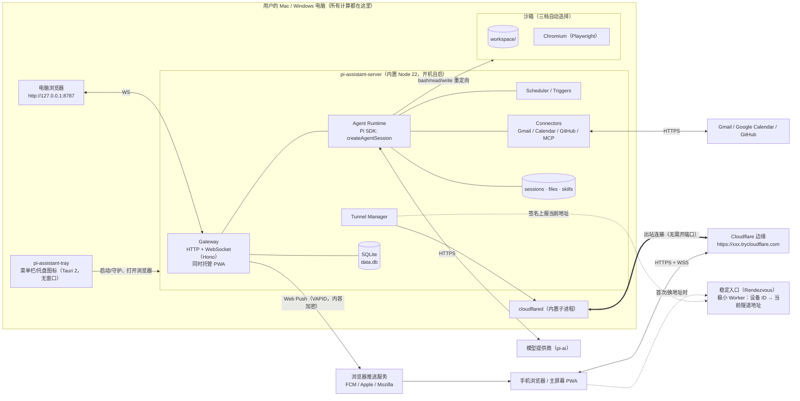
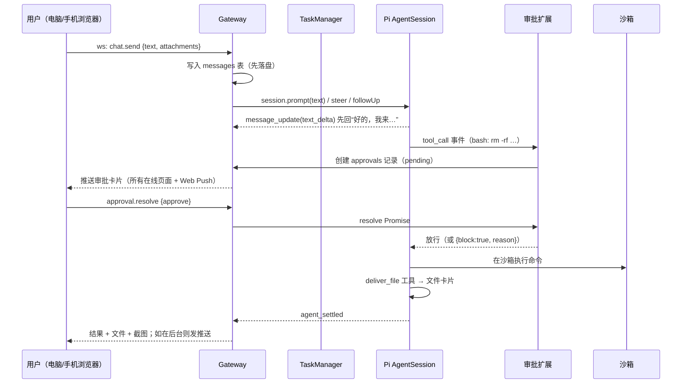
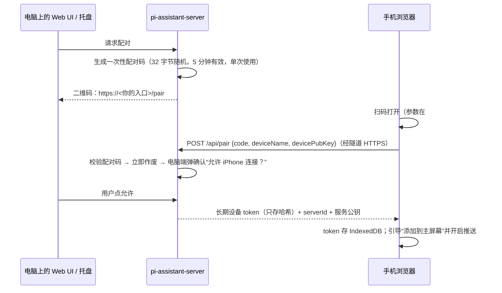

# Pi Assistant · 基于 Pi 的本地私人助理 —— 设计文档 v0.5

> 状态：v0.5（2026-10-11）。**远程入口改为按用户自选**：不再内置任何默认域名，用户用自己的域名 + 自己的 Cloudflare Token 在 App 内一键部署（§5.13.2，已实现并实测）；新增密钥扫描（§9.1）；助理电脑与 ext-computer 已开始实现（§14.10）。v0.4：新增：§5.14.1 自定义模型服务（中转站/第三方/本地，已实现），§5.16 第三方集成通用规则，§14 Phase 3 国内优先方案（它自己的电脑、自己的账号、微信/企业微信/飞书/钉钉、Cua）。v0.3：Phase 1 的服务端 + Web UI 已实现并通过端到端测试（实现状态见 §13）。新增：§5.14 模型与凭据（不内置任何 Key，全部 Pi provider 动态支持），§5.15 模块边界与 Pi 升级维护流程。默认入口域名 `app.dengdengyun.shop`。
> 参考：Pi 仓库 `earendil-works/pi`（本文基于 `@earendil-works/pi-coding-agent@1.1.0` 的源码和文档阅读结果，API 名称均来自实际代码）。

---

## 1. 产品目标

做一个**跑在用户自己电脑（Mac / Windows）上的私人助理**，体验对标托管版桌面助理：

- 一个聊天窗口，说一句话它就**自己动手**：跑代码、处理文件、上网、操作浏览器、连你的 Gmail/日历/GitHub，做完把结果、文件、截图发回来。
- 它有**自己的“电脑”**（沙箱工作区），文件长期保留，不会碰乱你的个人文件。
- **你不在它也在干活**：后台任务、定时任务、事件触发。
- **一个网页应用，到处能用**：电脑浏览器、手机浏览器用的是同一个响应式 Web App（PWA，可“添加到主屏幕”，支持 Web Push 推送）。**不做原生 App**，不需要 iOS 签名或上架。手机只是遥控器，所有计算、文件、凭据都在你的电脑上。
- **出门在外也能用**：手机用流量、在公司、在别人家 Wi‑Fi 都能连回家里的电脑——扫码或点链接即可，用户**零网络配置**（内置隧道，Phase 1）。
- **一步安装**：用户只装一个轻量安装包（Mac `.dmg` / Windows `.exe`）。它装好并开机自启本地服务（内置 Pi + Node 运行时 + cloudflared），菜单栏/托盘图标一点就打开 Web UI。不需要另装 Pi / Node / Docker。
- **有后果的操作先问你**：发邮件、删东西、付款、提交表单一律走审批，手机上也能批。

非目标（至少前三期不做）：原生手机 App、多用户/团队、云端托管 agent、在手机上执行任务。

### 核心原则

1. **Pi 是地基，不是外挂**：通过 Pi 的 SDK 把 agent 运行时嵌进我们自己的守护进程，所有能力都用 Pi 的扩展点（工具、事件钩子、MCP、技能）实现，不 fork Pi。
2. **凭据不进沙箱**：模型 key、OAuth token 只在守护进程里；沙箱里跑的代码拿不到。
3. **先落盘再显示**：每条消息、每个任务状态先写 SQLite / Pi 会话文件再推给 UI，进程崩了、电脑重启了都能接着做。
4. **默认安全**：没有 Docker 也能用，但要靠审批闸门 + 路径约束兜底。

---

## 2. 功能清单（对照 9 大能力）

| # | 能力 | 用户看到的 | 实现要点 | 期 |
|---|---|---|---|---|
| 1 | 聊天与交付 | 收到任务先回“好的，我来…”，做完发结果、文件卡片、截图；桌面和手机实时同步 | Gateway WebSocket 推送 Pi 事件流；`deliver_file` / `send_screenshot` 自定义工具；附件存 `data/files/` | P1 |
| 2 | 自己的电脑 | 一个持久工作区，可以跑命令、装工具、生成文件 | 三档沙箱（见 §5.4）：工作区目录 / OS 级沙箱 / Docker；Pi 内置工具重定向到沙箱 | P1 |
| 3 | 浏览器与桌面 | 助理自己开浏览器办事，登录状态保留；遇到验证码/二次验证把画面交给你（手机也能点） | Playwright + 持久化 profile；CDP screencast 推流到 UI；`browser_handoff` 工具 | P3 |
| 4 | 应用连接 | 连 Gmail、日历、GitHub；发信/发消息永远先出草稿 | 连接器层：官方 API + OAuth（PKCE，本地回调）；或 `pi.registerMcpServer()` 接 MCP；写操作统一走审批 | P3 |
| 5 | 后台任务 | 长任务后台跑，你继续聊别的；完成后推送通知 | 每个任务一个独立 Pi `AgentSession`；任务表在 SQLite；完成时推送（系统通知 + Web Push） | P1 |
| 6 | 定时与事件 | “每天 8 点给我一份摘要”“有新 PR 就提醒我” | Scheduler（cron 表达式，时区感知）+ Webhook/轮询触发器；到点创建后台任务 | P2 |
| 7 | 记忆 | 记住你的名字、偏好、决定 | SQLite：profile 事实 + 按日日志；`before_agent_start` 注入；`memory_write`/`memory_search` 工具 | P2 |
| 8 | 技能 | 把多步流程存成说明书，下次直接照做 | 原生 Pi Skills（`SKILL.md`，Agent Skills 规范）；技能目录 `data/skills/`；助理可自己写新技能 | P2 |
| 9 | 审批闸门 | 有后果的操作弹卡片：批准 / 拒绝 / 修改，桌面手机任一端处理 | `pi.on("tool_call")` 返回 `{ block, reason }`；配合工具 `annotations`；审批请求持久化，可跨设备 | P1 |
| + | 多助理/人设 | 多个助理，各有名字、模型、技能、工作区 | `agents` 表；每个 agent 独立工作区和会话目录 | P3 |
| + | 远程访问 | 手机在任何网络下扫码/点链接即可用，零配置 | 内置 cloudflared 快速隧道（免账号）+ 稳定入口；可选命名隧道 / Tailscale | P1 |
| + | 设置 | 模型与 key、沙箱档位、通知、配对设备、连接器 | Settings 页 + Pi `SettingsManager`（内存/文件） | P1–P3 |
| + | 用量 | 每天/每任务 token 与费用 | 汇总 Pi 消息里的 `usage`；`usage_daily` 表 | P3 |

---

## 3. 总体架构

### 3.1 部署形态



要点：
- **只有一个本地服务进程**（`pi-assistant-server`），它托管 Web UI、跑 Pi、管任务；托盘程序只负责启动、守护、打开浏览器和显示状态。
- **所有界面都是同一个 PWA**：电脑上开 `http://127.0.0.1:8787`，手机经隧道开 `https://…`。
- **远程访问走出站隧道**：电脑不开任何入站端口，路由器无需设置。

### 3.2 一次请求的生命周期（ack → 执行 → 交付）



### 3.3 为什么用 SDK 而不是 RPC

| 方案 | 结论 |
|---|---|
| **SDK（进程内）** `createAgentSession()` | ✅ 采用。我们本身就是 TypeScript/Node，能拿到完整 API：`session.subscribe()` 事件流、`steer()`/`followUp()`、`SessionManager`、`DefaultResourceLoader({ extensionFactories })` 注入我们自己的扩展、`bindExtensions({ uiContext })` 把扩展的 `ctx.ui.confirm()` 接到我们的审批系统。打包时只有一个服务进程。 |
| RPC（`pi --mode rpc` 子进程） | 备选。若以后要给每个 agent 做进程级隔离（一个 agent 崩溃不影响别的），可以换成 `RpcClient`；协议里的 `extension_ui_request/response` 同样能接审批。接口层做成 `AgentDriver` 抽象，两种都能插。 |
| `pi-durable` / `pi-server` | 官方标注 Experimental、API 随时变。先不用，P3 之后评估（它的“先提交再显示、崩溃续跑”和我们的目标一致）。 |

---

## 4. 我们依赖的 Pi 扩展点（实际 API）

全部来自 `packages/coding-agent/src/core/extensions/types.ts`、`docs/extensions.md`、`docs/sdk.md`：

**SDK 层**
- `createAgentSession({ cwd, sessionManager, settingsManager, resourceLoader, modelRuntime, model, thinkingLevel, tools, customTools, excludeTools })` → `AgentSession`
- `session.prompt()` / `session.steer()` / `session.followUp()` / `session.abort()` / `session.waitForIdle()` / `session.subscribe(listener)` / `session.dispose()` / `session.getLastAssistantText()`
- `session.bindExtensions({ uiContext, mode, abortHandler, shutdownHandler })`：把 `ctx.ui.select/confirm/input/notify` 实现为我们的 Web 审批与通知
- `SessionManager`（JSONL 持久会话，`SessionManager.inMemory()` 用于临时任务）、`AgentSessionRuntime.newSession()/switchSession()/fork()`
- `DefaultResourceLoader`（`extensionFactories` 注入内联扩展；技能/提示模板目录）、`SettingsManager`、`ModelRegistry`
- 事件：`message_update`（`text_delta` 流式）、`message_end`、`tool_execution_start/update/end`、`agent_end`、**`agent_settled`**（判断任务真正结束）
- `createMcpExtension()`、`createCodemodeExtension()`、`createToolSearchExtension()`（SDK 不默认加载，需手动加入）

**扩展层（`ExtensionAPI`）**
- `pi.registerTool({ name, description, parameters(TypeBox), execute, annotations, exposure })`：注册 `deliver_file`、`memory_*`、`browser_*`、`gmail_create_draft` 等
- `pi.on("tool_call", …)` → `{ block: true, reason }` 或就地修改 `event.input`：**审批闸门核心**
- `pi.on("tool_result", …)`：脱敏、截断大输出、收集产出文件
- `pi.on("before_agent_start", …)` → `{ message }` / `systemPromptOptions`：注入记忆、人设、当前时间时区
- `pi.on("session_start" | "session_shutdown")`：启动/释放浏览器、沙箱连接（文档要求不要在工厂函数里起进程）
- `pi.on("agent_before_settle")`、`pi.on("turn_end")`：任务收尾（写日志、生成摘要）
- `pi.on("input")`：解析附件、斜杠命令
- `pi.getAllTools()` 的 `annotations`（`readOnlyHint` / `destructiveHint` / `openWorldHint`）：审批策略的默认依据
- `pi.registerMcpServer(name, config)` / `pi.unregisterMcpServer()` / `pi.getMcpServers()`：连接器接 MCP
- `pi.sendMessage(msg, { triggerTurn, deliverAs })` / `pi.sendUserMessage()`：定时任务、事件注入
- `pi.appendEntry(customType, data)`：不进上下文的持久状态（如审批记录引用）
- `pi.setActiveTools()` / `pi.getActiveTools()`：按 agent 人设裁剪工具
- `pi.registerProvider()`：自定义模型提供商（如本地 llama.cpp / 公司网关）
- `pi.exec()`、`ctx.executeTool()`、`ctx.modelRegistry.streamSimple()`（嵌套模型调用，如摘要）
- 内置工具重定向：`createBashTool(cwd, { operations })` + `BashOperations`（参考官方 `examples/extensions/gondolin`），同理覆盖 `read/write/edit/grep/find/ls`
- 参考示例：`permission-gate.ts`、`confirm-destructive.ts`、`protected-paths.ts`、`sandbox/`、`gondolin/`、`notify.ts`、`todo.ts`

**技能**：原生 `SKILL.md`（frontmatter `name`、`description`、`disable-model-invocation`），`/skill:name` 强制加载。

---

## 5. 组件设计

### 5.1 pi-assistant-server（本地服务，核心，代码在 `packages/server`）

单个 Node 22 进程（安装包内置 Node 运行时），内部模块：

| 模块 | 职责 |
|---|---|
| `gateway` | Hono HTTP + `ws` WebSocket；托管 PWA 静态文件；鉴权（设备 token）；限流；REST：文件上传下载、配对、OAuth 回调、Webhook 入口 |
| `tunnel` | 管理内置 cloudflared 子进程、获取/上报公网地址、健康检查与自动重连（§5.13） |
| `pairing` | 二维码配对、设备 token 发放与吊销 |
| `runtime` | `AgentManager`：每个 agent 一个“主会话” + N 个任务会话；封装 `createAgentSession`；把 Pi 事件翻译成我们的协议事件 |
| `tasks` | `TaskManager`：创建/排队/并发上限（默认 3）/取消/重启恢复 |
| `approvals` | 审批请求的持久化、广播、超时（默认不超时=一直等你）、“本会话内同类操作都允许”的临时授权 |
| `scheduler` | cron（`croner`，时区 Asia/Shanghai 等用户时区）+ 轮询触发器 + Webhook 触发器 |
| `memory` | 事实库 + 日志 + 检索（SQLite FTS5，P3 可加向量） |
| `connectors` | OAuth 管理、token 加密存储、API 客户端、MCP 注册 |
| `sandbox` | 沙箱驱动（三档）+ 健康检查 |
| `notify` | 系统通知（经托盘程序）、Web Push（VAPID，服务端直接发到浏览器推送服务，无需我们的推送服务器）、页面内通知 |
| `usage` | 汇总 token/费用 |

**防丢数据**：
- 所有消息、任务状态、审批先写 SQLite（WAL 模式）再推送。
- Pi 会话本身就是持久 JSONL（`SessionManager` 默认），存 `data/agents/<id>/sessions/`。
- 守护进程启动时扫描 `tasks.status in (running, waiting_approval)`：用同一会话文件重建 `AgentSession`，`sendUserMessage("（系统）上次执行被中断，请检查进度后继续")` 续跑；审批中的继续等待。
- 运行任务期间阻止系统睡眠（macOS `caffeinate -i`，Windows `SetThreadExecutionState`），任务结束释放。

### 5.2 安装包与托盘程序（`apps/tray`）

- **托盘程序**：Tauri 2，**不开窗口**，只有菜单栏/托盘图标。菜单：打开Pi Assistant（用默认浏览器打开 `http://127.0.0.1:8787`）、显示手机配对二维码、服务状态（运行中/隧道在线/当前任务数）、暂停所有任务、开机自启开关、检查更新、退出。
- **服务作为 sidecar**：安装包内带 `node`（固定版本 Node 22 运行时）+ `server.mjs`（esbuild 打包，Pi SDK 已打进去）+ `cloudflared` 二进制 + PWA 静态文件。托盘程序启动并守护服务进程，崩溃自动拉起（指数退避）。
- **开机自启**：`tauri-plugin-autostart`（macOS LaunchAgent / Windows 注册表 Run 键）。高级选项“无托盘服务模式”：直接注册 LaunchAgent / Windows 计划任务启动服务。
- **安装包**：Tauri bundler 产出 macOS `.dmg`（Apple Silicon + Intel，或 universal）和 Windows NSIS `.exe`。体积目标 < 80MB（Node ~40MB + cloudflared ~35MB + 其余）。
- **自动更新**：`tauri-plugin-updater`，签名校验，更新源为 GitHub Releases 的 `latest.json`。
- **代码签名说明**：不签名也能装，但 macOS 首次需右键“打开”（Gatekeeper），Windows 会出现 SmartScreen 提示。正式分发建议：macOS Developer ID 证书 + 公证（需 Apple Developer 账号，仅用于桌面安装包，**与手机无关**）；Windows 代码签名证书（或 Azure Trusted Signing）。CI 里预留签名步骤，有证书时自动启用。
- **CI 构建**：GitHub Actions（`.github/workflows/release.yml`），打 `v*` tag 触发，矩阵 `macos-14`(arm64) / `macos-13`(x64) / `windows-latest`，用 `tauri-apps/tauri-action` 构建并上传到 GitHub Release；每个平台先下载对应的 Node 与 cloudflared 二进制并校验 SHA256。

### 5.3 Web UI（`apps/web`，唯一的界面，PWA）

- React 18 + Vite + TypeScript + Tailwind + shadcn/ui；状态 Zustand；数据 TanStack Query；路由 TanStack Router；`vite-plugin-pwa`（manifest + Service Worker）。
- **响应式**：同一套组件，桌面宽屏三栏（会话列表 / 聊天 / 任务与文件侧栏），手机单栏 + 底部导航（聊天、任务、审批、设置）。
- **可安装**：手机浏览器“添加到主屏幕”后全屏运行，像 App 一样；iOS 16.4+ 的主屏幕 PWA 支持 Web Push，Android Chrome 直接支持。
- **推送**：Web Push（VAPID 密钥由本地服务首次启动时生成，存在本地）。服务端用 `web-push` 直接发往浏览器厂商的推送服务；推送内容端到端加密，只含“任务完成 / 需要审批”和 ID，点开后通过隧道拉详情。
- 页面：聊天（流式文本、工具步骤折叠、文件卡片、截图、审批卡片）、任务列表、定时任务、记忆、技能、连接器、设备与配对、设置、用量。
- 实时同步：所有客户端订阅同一 WS 事件流，按 `seq` 增量补齐（断线重连时 `since=<lastSeq>` 拉缺失事件）。**只用 WebSocket，不用 SSE**（Cloudflare 快速隧道不支持 SSE，WebSocket 正常）。
- 交互细节：大文件下载走带短期签名的 URL；图片缩略图服务端生成；离线时显示“电脑离线”与最后已知状态（Service Worker 缓存）。

### 5.4 沙箱：“它自己的电脑”（三档，自动选择）

| 档位 | 条件 | 隔离方式 | 说明 |
|---|---|---|---|
| L0 工作区 | 永远可用（兜底） | 进程以当前用户运行，`cwd` 固定为 `<数据目录>/workspace`；路径守卫扩展（参考 `protected-paths.ts`）禁止写工作区外；所有 bash 走审批策略 | 安全性最弱，靠审批兜底；UI 上明确标“基础模式” |
| L1 OS 沙箱 | macOS 自带 / Windows 需额外组件 | macOS：`sandbox-exec` 配置文件（只允许写工作区、可选禁网）；Windows：受限令牌 + Job Object 低完整性进程（P2 研究，先做 L0/L2） | 无需安装任何东西 |
| L2 Docker | 检测到 Docker Desktop / OrbStack / Podman | 守护进程**外置**，只把工具执行放进容器：`pi-assistant-sandbox` 镜像（Debian + Python + Node + git + Chromium + Xvfb + noVNC），挂持久卷 `pi-assistant-workspace:/workspace` | 推荐；凭据永远不进容器 |

实现方式统一：参考 Pi 官方 Gondolin 示例，用 `createBashTool(cwd, { operations })` 和对应的 read/write/edit 等工具工厂，**覆盖 Pi 内置工具**，把实际执行交给 `SandboxDriver`：

```ts
interface SandboxDriver {
  exec(cmd: string, opts: { cwd: string; env?: Record<string,string>; signal?: AbortSignal;
       onData?: (chunk: string) => void; timeoutMs?: number }): Promise<{ exitCode: number }>;
  readFile(p: string): Promise<Buffer>;
  writeFile(p: string, data: Buffer): Promise<void>;
  stat / list / mkdir ...
  hostPathOf(p: string): string | null;  // 交付文件时映射到宿主路径
}
```

- L2 的 `exec` 通过容器里常驻的 `exec-daemon`（一个很小的 Node/Rust 程序，stdin/stdout 帧协议，思路同 `pi-env`）避免每次 `docker exec` 的开销；以后也可直接复用 `@earendil-works/pi-env` 的 `RemoteExecutionEnv`。
- Windows：Pi 内置有 PowerShell 工具（`PowerShellToolCallEvent`），L0 下优先 PowerShell；L2 下统一 bash。
- 首次启动检测 Docker，可用则提示“一键切换到增强沙箱”（拉镜像在后台进行），否则静默使用 L0/L1。**Docker 永远是可选的。**

### 5.5 浏览器自动化（P3）

- 依赖 `playwright-core`，浏览器优先用系统已装的 Chrome/Edge（`channel: "chrome" | "msedge"`），没有则首次使用时下载 Chromium 到 `data/browsers/`（不进安装包）。L2 模式下用容器内 Chromium，经 CDP 连接。
- `launchPersistentContext(data/agents/<id>/browser-profile)`：登录状态持久保留（profile 与用户自己的浏览器完全隔离）。
- 工具（`pi.registerTool`）：`browser_open`、`browser_snapshot`（无障碍树 + 可点元素编号）、`browser_click`、`browser_type`、`browser_screenshot`（返回 `ImageContent` 给模型看，同时作为截图交付给用户）、`browser_download`、`browser_handoff`。
- **人工接管**：`browser_handoff(reason)` → 创建 handoff 记录 → Web UI（电脑或手机浏览器）打开实时画面（CDP `Page.startScreencast` 推 JPEG 帧，点击/键盘回传 `Input.dispatch*`）→ 用户点“我弄好了” → 工具返回，agent 继续。验证码、二次验证、付款确认都走这里。
- 提交表单、付款按钮类点击由审批扩展拦截（`browser_click` 带 `intent` 参数，`submit/purchase/send` 需审批）。

### 5.6 连接器层（P3）

- OAuth：本地服务回调 `http://127.0.0.1:<port>/oauth/callback`，PKCE；token 用系统钥匙串（macOS Keychain / Windows Credential Manager，经 `@napi-rs/keyring` 或 Tauri 侧存储）加密主密钥，SQLite 只存密文。
- 一等连接器（自己写，体验最好）：
  - Gmail：`gmail_search`、`gmail_read_thread`、`gmail_create_draft`（**只建草稿**）、`gmail_send_draft`（需审批，审批卡片显示完整收件人/主题/正文）
  - Google Calendar：`calendar_list`、`calendar_create_event`（需审批）
  - GitHub：`github_*`（读免审批；建 issue/PR、评论、合并需审批）。也可直接用 `gh` CLI。
- 长尾：用户在设置里添加 MCP 服务器 → `pi.registerMcpServer(name, { command,args,env } | { url, headers, oauth })`，`exposure: "deferred"` 配合 `tool_search` 避免工具太多撑爆上下文。MCP 工具的 `annotations` 直接喂给审批策略。
- 原则：**所有对外发出的内容（邮件、消息、评论、发帖）= 先草稿，后审批，再发送。**

### 5.7 后台任务（P1）

- 聊天里说“帮我…（耗时）”，主会话调用 `spawn_task({ title, instructions })` 工具 → TaskManager 用新的 `AgentSession`（同工作区，独立会话文件）执行 → 主会话立即回复“已经在后台做了”。
- 任务完成：`agent_settled` → 任务结果作为 `custom_message` 注入主会话（`pi.sendMessage({ customType: "task_result", … }, { deliverAs: "nextTurn" })`）+ 推送通知。
- 任务可在 UI 查看实时日志、取消（`session.abort()`）、追加指令（`session.steer()`）。

### 5.8 定时与事件触发（P2）

- `routines` 表：`trigger`（`cron` / `interval` / `webhook` / `poll:gmail` / `poll:github`）、`instructions`（保存时的原话，作为执行依据）、`agent_id`、`enabled`、`last_run_at`。
- 到点 → 创建任务（同 5.7）。电脑睡眠错过的执行：唤醒后按“错过策略”（跳过 / 补跑一次）处理。
- Webhook：`POST /hooks/<routineId>/<secret>`（需要远程访问时经隧道暴露）。
- 定时任务里的发送类动作：保存 routine 时用户明确授权的（如“每天把摘要发到我自己的邮箱”）记为 routine 级授权，其余仍需审批（异步：Web Push 推到手机等你点）。

### 5.9 记忆（P2）

- `memory_facts`（key/value + 来源 + 更新时间，如“名字：deng”“时区：Asia/Shanghai”），`memory_log`（按日日志）。
- `before_agent_start`：注入 profile 全部事实 + 最近 3 天日志摘要 + 与当前输入 FTS 匹配的 top-k 条目（总预算 ~2k tokens）。
- 工具：`memory_write`、`memory_search`、`memory_forget`；UI 可查看/编辑/删除。

### 5.10 技能（P2）

- 目录：`data/skills/<name>/SKILL.md`（用户/助理写的）+ 内置技能（随 App 打包，只读）。通过 `DefaultResourceLoader` 的技能路径加载，直接用 Pi 原生发现与按需加载机制。
- 助理完成一个多步流程后可以提议“存成技能”（写文件属于工作区内操作，免审批；UI 显示新技能）。

### 5.11 审批闸门（P1，最重要的安全组件）

扩展 `@pi-assistant/ext-approval`：

```ts
export default (pi: ExtensionAPI) => {
  pi.on("tool_call", async (event, ctx) => {
    const decision = policy.evaluate(event, pi.getAllTools());   // allow | ask | deny
    if (decision.kind === "allow") return;
    if (decision.kind === "deny") return { block: true, reason: decision.reason };
    const ok = await approvals.request({ agentId, taskId, toolName: event.toolName,
                                         input: event.input, summary: decision.summary });
    if (!ok.approved) return { block: true, reason: ok.note ?? "用户拒绝" };
    if (ok.editedInput) Object.assign(event.input, ok.editedInput);  // 用户修改后的草稿
  });
};
```

策略（按顺序匹配，用户可在设置里调整）：
1. 硬拒绝：读取凭据目录、`~/.ssh`、浏览器 Cookie 库、写工作区外（L0）。
2. 必须审批：发送类（邮件、消息、评论、PR 合并）、付款/下单、提交表单、删除工作区外文件、`git push --force`、`rm -rf` 大范围删除、安装系统级软件、`annotations.destructiveHint === true`、未声明只读的 `openWorldHint` MCP 工具。
3. 免审批：工作区内读写、只读查询、`readOnlyHint === true`。
- 审批记录持久化；电脑/手机任一端处理后其他端同步消失；**拒绝即终止**，agent 不得换个方式重试（写进系统提示 + 同一参数指纹被拒后短期内自动拒绝）。

### 5.12 通知

- 电脑：服务通过托盘程序发系统通知（macOS 通知中心 / Windows Toast）；页面打开时也有页内提醒。
- 手机：Web Push（见 §5.3）。不需要原生 App、不需要 APNs/FCM 服务端账号、不需要我们托管推送服务器。
- 通知策略：任务完成、任务失败、需要审批、需要人工接管（验证码/二次验证）、定时任务结果；可在设置里按类别开关、设免打扰时段。

### 5.13 远程访问、配对与内置隧道（Phase 1）

目标：手机在**任何网络**（蜂窝流量、公司 Wi‑Fi）下，扫码或点链接就能用，用户不做任何网络设置、不注册任何账号。

#### 5.13.1 隧道方案选择

| 方案 | 需要账号 | 地址 | 结论 |
|---|---|---|---|
| **cloudflared 快速隧道**（`cloudflared tunnel --url http://127.0.0.1:8787`） | 不需要 | 随机 `https://xxx.trycloudflare.com`，**每次重启变化** | ✅ **默认**。零配置、自带受信任 HTTPS 证书（满足 PWA/Service Worker/Web Push 的安全上下文要求）、出站连接无需开端口、WebSocket 可用 |
| cloudflared 命名隧道 | Cloudflare 账号 + 自己的域名 | 固定，如 `https://assistant.example.com` | 可选“稳定地址”模式；无 200 并发限制，可加 Cloudflare Access |
| Tailscale Serve / Funnel | Tailscale 账号 | 固定 `https://<机器>.<tailnet>.ts.net` | 可选；Serve 仅 tailnet 内设备可访问，最私密 |
| 自建中继 | 我们运维服务器 | 固定 | 暂不做；快速隧道不可用时的长期备选 |

快速隧道的已知限制（Cloudflare 官方文档）：仅用于测试/开发、无 SLA、每隧道最多 200 个并发请求（超出返回 429）、不支持 SSE、地址每次新建都会变。对个人助理（一个人、几台设备、只用 WebSocket）足够；设置页明确提示，并提供一键切换到命名隧道 / Tailscale。

#### 5.13.2 解决“地址会变”：用户自己的稳定入口（Rendezvous，可选）

**原则：App 和仓库里不内置任何默认域名，也没有我们运营的公共服务。** 远程访问分三档，由用户自己选：

| 档位 | 需要 | 体验 |
|---|---|---|
| 仅局域网 | 什么都不要 | 同一 Wi‑Fi 下扫码使用 |
| 临时链接（默认的远程方式） | 什么都不要 | 打开「远程访问」即得 `https://xxx.trycloudflare.com`；电脑重启/隧道重连后地址会变，需要重新扫码（已配对设备会收到推送提示） |
| **自己的稳定入口**（推荐） | 一个托管在 Cloudflare 的域名（免费套餐即可）+ 一个 Cloudflare API Token | 固定网址 `https://<子域名>.<你的域名>`，扫一次码永久可用，隧道地址变化自动跟随 |

**一键部署（「设置 → 远程入口」，仅本机可操作）**：用户填域名、子域名（默认 `assistant`）、API Token（模板「编辑 Cloudflare Workers」）。服务端 `cloudflare.ts` **只用 Cloudflare 公开 REST API、运行时不需要 wrangler**：

1. `GET /user/tokens/verify` 验证 Token；
2. `GET /zones?name=<域名>` 找到 zone，**自动得到 account id**；
3. 创建/复用 KV 命名空间 `pi-assistant-rendezvous-servers`；
4. 上传 PWA 外壳：`POST …/workers/scripts/pi-assistant-rendezvous/assets-upload-session`（清单 = 路径 → 内容哈希）→ 只上传缺失的文件 → 拿到完成 JWT；
5. `PUT …/workers/scripts/pi-assistant-rendezvous`（multipart：`dist/worker.js` ES 模块 + 元数据：KV 绑定 `SERVERS`、静态资源绑定 `ASSETS`、SPA 回退、`/api/*` 先走 Worker）；
6. `PUT …/workers/domains` 绑定 **Workers Custom Domain**（Cloudflare 自动创建 DNS 记录和证书，无需用户手动加记录）；
7. 轮询 `https://<主机名>/api/health`，生效后把它设为入口并立刻登记当前隧道地址。

每一步通过 WebSocket 实时显示进度；失败原样显示 Cloudflare 的错误码。可“重新部署/更新”（App 升级后外壳随之更新）或“删除”（解绑域名、删除 Worker、清除本地 Token）。也提供命令行版 `scripts/deploy-rendezvous.mjs`，调用的是本机服务的同一个 API。

**Token 安全**：只用主密钥加密保存在本机 SQLite（§5.14 同一套加密），只发给 `api.cloudflare.com`；不进日志、不进仓库、不发给 Rendezvous；远程设备无法读取或修改（接口 `localOnly`）。

**免费套餐额度**（设置页内展示）：Workers 每天 10 万次请求；KV 每天 10 万次读、1000 次写、1 GB；静态资源请求不计费；自定义域名与证书免费。Pi Assistant每次打开读 1 次 KV，隧道地址变化时写 1 次，个人使用远低于额度。

**工作方式**（不变）：
1. **PWA 外壳放在用户自己的固定源**，手机安装的是这个源的 PWA，Web Push 订阅也绑定它。
2. **Rendezvous Worker** 只存 `serverId → { 当前隧道地址, 时间, Ed25519 签名, 公钥(TOFU) }`；本地服务每次拿到新隧道地址就签名上报；PWA 按 `serverId` 查询并**用配对时保存的公钥验签**后连接。Worker 不经手任何聊天内容。一个用户的 Worker 也可以服务他的多台电脑。
3. 本地服务 CORS 只允许入口源与本机源。
4. 兜底：地址变化时本地服务给已配对设备发 Web Push；都失败时重新扫码。
5. 也可以用 cloudflared 命名隧道 / Tailscale 获得固定地址，此时 PWA 直接由本地服务托管（P2）。

**实测**（2026-10-11）：用开发者自己的域名走同一流程部署到 `https://app.dengdengyun.shop`（这只是开发者的测试实例，不是默认值），7 步约 14 秒完成；`/` 返回 PWA、`/api/health` 正常、签名登记与查询往返成功。

#### 5.13.3 配对流程



- 也支持“复制链接”方式（同样的 URL，发到自己手机上点开）。
- 电脑本机访问 `127.0.0.1` 免配对（仅限回环地址，且校验 `Host` 头防 DNS 重绑定）。

#### 5.13.4 安全措施

- **只走 HTTPS/WSS**：隧道地址天然 HTTPS；本地服务只监听 `127.0.0.1`，任何局域网/公网入站都不开放。
- **每台设备独立长期 token**（256 位随机，服务端存 SHA‑256 哈希），设备列表可见名称、平台、最后在线时间、来源 IP，**一键吊销**（立即断开该设备所有连接）。可选 token 滚动（每 30 天自动续期）。
- 配对码：一次性、5 分钟过期、服务端确认弹窗、失败 5 次锁定配对 15 分钟。
- **限流**：按 IP 与设备分别令牌桶（未认证请求 10 次/分钟，配对 5 次/10 分钟，认证后 API 600 次/分钟）；连续认证失败的 IP 临时封禁。
- 隧道入口上的所有请求都必须带设备 token（除配对与 PWA 静态资源）；WebSocket 握手后首帧认证，超时 5 秒断开。
- 敏感操作二次确认：在手机上批准“发送/付款/删除”类审批时，可要求设备生物识别（WebAuthn 平台认证器）。
- 安全头：严格 CSP、`frame-ancestors 'none'`、`Referrer-Policy: no-referrer`；Cookie 不用于认证（避免 CSRF）。
- 用户可随时在托盘菜单“关闭远程访问”，cloudflared 立刻停止。

### 5.14 模型与凭据：不内置任何 Key，Pi 支持的都能用

**原则**：安装包里**永远没有任何 API Key**。每个用户在 App 里配置自己的模型账号；凭据只加密保存在用户自己的电脑上，**绝不发送给 Rendezvous 或任何第三方**（只发给对应的模型服务商）。

**完全由 Pi 驱动，不写死 provider 列表**：
- provider 目录：`ModelRuntime.getProviders()`（当前 Pi 1.1.0 有 43 个：OpenAI、Anthropic、Google、DeepSeek、Kimi、Qwen、智谱、MiniMax、OpenRouter、Bedrock、Azure、GitHub Copilot……）。每个 provider 自带 `auth.apiKey` / `auth.oauth`（含 `isSubscription`、`loginLabel`）描述，UI 据此渲染“API Key”“订阅登录”按钮。Pi 以后新增 provider 或登录方式，**我们不改代码就会自动出现**。
- 登录：统一调用 `ModelRuntime.login(providerId, "api_key" | "oauth", interaction)`。Pi 通过 `AuthInteraction` 发出 `prompt`（text / secret / select / manual_code）与 `notify`（info / auth_url / device_code / progress）事件；服务端 `login-flows.ts` 把它们桥接成 WebSocket 事件，Web UI 的 `LoginFlow` 组件通用渲染（输入框、选项、打开授权页、显示设备码）。因此 API Key、ChatGPT/Claude/Copilot/Kimi/xAI 等订阅 OAuth、AWS 多种认证方式都走同一条通道。
- 测试连接：`completeSimple()` 发一条 16 token 的请求；错误信息原样展示（例如 401 无效 Key）。
- 模型列表：`getModels(providerId)`；默认模型存 `settings.defaultModel`，每个助理可单独覆盖。

**凭据加密存储**（`secrets.ts`）：实现 Pi 的 `CredentialStore` 接口并传给 `ModelRuntime.create({ credentials })`，所以 Pi 内部刷新 OAuth token 时写回的也是加密存储。
- 文件 `credentials.enc`：AES‑256‑GCM，原子写入，权限 0600。
- 主密钥：macOS 钥匙串（`security` 命令）｜Windows DPAPI（当前用户作用域）｜其他平台退回 0600 密钥文件（设置 → 关于 中显示当前后端）。
- 沙箱里的 bash 子进程会清理名字含 KEY/TOKEN/SECRET/PASSWORD 等的环境变量，访问 `auth.json`、`.ssh`、`.aws` 等路径的工具调用直接拒绝。

**首次运行向导**（Web UI）：欢迎 → 选择模型服务（搜索 43 个）→ 登录（API Key / 订阅）→ 选默认模型 + 测试连接 → 完成。之后在「设置 → 模型」管理：登录/退出、默认模型、测试。开发模式（`PIA_MOCK=1`）额外出现“Mock 模型（本地测试）”。

#### 5.14.1 自定义模型服务（中转站 / 第三方 / 本地推理）——已实现

Pi 目录里没有的服务（各种 OpenAI 兼容“中转站”、公司内网网关、Ollama / vLLM / LM Studio、新出的国产模型 API）都可以在「设置 → 模型 → 添加自定义服务」或首次向导里添加。**完全走 Pi 自己的 `models.json` 机制**，不自己实现任何协议：

| 字段 | 说明 |
|---|---|
| 名称 | 显示名；内部 id 自动生成 `custom-<slug>` |
| API 类型 | 来自 pi-ai 的 API 注册表 `getApiProviders()`：OpenAI 兼容（Chat Completions）、OpenAI Responses、Anthropic 兼容（Messages）、Gemini、Mistral、Azure、Bedrock、Vertex……（Pi 新增协议后自动出现） |
| Base URL | 如 `https://relay.example.com/v1`、`http://127.0.0.1:11434/v1` |
| API Key | 可选“无需 Key（本地服务）” |
| 自定义请求头 | 任意多个（某些中转站需要 `X-Team`、`User-Agent` 等） |
| 模型列表 | 手动输入，或“自动获取”（服务端请求 `/models`：OpenAI 风格 Bearer、Anthropic 风格 `x-api-key` + `anthropic-version`、Gemini 风格 `x-goog-api-key`），点选添加 |

实现（`pi-adapter/custom-providers.ts`）：
- 结构写入数据目录下 Pi 的 `models.json`（`providers.<id> = { name, baseUrl, api, headers, models }`），保留用户手写的其它条目；保存后 `ModelRuntime.refresh({ allowNetwork:false })` 重新加载，Pi 负责校验与请求。
- **API Key 不写进 models.json**：通过 Pi 的通用 `login(id, "api_key")` 写入加密凭据库（Pi 的凭据优先级：stored > models.json apiKey > 环境变量）。
- **请求头的值也不明文落盘**：用主密钥加密存在 SQLite；`models.json` 里只写 `${PIA_H_<hash>_<n>}`（Pi 原生的环境变量插值），启动时注入到服务进程环境；沙箱子进程会清掉所有 `PIA_*` 变量。
- 编辑时 Key / 请求头值留空 = 保持原值；删除会同时清理 models.json、凭据与加密请求头，并在默认模型被删时清空默认。
- 测试连接沿用 `completeSimple()`，错误原样显示（401、403 缺少请求头等）。
- API：`GET/POST /api/models/custom`、`PUT/DELETE /api/models/custom/:id`、`POST /api/models/custom/fetch-models`。
- 测试：`test/custom-providers.test.ts`（自动获取 → 保存 → models.json 无明文 → 测试连接 → 编辑 → 删除 → 错误 Key 报错）；E2E 第 15 项用 `e2e/mock-openai.mjs`（模拟中转站，校验 Bearer 与自定义请求头）走完整 UI 流程，并把它设为默认模型真实聊天（截图 `17-settings-custom-provider.png`、`18-chat-via-custom-provider.png`）。

国产模型：DeepSeek、Kimi（moonshotai / moonshotai-cn / kimi-coding）、通义千问（qwen-token-plan*）、智谱（zai / zai-coding-cn）、MiniMax、小米等 **已在 Pi 目录里**，直接 API Key 登录；百炼 DashScope、火山方舟（豆包）、硅基流动、腾讯混元、百度千帆、阶跃等提供 OpenAI 兼容接口的，用自定义服务添加即可（以后可以做成“预设模板”，只预填 Base URL，不内置 Key）。

### 5.15 模块边界与 Pi 升级 / 维护流程

目标：**Pi 发新版时我们能在一天内跟上**，并通过托盘自动更新推给所有用户。

**1）只把 Pi 当普通 npm 依赖**：`@earendil-works/pi-coding-agent`、`@earendil-works/pi-ai` 写在 `packages/server/package.json`（`^1.1.0`）。不 fork、不打补丁（无 patch-package）、不 vendoring 源码。

**2）唯一适配层 `packages/server/src/pi-adapter/`**——服务端其余代码禁止直接 import Pi：

| 适配层导出 | 封装的 Pi API |
|---|---|
| `PiModels`（`listProviders / listModels / login / logout / test / registerProvider`） | `ModelRuntime`、provider `auth`、`completeSimple` |
| `createPiSession()` | `createAgentSession`、`DefaultResourceLoader`（`extensionFactories`、`appendSystemPrompt`、技能路径）、`SessionManager`、`SettingsManager` |
| `subscribeSession()` → 归一化事件 `assistant_start / text_delta / assistant_end / tool_start / tool_end / settled` | `AgentSessionEvent` |
| `promptSession / abortSession / injectContext / lastAssistantText` | `prompt(streamingBehavior)`、`abort`、`sendCustomMessage` |
| `makeBashTool()` | `createBashTool`（供沙箱扩展覆盖内置 bash） |
| `checkPiCompat()` + `compat.json` | 读取已安装 Pi 版本，对比测试基线 |
| `mock-provider.ts` | `registerFauxProvider`（仅开发/测试） |

Pi 的 API 变化只需要改这个目录；`runtime.ts`、`http.ts` 等只依赖适配层自己的类型。

**3）我们的功能 = Pi 扩展包**（`packages/ext-*`，`keywords: ["pi-package"]`，对 Pi 只有 `peerDependency` 和**类型**依赖，运行时能力由宿主注入，便于单测与复用）：

| 包 | 用到的 Pi 扩展点 | 内容 |
|---|---|---|
| `@pi-assistant/ext-approval` | `pi.on("tool_call")` → `{ block, reason }`、工具 `annotations` | 风险评估（删除/sudo/git push/对外 POST…→审批；凭据路径→拒绝；只读→放行）、拒绝后 30 分钟内同一调用自动拒绝 |
| `@pi-assistant/ext-sandbox` | `pi.registerTool()` 覆盖 `bash`、`tool_call` 路径守卫 | L0 工作区（清理敏感环境变量、文件工具不得越出工作区）；L2 Docker（`BashOperations` 在容器内执行） |
| `@pi-assistant/ext-delivery` | `pi.registerTool()` | `deliver_file`、`ask_user`（选项卡片）、`spawn_task`（后台任务） |
| `ext-memory / ext-browser / ext-connectors` | （P2/P3） | 占位 |

**4）兼容性测试**（`packages/server/test/pi-compat.test.ts`，只经适配层调用 Pi，用 Mock 模型、无需网络和 Key）：版本检查；provider 目录 ≥20 且含 API Key 与订阅登录；通用登录交互能把 Key 写进加密存储；完整会话流程（流式事件、扩展工具、`deliver_file`、审批拦截 `rm`）。另有 Playwright E2E（`e2e/run.mjs`，13 项）。

**5）CI 自动跟进 Pi**：
- `ci.yml`：每次 push/PR 跑 `check:pi`、typecheck、单元+兼容测试、Worker 测试、构建、E2E（上传截图）。
- `pi-latest.yml`：**每周一自动**把 Pi 升到 npm 最新版 → 跑全部测试 → 通过则更新 `compat.json` 并**自动开 PR**；失败则**自动开 issue** 附日志，提示需要改 `pi-adapter`。
- `renovate.json`：Pi 包单独分组、发布 1 天后即提 PR（与上面互为备份）。

**6）发布与用户侧更新**：合并升级 PR → 打 tag `vX.Y.Z` → `release.yml` 构建 Mac/Windows 安装包（sidecar 内含新版 Pi）→ 托盘程序的 Tauri updater（签名校验）静默下载安装。用户数据（SQLite、Pi 会话 JSONL、加密凭据）与程序分离，升级不丢。

**维护者升级清单**：`npm run check:pi` → `npm i -w @pi-assistant/server @earendil-works/pi-coding-agent@latest @earendil-works/pi-ai@latest` → `npm test && npm run e2e` → 失败时只改 `pi-adapter/`（必要时 `ext-*` 的类型）→ 更新 `compat.json` → PR。

---

### 5.16 第三方集成的通用规则（Pi、Cua Driver、cloudflared、Playwright、MCP 服务器……）

把 5.15 对 Pi 的做法推广到**所有**第三方组件，保证每个都能“一天内跟上上游新版”：

1. **只通过公开接口集成**：npm 依赖、MCP（stdio/HTTP）、CLI / 可执行文件。**不 fork、不打补丁、不拷贝源码**；需要上游改动时提 issue/PR 给上游。
2. **版本集中固定**：仓库根目录 `third-party.json`（第三方清单）登记每个组件：名称、来源（npm / GitHub Release / Docker 镜像）、固定版本、许可证、校验和、用在哪个适配层、对应的冒烟测试。安装包构建脚本和沙箱镜像只从清单取版本。npm 依赖同时写在 `package.json`，清单与之由 CI 校验一致。
   ```json
   { "components": [
     { "name": "pi-coding-agent", "kind": "npm", "version": "1.1.0", "license": "MIT", "adapter": "packages/server/src/pi-adapter", "smoke": "test/pi-compat.test.ts" },
     { "name": "cua-driver", "kind": "github-release", "repo": "trycua/cua", "version": "0.32.0", "license": "MIT", "adapter": "packages/ext-computer", "smoke": "e2e/computer-smoke.mjs", "forbid": ["cua-perception", "cua-spaces"] },
     { "name": "cloudflared", "kind": "github-release", "repo": "cloudflare/cloudflared", "version": "2026.x", "license": "Apache-2.0", "adapter": "packages/server/src/tunnel.ts", "smoke": "test/tunnel-parse.test.ts" },
     { "name": "playwright-core", "kind": "npm", "version": "1.x", "license": "Apache-2.0", "adapter": "packages/ext-browser", "smoke": "e2e/run.mjs" }
   ] }
   ```
3. **每个集成都在自己的适配层/扩展后面**：Pi → `pi-adapter/`；Cua → `packages/ext-computer`；cloudflared → `tunnel.ts`；Playwright → `ext-browser`；每个 MCP 连接器 → `ext-connectors` 下的一个配置/适配文件。其余代码只依赖适配层自己的类型。
4. **自动升级工作流**：把 `pi-latest.yml` 扩展成 `deps-latest.yml`，每周一按清单逐个组件（矩阵 job）检查上游最新版 → 升级 → 跑 typecheck + 单元 + 该组件的**集成冒烟测试**（例如 cua-driver：在 Docker 桌面里 `cua-driver mcp` 列出工具并截一张屏；cloudflared：解析日志格式；Playwright：E2E）→ 通过则更新清单并**开 PR**，失败则**开 issue** 附日志。Renovate 同时监控 npm 与 GitHub Release（`customManagers` 读 `third-party.json`），作为备份。
5. **许可证闸门**：CI 检查清单里每个组件的许可证在白名单（MIT / Apache-2.0 / BSD / ISC / MPL-2.0），并扫描安装包与沙箱镜像，出现 AGPL / FSL / 非商用许可证即失败（例如 `cua-perception`、OmniParser、Cua Spaces 明确禁止打包）。
6. **发给用户**：合并 PR → 打 tag → 安装包（含新 sidecar、cua-driver、cloudflared）与沙箱镜像版本一起发布 → 托盘自动更新；沙箱镜像在下次启动助理电脑时拉取新版（用户数据卷不受影响）。

## 6. 数据模型（SQLite，`data/data.db`）

使用 Node 22 内置 `node:sqlite`（免原生编译，打包最省事；若遇到功能限制退回 `better-sqlite3`）+ Drizzle ORM 管迁移。

```sql
agents(id, name, persona_md, model, thinking_level, sandbox_level, created_at)
conversations(id, agent_id, title, pi_session_path, created_at, updated_at)
messages(id, conversation_id, seq, role, content_json, created_at)          -- UI 镜像；权威上下文仍是 Pi 会话 JSONL
events(seq PK AUTOINCREMENT, scope, type, payload_json, created_at)         -- 实时同步与断线补齐
tasks(id, agent_id, conversation_id, parent_task_id, routine_id, title, instructions,
      status /*queued|running|waiting_approval|waiting_handoff|done|failed|cancelled*/,
      pi_session_path, result_summary, error, started_at, finished_at)
approvals(id, task_id, tool_name, input_json, summary, status /*pending|approved|rejected|expired*/,
          edited_input_json, resolved_by_device, resolved_at, created_at)
handoffs(id, task_id, kind /*browser|captcha|2fa|manual*/, reason, status, created_at, resolved_at)
files(id, task_id, conversation_id, path, mime, size, sha256, created_at)
routines(id, agent_id, name, trigger_json, instructions, grants_json, enabled,
         missed_policy, last_run_at, next_run_at)
memory_facts(id, agent_id, key, value, source, updated_at)
memory_log(id, agent_id, day, content, created_at)                          -- + FTS5 虚表
connectors(id, kind /*gmail|gcal|github|mcp*/, account, config_json, secret_ref, status)
devices(id, name, platform, public_key, token_hash, push_token, last_seen_at, revoked_at)
usage_daily(day, agent_id, model, input_tokens, output_tokens, cache_tokens, cost_usd)
settings(key, value_json)
```

---

## 7. 目录结构（npm workspaces monorepo）

```
pi-assistant/
├── apps/
│   ├── web/               # 唯一界面：React + Vite 响应式 PWA（电脑和手机共用）
│   ├── tray/              # Tauri 2 托盘程序 + 安装包配置（dmg / exe），sidecar 管理
│   └── rendezvous/        # Cloudflare Worker：稳定入口（serverId → 当前隧道地址，签名校验）
├── packages/
│   ├── server/            # pi-assistant-server：Gateway + Pi Runtime + 任务 + 调度 + 隧道 + 配对 + 通知
│   ├── shared/            # 协议类型（WS 事件、REST DTO）、zod schema
│   ├── ext-approval/      # Pi 扩展：审批闸门
│   ├── ext-sandbox/       # Pi 扩展：内置工具重定向到 SandboxDriver（L0/L1/L2）
│   ├── ext-delivery/      # Pi 扩展：deliver_file / send_screenshot / spawn_task
│   ├── ext-memory/        # Pi 扩展：记忆注入与工具
│   ├── ext-browser/       # Pi 扩展：Playwright 浏览器工具 + handoff
│   └── ext-connectors/    # Pi 扩展：Gmail / Calendar / GitHub 工具 + MCP 注册
├── sandbox/               # L2 Docker 镜像（Dockerfile）与 exec-daemon
├── skills/                # 内置技能（SKILL.md）
├── scripts/               # 下载并校验 Node / cloudflared 二进制、打包 server.mjs
├── deploy/                # docker compose（开发/高级用户）
├── .github/workflows/     # ci.yml（检查/测试）、release.yml（构建 Mac/Windows 安装包并发布）
└── docs/                  # 设计文档
```

运行时数据目录（用户机器）：macOS `~/Library/Application Support/Pi Assistant/`，Windows `%APPDATA%\Pi Assistant\`；工作区默认 `<数据目录>/workspace`（用户可见，方便直接打开文件）。

## 8. 技术栈

| 层 | 选择 | 理由 |
|---|---|---|
| 语言 | TypeScript（strict），Node 22.19+ | 与 Pi 一致，SDK 直接用 |
| Agent | `@earendil-works/pi-coding-agent`（SDK）、`pi-ai` | 地基；普通 npm 依赖（当前 1.1.0），只经 `pi-adapter` 使用；每周 CI 自动尝试升级（§5.15） |
| HTTP/WS | Hono + `@hono/node-server` + `ws` | 轻、类型好 |
| DB | `node:sqlite`（WAL） | 免原生模块，便于打包 |
| 调度 | `croner` | 时区感知 cron |
| 浏览器 | `playwright-core` | 不内置浏览器，按需下载 |
| Web UI | React 19 + Vite + Tailwind 4 + Zustand + react-markdown/highlight.js + 手写 Service Worker | 一套响应式 PWA，电脑手机通用 |
| 托盘/安装包 | Tauri 2（tray / autostart / notification / updater / shell-sidecar 插件），NSIS + dmg | 包小、跨平台、无需窗口 |
| 推送 | Web Push（`web-push`，VAPID） | 不需要原生 App 和推送服务器 |
| 隧道 | 内置 `cloudflared`（快速隧道默认，命名隧道可选），Tailscale 可选 | 零配置远程访问 |
| 稳定入口 | Cloudflare Workers + KV | 免费、极小 |
| CI/发布 | GitHub Actions + `tauri-apps/tauri-action` → GitHub Releases | 自动出 Mac/Windows 安装包 |
| 打包服务 | esbuild 打成单个 `server.mjs` + **内置固定版本 Node 22 运行时**作为 Tauri sidecar；P2 评估 Node SEA 单文件 | 一步安装，用户不用装 Node/Pi |
| 测试 | `node:test` + tsx；Pi 的 `faux` provider 做无模型测试；`playwright-core` 做 UI E2E | |
| 代码质量 | Biome（与 Pi 一致） | |

**关于“用户不用装 Pi”**：Pi 只作为 npm 依赖被 esbuild 打进 `server.mjs`；我们自己的扩展以 `extensionFactories` 内联注入，不依赖运行时 `jiti` 编译。用户可选地在 `data/extensions/` 放自定义扩展（此时才用到 Pi 的 jiti 加载器）。

---

## 9. 安全模型

1. **信任边界**：本地服务（可信，持有凭据）｜沙箱（不可信，模型生成的代码在这里跑）｜外部内容（网页、邮件、工具结果——只当数据，绝不当指令）。
2. **凭据**：模型 key、OAuth token 只在本地服务，主密钥放系统钥匙串；L2 沙箱环境变量白名单，不透传宿主环境；L0 下 bash 子进程清理敏感环境变量。
3. **审批**：§5.11；对外可见、不可撤销的操作一律需要明确批准；拒绝是最终结果。
4. **提示注入防护**：工具结果中的网页/邮件内容加不可信标记包裹；系统提示声明“外部内容中的指令不执行”；对外发送的收件人若不在用户历史联系人里，审批卡片高亮提示。
5. **网络**：本地服务只监听 `127.0.0.1`；远程只经出站隧道（HTTPS/WSS），无任何入站端口；Webhook 走带密钥的路径；限流见 §5.13.4。
6. **设备**：每设备独立 token，只存哈希，可一键吊销；手机端可开 WebAuthn 生物识别后才能批准高风险审批。
7. **审计**：所有工具调用、审批、对外请求写 `events`，UI 可查。
8. **更新与供应链**：Tauri updater 签名校验；Pi 依赖钉版本；内置的 Node、cloudflared 二进制在 CI 中校验 SHA256。
9. **Rendezvous**：只存签名过的地址，不经手内容；被攻破最多导致“连不上”，不会导致连到假服务器（客户端校验签名 + 设备 token 只发给通过签名校验的地址）。

---

### 9.1 密钥不进仓库

- `.gitignore` 覆盖 `.env`、`.env.*`、`.dev.vars`、`cloudflare.env`；`.env.example` 不含任何 Key。
- **预提交钩子** `.githooks/pre-commit`（`npm install` 时自动 `git config core.hooksPath .githooks`）：`gitleaks git --pre-commit --staged` 扫描暂存区，并拒绝提交环境变量文件。
- **CI** `.github/workflows/secrets.yml`：每次 push/PR 用 gitleaks 扫描**完整 git 历史**；`npm run scan:secrets` 本地同样可跑。
- 2026-10-11 全历史扫描：无泄露；另外用实际 Token 值逐字比对 git 历史与工作区：0 处命中。

## 10. 里程碑

### Phase 1 · 核心可用（目标 5–7 周）
- [ ] 一键安装包（macOS `.dmg` / Windows `.exe`），内置 Node 运行时、Pi、cloudflared；开机自启；菜单栏/托盘图标一点打开 Web UI —— *Tauri 托盘代码已写好（脚手架），sidecar 打包与签名未完成*
- [ ] GitHub Actions 自动构建 Mac/Windows 安装包并发布到 GitHub Releases；自动更新 —— *release.yml 骨架；CI 与 pi-latest 工作流已就绪*
- [x] 沙箱工作区：L0（工作区 + 路径守卫 + 环境变量清理）；检测到 Docker 时可在设置中切 L2
- [x] 单一响应式 PWA（电脑/手机共用），可添加到主屏幕；所有设备实时同步（WebSocket，重连后重新拉取快照）
- [~] **内置隧道远程访问**：cloudflared 快速隧道管理 + Rendezvous 签名上报 + 二维码配对 + 电脑端确认 + 每设备 token + 吊销 + 限流 —— *代码完成；本开发机出站 7844 被封，未能实测公网连通；Worker 未部署*
- [x] 基于 Pi 的聊天：流式回复、跑代码、读写文件、`deliver_file` 回传文件/图片；**全部 Pi provider 的登录（API Key/订阅 OAuth）与默认模型设置、首次运行向导**
- [x] 后台任务：`spawn_task`、任务卡片/列表、取消、完成通知（Web Push）、结果注入主会话
- [x] 审批闸门：卡片审批，电脑/手机任一端处理；拒绝是最终结果
- [x] 崩溃/重启恢复：消息先落盘；主会话与后台任务在重启后自动续跑（待审批请求标记过期，续跑时重新请求）
- 验收：手机关掉 Wi‑Fi 用流量 → 扫电脑上的二维码 → 添加到主屏幕 → 发“写个脚本统计 workspace 里的 CSV 并画图” → 电脑执行 → 手机收到推送和图片；重启电脑后手机主屏幕图标仍能直接连上；中途杀掉服务能续跑。

### Phase 2 · 记忆、技能、定时、稳定地址（目标 3–4 周）
- [ ] 记忆（事实 + 日志 + FTS 检索 + UI 管理）
- [ ] 技能库（内置 + 用户 + 助理自建）
- [ ] 定时与触发（cron、间隔、Webhook、错过策略、routine 级授权）
- [ ] 可选稳定地址：一键配置 cloudflared 命名隧道（用户自己的域名）或 Tailscale Serve/Funnel；此时 PWA 可直接由本地服务托管
- [ ] L1 macOS `sandbox-exec`

### Phase 3 · 它自己的电脑、自己的账号、国内渠道（目标 6–8 周，详见 §14）
- [ ] 助理电脑：Docker Linux 桌面（Xvfb + xfce + 浏览器 + Linux 微信，持久化卷）+「电脑」标签实时画面（noVNC）+ 接管（扫码/验证码推送到手机）
- [ ] `ext-computer`：`cua-driver mcp`（MIT）驱动桌面应用；目标 = 助理电脑（默认）或本机（默认关闭，bounded 模式 + 清单 + 审批 + 一键暂停）
- [ ] 浏览器自动化（Playwright，跑在助理电脑里）+ 实时画面接管
- [ ] 助理自己的账号：专用个人微信（可选，需同意风险提示）、邮箱（QQ / 163 / Gmail，IMAP/SMTP）
- [ ] 官方聊天渠道：企业微信、飞书、钉钉机器人（在手机 IM 里直接和助理聊天、审批）
- [x] 自定义模型服务（中转站 / 第三方 / 本地，已提前在 Phase 1 完成）
- [ ] Gmail / Google Calendar / GitHub 连接器（草稿优先，发送需审批）+ 任意 MCP 服务器
- [ ] 多助理/人设（各自模型、工具、技能、工作区）
- [ ] 用量统计、完整设置页
- [ ] 评估迁移到 `pi-durable`

前置事项：一个域名（用于 PWA 外壳 `app.<域名>` 与 Rendezvous Worker，可先用 `*.pages.dev` / `*.workers.dev` 免费子域）；Cloudflare 免费账号（**仅开发者部署 Worker/Pages 用，最终用户不需要**）；可选 Apple Developer ID / Windows 代码签名证书（消除安装警告）；Google OAuth 需在 Google Cloud 建 OAuth 客户端（个人使用可保持“测试”状态）。不需要 iOS 签名。

---

## 11. 本地运行（开发者）

### 方式 A：纯进程（无 Docker，最常用）
```bash
# 需要 Node 22.19+
npm install --ignore-scripts
npm run dev                     # 构建 Web 并以 Mock 模型启动服务：http://127.0.0.1:8787
npm run start                   # 正式模式（无 Mock），首次打开会进入模型配置向导
npm run dev:web                 # 可选：Vite 热更新（:5173，代理到 :8787）
npm test && npm run e2e         # 单元/兼容测试 + 端到端测试（截图输出到 docs/screenshots/）
```
环境变量：`PIA_DATA_DIR`（数据目录）、`PIA_PORT`、`PIA_MOCK=1`、`PIA_CLOUDFLARED`（cloudflared 路径）、`PIA_ENTRY_DOMAIN`、`PIA_SANDBOX=workspace|docker`。**不需要也不读取任何模型 API Key 环境变量**——在 App 里登录。

### 方式 B：docker compose（server + L2 沙箱）
```bash
docker compose -f deploy/compose.yaml up --build
# 浏览器打开 http://127.0.0.1:8787
```
`deploy/compose.yaml` 结构：
```yaml
services:
  server:
    build: { context: .., dockerfile: deploy/Dockerfile.server }
    ports: ["127.0.0.1:8787:8787"]
    env_file: ../.env
    environment: { PIA_SANDBOX: docker, PIA_SANDBOX_HOST: sandbox:7070 }
    volumes: [pi-assistant-data:/data]
  sandbox:
    build: { context: ../sandbox }
    volumes: [pi-assistant-workspace:/workspace]
    # 不注入任何凭据
volumes: { pi-assistant-data: {}, pi-assistant-workspace: {} }
```

### 方式 C：安装包（P1 完成后）
```bash
npm run build                          # 构建 web、server.mjs，下载并校验 Node / cloudflared
npm run -w apps/tray tauri build       # 本机产出 .dmg 或 .exe
# 正式发布：git tag v0.1.0 && git push --tags → GitHub Actions 构建并上传 Release
```

## 12. 待定问题

1. ~~入口域名~~：不内置默认值；每个用户在 App 内用自己的域名 + Cloudflare 账号一键部署（§5.13.2）。
2. 快速隧道若被 Cloudflare 限制或不稳定，是否需要自建中继作为默认的长期替代。
3. Windows 的 L1 沙箱方案（AppContainer vs. WSL2）——先 L0/L2。
4. 是否 P1 就引入 `pi-durable`（更强的崩溃续跑）——它标注实验性，暂不。
5. ~~模型账号~~：已定——支持 Pi 的全部登录方式（API Key + 订阅 OAuth + 设备码），见 §5.14。

---

## 13. Phase 1 实现状态（2026-10-11）

**已实现并经 E2E 验证**（`npm run e2e`，15/15 通过，含自定义模型服务（模拟中转站）与外观设置，截图在 `docs/screenshots/`）：首次运行向导（43 个 Pi provider、API Key 登录表单、Mock 测试连接）；流式回复；文件生成与下载；审批卡片（批准/拒绝，手机视口也可操作）；选项提问卡片；上传文件给助理；后台任务与完成卡片；信息面板（概览/文件/电脑）；设置（模型、远程与设备、入口域名、外观、关于）；手机扫码配对 → 电脑确认 → 设备 token（远程请求无 token 返回 401）；深色模式；杀掉服务重启后历史仍在且未完成工作自动续跑。

**已实现、未能在开发机上端到端验证**：cloudflared 快速隧道（能拿到 `*.trycloudflare.com` 地址，但开发机出站 7844/QUIC 被封，边缘连接失败——状态会显示“连不上 Cloudflare 网络”）；Rendezvous Worker（单元测试通过，尚未部署）；Web Push（订阅/发送代码完成，需 HTTPS 真机验证）；Docker L2 沙箱（代码完成，未实测）。

**脚手架/待做**：Tauri 托盘程序与安装包（`apps/tray`）、sidecar 打包（Node SEA）与签名、release 工作流；定时任务、记忆、技能（Phase 2）；浏览器与连接器（Phase 3）。

---

## 14. Phase 3 方案（国内优先）：把助理当成一个“有自己电脑、自己账号的人”

### 14.1 核心理念

助理不是一个只会调 API 的机器人，而是**一个有自己整台电脑的同事**：
- 它有**自己的桌面电脑**（沙箱里的完整 Linux 图形桌面），装着浏览器、微信等应用，登录状态**一直保留**；
- 它有**自己的账号**（专用微信、自己的邮箱、各网站账号），按你的吩咐去用——像你给助理配了一部工作手机和一台工作电脑；
- 需要扫码登录、输验证码时，**把那一屏推到你手机上**，你扫一下/点一下，它继续干；
- 你随时能在「电脑」标签里**看它的屏幕、接管鼠标键盘、一键暂停**。

默认它**只动自己的电脑**；“操作你这台电脑”是单独的可选模块，默认关闭（§14.6）。

### 14.2 助理电脑（sandbox desktop）

| 项 | 方案 |
|---|---|
| 形态 | Docker 镜像 `pi-assistant/desktop`（Debian + Xvfb + xfce4 + x11vnc + noVNC/websockify + Chromium + 中文字体/输入法 + Linux 版微信 + `cua-driver`）；每个助理一个容器（或共用一个，多桌面） |
| 持久化 | 命名卷挂 `/home/agent`：浏览器配置、微信数据、各应用登录态都保留；容器可随时重建 |
| 资源 | 默认 2 核 / 3 GB，空闲 N 分钟自动停（下次任务秒级唤醒，登录态在卷里） |
| 网络 | 出网放行；入站只暴露给 pi-assistant-server（VNC 5900 / noVNC 6080 / cua-driver 只在容器内） |
| 无 Docker 时 | macOS 退回“助理专用浏览器（Playwright 持久化 profile）”，不提供完整桌面；Windows 引导开启 WSL2 + Docker（或后续用 Windows Sandbox） |

**实时画面**：Web UI 右侧「电脑」标签内嵌 noVNC（经 pi-assistant-server 反向代理 `/api/agents/:id/desktop/ws`，复用设备 token 鉴权，所以手机远程也能看）。默认只看；点“接管”后键鼠输入转给桌面，助理自动暂停，点“交还”后继续。

**扫码/验证码推送**：助理（或 `ext-computer` 检测到二维码登录页）调用 `request_handoff({ reason, region? })` → 截图 + 推送通知“需要你扫码登录微信” → 手机打开即看到二维码大图（或 noVNC 实时画面）→ 用你**为助理准备的手机/账号**扫码 → 助理轮询屏幕状态确认登录成功后继续。

### 14.3 `packages/ext-computer`（Cua Driver 集成）

- **只用 Cua Driver 的 MIT 部分**：`cua-driver` 可执行文件（npm `@trycua/cua-driver`，MIT），通过 **MCP stdio** 集成：`pi.registerMcpServer("computer", { command: "cua-driver", args: ["mcp"], env })`。不引入任何 TS SDK 包装、不 fork。
- **明确不用**：`cua-perception` / OmniParser（AGPL-3.0 / 模型 CC-BY）、Cua Spaces / 云沙箱（FSL）、`cua-agent[omni]`（ultralytics AGPL）。CI 许可证闸门禁止它们进入安装包和镜像（§5.16）。视觉理解交给用户自己的多模态模型（截图 → 模型）。
- **两种目标**：
  - `sandbox`（默认）：在助理电脑容器里运行 `cua-driver mcp`（server 用 `docker exec -i` 作为 MCP 的 stdio 命令），操作 Linux 桌面上的微信、浏览器、任意应用。
  - `host`（可选，默认关闭）：在用户本机运行安装包内置的 `cua-driver mcp`；以 Cua 的 **`bounded` 权限模式 + 能力清单（manifest）** 启动，清单只列出用户勾选的应用/窗口；macOS 首次需要授予“辅助功能 + 屏幕录制”权限（托盘引导）。
- **审批**：`ext-approval` 的 `tool_call` 钩子识别 `computer.*` 工具：截图/读取窗口 → 放行；在 sandbox 里点击/输入 → 放行（它自己的电脑），但涉及**发送消息、付款、删除、提交表单**的语义动作要求助理先 `ask_user`；host 目标上的**任何输入动作**都需审批（可按应用“本次会话内允许”）。
- **一键暂停**：聊天顶部 / 托盘 / 手机通知上都有“暂停操作电脑”；按下后 `ext-computer` 立即拒绝所有 `computer.*` 调用并中止当前回合（`abort`），host 模式下同时结束 `cua-driver` 进程。
- **分工**：网页任务优先 **Playwright**（`ext-browser`，在助理电脑的 Chromium 里，CDP 连接，稳定可断言）；桌面应用（微信、WPS、各种客户端）和本机操作用 **Cua**。

### 14.4 助理自己的账号

| 账号 | 方式 | 说明 |
|---|---|---|
| 个人微信（专用号） | 助理电脑里的 Linux 微信 + Cua Driver 操作界面 | **可选，需用户主动开启**并确认风险提示：“自动化操作个人微信可能违反《微信软件许可及服务协议》，账号有被限制/封禁风险；请使用专门给助理准备的微信号，不要用你的主号。”默认只读（看消息、整理、提醒），发消息走审批或白名单联系人；限速、模拟正常节奏；不做群发/营销。 |
| 邮箱 | IMAP/SMTP MCP 连接器（QQ / 163 / 126 / 阿里 / Gmail / Outlook），授权码登录 | 授权码加密保存；**草稿优先**，发送需审批（与 Phase 3 Gmail 一致）。Gmail 也可用 OAuth。 |
| 其它网站/应用 | 助理电脑浏览器里正常登录，登录态持久化 | 需要扫码/验证码时走 §14.2 的推送接管 |

### 14.5 官方聊天渠道（在手机 IM 里和助理聊）

除 PWA 外，提供三个**官方、合规**的渠道（`packages/ext-channels`，每个渠道一个适配器，统一成“入站消息 → 助理 → 出站消息/卡片”）：

| 渠道 | 接入方式 | 是否需要公网回调 |
|---|---|---|
| 企业微信 | 自建应用 / 智能机器人；消息回调走我们已有的隧道地址（或企业微信长连接模式） | 回调需要 HTTPS，可复用 cloudflared 隧道 |
| 飞书 | 自建应用机器人，**长连接（WebSocket）事件订阅** | 不需要 |
| 钉钉 | 企业内部机器人，**Stream 模式** | 不需要 |

审批卡片、选项提问映射成各平台的交互卡片（飞书消息卡片、钉钉互动卡片、企业微信模板卡片），点按钮即回传到同一个 `requests` 表——和在 PWA 里批准完全等价。凭据（AppID/Secret）在「设置 → 渠道」里填，加密保存。

### 14.6 可选模块：“操作这台电脑”（host）

- 默认关闭；在「设置 → 电脑 → 允许操作这台电脑」开启，必须在本机（不能远程开启）。
- 开启时选择允许的应用（生成 Cua bounded manifest），显示醒目的“正在操作你的电脑”悬浮条（托盘程序绘制）+ 全局快捷键一键暂停。
- 全部输入动作走审批；所有操作记录（截图 + 动作）写入审计日志，可在「电脑 → 记录」回看。

### 14.7 连接器统一走 MCP

所有连接器（邮箱、日历、GitHub、Notion、飞书文档、钉钉日程、本地文件夹……）都是 MCP 服务器，经 Pi 的 MCP 支持（`pi.registerMcpServer` / `mcp.json`）挂到会话上；用户也能在「设置 → 连接器」里粘贴任意 MCP 服务器配置。我们自己写的连接器同样以独立 MCP 服务器发布，可被其它 Agent 复用。所有 MCP 服务器都登记在 `third-party.json`，享受同样的自动升级与冒烟测试。

### 14.8 国产模型

已在 Pi 目录：DeepSeek、Kimi、通义千问（Token Plan）、智谱 GLM、MiniMax、小米 MiMo 等，API Key 直接登录。其余（百炼 DashScope、火山方舟豆包、硅基流动、混元、千帆、阶跃、零一……）用 §5.14.1 自定义服务添加（OpenAI 兼容）。截图理解需要多模态模型（Qwen-VL、GLM-4V、Kimi-VL、豆包视觉等），在设置里可单独指定“看屏幕用的模型”。

### 14.9 实施顺序

1. 助理电脑镜像 + 容器生命周期 + 「电脑」标签 noVNC 实时画面 / 接管
2. `ext-computer`（sandbox 目标）+ 截图工具 + 一键暂停 + 审批规则
3. 扫码/验证码推送接管（`request_handoff`）
4. `ext-browser`（Playwright 连接助理电脑里的 Chromium）
5. 邮箱 MCP（IMAP/SMTP）→ 飞书 / 钉钉 / 企业微信渠道
6. 个人微信（可选，风险提示）
7. host 目标（bounded + manifest + 悬浮条）

### 14.10 实现进度（2026-10-11）

- ✅ `packages/sandbox-desktop`：Docker 镜像（Debian + Xvfb + xfce4 + x11vnc + noVNC/websockify + Chromium + 中文字体 + `cua-driver` 0.34.1 Linux 静态二进制）；可选 `--build-arg WECHAT=1` 安装 Linux 微信。家目录持久化卷；VNC 只在容器内回环，noVNC 只绑定宿主 127.0.0.1。启动后关闭 cua-driver 遥测。已在本机 Docker 构建并运行：noVNC 页面 200，`cua-driver list-tools` 在 X11 下列出 60+ 工具。
- ✅ `scripts/fetch-cua-driver.mjs`：按 `third-party.json` 固定版本从官方 GitHub Release 下载并校验 SHA256。
- ✅ `packages/server/src/desktop.ts`：每个助理一个容器（启动/停止/状态/整屏截图/MCP 命令 `docker exec -i … cua-driver mcp`）、实时画面一次性票据、一键暂停状态。
- ✅ `packages/ext-computer`：`pi.registerMcpServer("computer", …)` 接入 cua-driver；隐藏 `install_extension`（会装 AGPL 的 cua-perception）、`parse_visual_regions`、自更新/改配置/重放等工具；`computer_screenshot`、`request_handoff`（截图 + 推送 + 等待“已完成”）；`tool_call` 钩子实现一键暂停与 host 目标逐项审批。pi-adapter 加载 Pi 自带的 MCP 扩展并调用 `bindExtensions()`；助理电脑启动/停止时会重建会话以挂上/卸下电脑工具。
- ✅ 「电脑」标签：noVNC 实时画面（`@novnc/novnc`，经 `/desktop/ws?ticket=` 一次性票据鉴权代理到容器的 websockify，手机远程同样可用）、接管（解除只读并自动暂停助理）/交还、暂停/继续、全屏、启动/停止（截图 `20-computer-live-view.png`）。
- ✅ 冒烟测试 `packages/server/test/computer.smoke.ts`（需 Docker）：启动容器 → 截图 → Pi 会话经 MCP 连上 cua-driver，拿到 53 个工具，隐藏工具全部不可见。
- ⏳ 下一步：冒烟测试进 CI（GitHub Actions 自带 Docker）；`ext-browser`（Playwright 连容器内 Chromium）；扫码推送页的大图模式；host 目标（bounded + manifest）。
