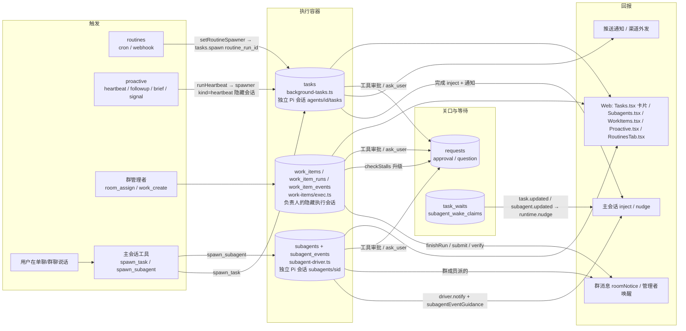

# 任务类机制架构地图（后台任务 / 例行任务 / 主动巡检 / 子代理 / 群任务 / 审批）

> 状态：**已实现（§5.5 六步全部完成，2026-10-19，未打包；决策 [0014](../decisions/0014-task-and-helper.md)）**。原为只读分析。基于 main@95c0bd3 之后的代码。行号是写这份文档时的位置，会漂移，以函数名为准。
> 目的：在动手合并之前把「谁触发、存哪、怎么跑、重启怎么办、谁盯、往哪报、怎么停、界面在哪」逐个讲清楚，再给出最少概念的合并方案。

## 0. 一句话结论

现在有 **3 个执行容器**（后台任务 `tasks`、子代理 `subagents`、群任务执行 `work_item_runs`）+ **2 个触发器**（例行任务 `routines`、主动巡检 `proactive`）+ **1 个共用的人机关口**（`requests` 审批/提问）+ **1 个等待器**（`task_waits`）。
三个执行容器各自实现了一遍「建会话 → 跑 → 重启恢复 → 卡住检测 → 回报 → 停止 → 状态词 → 界面卡片」，安全性和体验不一致（例如后台任务重启后**无安全判定直接续跑**，子代理有 `resumeSafetyOf`，群任务只标中断）。
建议：对用户只保留 **「任务」（要负责到底、有完成标准和核验的事）** 和 **「执行」（一次后台跑，界面叫“子代理”）** 两个词；代码上把后台任务和群任务执行都落到子代理这一套执行器上，卡住检测抽成共用模块，例行/巡检只当触发器。

## 1. 总图

## 2. 逐个机制

### 2.1 后台任务（`agent-runtime/background-tasks.ts`，表 `tasks` db.ts:20）

| 方面 | 现状 |
|---|---|
| 触发 | 主会话工具 `spawn_task`（delivery 扩展，extensions.ts:92，仅 `allowSpawn` 时提供）；例行任务 spawner（routines.ts:67-69/248）；主动巡检 `runHeartbeat`（proactive.ts:831-837，`kind: "heartbeat"`，会话是 `hiddenConversation(agentId)`）。 |
| 持久化 | `tasks`（status / session_file / kind / routine_run_id / conversation_id 等）。巡检另有 `proactive_runs`，例行另有 `routine_runs` 关联。 |
| 执行 | `run` background-tasks.ts:84-157：`createPiSession`，sessionDir `agents/<id>/tasks`；身份=该助理；模型=助理默认模型（无模型池回退）；工作区=助理工作区；`extensionsFor(agentId, conv, taskId, { allowSpawn: false })`，记忆 actor=`background`（extensions.ts:57）；电脑/浏览器同主会话权限；巡检任务额外拿到 `proactive_surface` / `advance`（extensions.ts:64/228/230），审批被自动拒绝（requests.ts:34）。 |
| 并发 | 全局 `MAX_CONCURRENT = 3`（:57），`pump`（:77）排队；`agentBusy`（:62）只数 tasks，不数群执行。 |
| 重启/失败 | runtime.ts:66-68：running 的任务用 `session_file` 恢复会话并发送续跑提示（:120），**没有副作用安全判定**——中断时正在跑的工具会被模型自行“继续”，可能重放。失败只写一条失败消息（:132-136 与 :150-153 两处几乎一样）。 |
| 监督 | 无卡住检测；无超时（只靠模型自己结束）。`task_wait` 可让主会话持久等它（task-waits.ts，事件 `task.updated`）。 |
| 回报 | 完成后 `inject` 进来源会话（:143）+ 推送通知；巡检的“值得说的事”走 `proactive_surface` 收件箱而不是直接说话。 |
| 停止 | `tasks.cancel`（:158，`POST /api/tasks/:id/cancel` routes/agents.ts:442），同时 `requests.cancelForTask`（requests.ts:105）。 |
| 界面 | 聊天里的 `kind: "task"` 卡片（Tasks.tsx 共用件）；信息面板“后台任务”；`GET /api/agents/:id/tasks`、`/api/tasks/:id/messages`。 |

### 2.2 例行任务（`routines.ts`，表 `routines` / `routine_runs` db.ts:98/103）

- 触发：cron 定时或 webhook；尊重免打扰时段。
- 执行：**不自己跑**，每次运行通过 `setRoutineSpawner` 变成一个后台任务（带 `routine_run_id`），因此执行、重启、停止全部继承 2.1。
- 回报：任务结束后把结果写回 `routine_runs`，并在对应会话插一条消息（routines.ts:271）。
- 界面：RoutinesTab.tsx。
- 结论：**它本来就是触发器**，合并时不用动语义，只换下游执行器。

### 2.3 主动巡检 / 跟进 / 每日简报（`proactive.ts`）

- 触发：心跳节奏（heartbeat）、`followup_schedule` 约好的跟进（表 `proactive_followups` db.ts:72）、每日简报（brief）、信号（`proactive_signals` proactive.ts:322）、手动。
- 执行：`runHeartbeat`（:831）拼 `situation()`（:774，现在几点、为什么醒、跟进备注、信号）→ spawner 生成 `kind: "heartbeat"` 后台任务，跑在隐藏会话里；审批一律自动拒绝（没人在场）。
- 产出：`proactive_items`（收件箱，db.ts:67）、`proactive_advances`（:377，“推进某个会话”，重启时 `resumeAdvances`，runtime.ts ~70）、`proactive_runs`。
- 监督：节奏本身就是“兜底巡检”；没有针对某件事的卡住检测。
- 界面：Proactive.tsx。
- 结论：也是触发器 + 收件箱；执行部分继承 2.1。

### 2.4 子代理（`subagents.ts`、`agent-runtime/subagent-driver.ts`、`subagent-resume.ts`、`subagent-supervision.ts`、`routes/subagent-routes.ts`、`Subagents.tsx`）

| 方面 | 现状 |
|---|---|
| 触发 | 主会话（单聊或群成员）调用 `spawn_subagent`；`spawnSubagent`（subagents.ts:428）建记录并在来源会话插 `kind: "subagent"` 卡片（:437）。 |
| 持久化 | `subagents`（:66）+ `subagent_events`（:72）；唤醒去重 `subagent_wake_claims`（task-waits.ts:123）。状态 queued/running/stalled/done/failed/stopped/timeout/lost。 |
| 执行 | driver `run`（subagent-driver.ts:24-136）：`createPiSession`，sessionDir `subagents/<sid>`；自己的系统提示（:45，禁止再派子代理）；`extensionsFor(..., { allowSpawn: false, subagentId, actor: "subagent" })`（:46）；记忆写入是**任务草稿**（主会话 promote/reject，extensions.ts:154-155）；模型池 + 回退（:114-129）；传输错误按安全性重试（:95-112）；工作区/电脑权限同所属助理。 |
| 并发 | 每个助理 `maxConcurrent`（SubagentSettings subagents.ts:39），`pumpSubagents`（:417）。 |
| 重启/失败 | `recoverSubagents`（:685）：用 `resumeSafetyOf`（subagent-resume.ts）判断——安全的排队 `resume=1`，用 `SUBAGENT_RESUME_PROMPT`（:372）续跑；有“已派出但结果未落盘”的工具的标 `lost`（中断待核验），不自动重放，用户/主会话点「继续」才续（`POST .../resume` subagent-routes.ts:89）。e2e/subagents.mjs 覆盖了这条路径。 |
| 监督 | `startSubagentWatcher`（:708）每 30s `checkSubagents`（:594）：180s 无活动 → stalled，超过 `maxMinutes` → timeout。事件经 `deliverSubagentEvents`（:636）→ driver.notify（subagent-driver.ts:137-154）唤醒**来源会话**，唤醒文字 = `subagentNotifyText` + `subagentEventGuidance(kind)`（subagent-supervision.ts，规则 `SUBAGENT_SUPERVISION_RULE` 进主会话系统提示）。已被 `task_wait` 等着的事件用 claims 去重，不重复唤醒。 |
| 回报 | 主会话收到“子代理回报：…”后由主会话决定怎么告诉用户；群成员派的结果回群。 |
| 停止 | `stopSubagent`（:458，路由 :87）；补充要求 `subagent_message`（路由 :94）在工具边界送达；失败可重试（:103）。 |
| 界面 | Subagents.tsx（431 行）：同款聊天详情、步骤、插话、继续/重试（:158-159）、任务切换 `SubagentTasks`（:188）；状态词标签（:19）。 |

### 2.5 群任务（`work-items/*`、`rooms/*`）

| 方面 | 现状 |
|---|---|
| 触发 | 群管理者 `room_assign` / `work_create` 工具（在信任列表 extensions.ts:75）；用户在群里指派；`rooms/scheduler.ts` 的 followup/check/peer 回合（:255-258）唤醒管理者。 |
| 持久化 | `work_items`（store.ts:95，含完成标准、核验、revision、escalation）、`work_item_runs`（:105）、`work_item_events`（:112）、`work_exec_conversations`（db.ts:135）。群本身 `rooms` / `room_members` / `room_turns`。 |
| 执行 | `dispatchRun`（exec.ts:95-120）：**不建独立会话类型**，而是 `runtime(owner, execConv).turn(prompt)`，跑在负责人自己的隐藏“执行会话”（`execConversation` :49）里，是一个普通 AgentRuntime：`allowSpawn: true`（agent-runtime.ts:94，所以执行中还能再派子代理），记忆 actor 按会话判定（群相关为 `group`），模型 = 负责人默认模型，**无模型池回退**；工作区/电脑 = 负责人的。 |
| 并发 | **无上限**；正在跑的记在 exec.ts 自己的 `live` Map（:36）；`busyInRoom`（rooms/index.ts:99）知道执行，但 `agentBusy`（background-tasks.ts:62）不知道。 |
| 重启/失败 | `bootstrapWorkItems`（exec.ts:270-278）把 queued/running 执行标 `interrupted`，群里提示“执行中断（服务重启），可继续”（:171）；**不自动续跑**，等管理者/用户继续。失败 `failRun`（:122）把任务标受阻。 |
| 监督 | `startWorkWatch` → `checkStalls`（watch.ts:100，`STALL_MS` 20 分钟 :15）+ `stallStep`（guard.ts:63）分级；同一卡点重复用 `fingerprint/repeatLevel`（guard.ts:36，exec.ts:130-131）；群里来回空聊检测在 rooms/collab.ts。升级顺序：提醒负责人 → 唤醒管理者（scheduler `check` 回合文字 :257）→ `work_ask_user` / `askUserDecision`（watch.ts:49）用 `requests.question` 问用户。 |
| 回报 | `roomNotice` 群系统消息、`work-result` 卡片（exec.ts:~212）、管理者被唤醒后在群里总结；执行会话本身不在群里显示。 |
| 停止 | `cancelWorkRuns`（exec.ts:244）；暂停/取消任务；停群时 `requests.cancelForRoom`（requests.ts:99）。插话 `steerToLiveRun`（:256）。 |
| 界面 | WorkItems.tsx（看板）+ WorkItemDetail.tsx（详情、事件、核验）。 |

### 2.6 审批 / 提问（`requests.ts`，表 `requests` db.ts:24）

- 入口：`requests.approval`（:61，approval 扩展和电脑/浏览器扩展都调它，extensions.ts:77/336/368/419）、`requests.question`（:64，`ask_user` 工具 extensions.ts:91，群任务 `work_ask_user`/`askUserDecision`）。都带 `task_id` 和 `conversation_id`。
- 解析：`resolve`（:68）；“本任务内都允许”（allowTask）。巡检任务自动拒绝（:34）。
- 清理：`cancelForTask`（:105）、`cancelForRoom`（:99）、重启 `expireStale`（:86，runtime.ts:55）。
- 界面：会话里的审批/提问卡片；子代理的审批卡显示在主会话。
- 结论：**已经是唯一共用件**，合并时保留。缺口：子代理和群执行没有 “cancelForSubagent / cancelForWorkRun” 的对等清理，靠 task_id 碰巧覆盖。

### 2.7 等待器（`task-waits.ts`）与主会话重启

- `task_wait` 登记持久等待（表 `task_waits` :85），事件 `task.updated` / `subagent.updated` 或定时 `tickWaits` 触发一次 `runtime.nudge`；不保证 exactly-once，唤醒词带等待 id。
- 主会话自身重启：runtime.ts:59-63 发“（系统通知）服务刚刚重启…”续跑提示。

## 3. 对比表

| | 后台任务 | 子代理 | 群任务执行 |
|---|---|---|---|
| 谁创建 | 主会话 spawn_task / 例行 / 巡检 | 主会话 spawn_subagent | 群管理者 / 用户 |
| 表 | tasks | subagents, subagent_events | work_items, work_item_runs, work_item_events |
| 会话 | 独立，agents/id/tasks | 独立，subagents/sid | 负责人隐藏执行会话（普通 runtime） |
| 能否再派 | 否 | 否 | **能**（allowSpawn true） |
| 记忆 | background 直写 | subagent 草稿待主会话确认 | 按会话（group） |
| 模型回退 | 无 | 模型池 | 无 |
| 并发 | 全局 3 | 每助理 maxConcurrent | 不限 |
| 重启 | **无判定自动续跑** | resumeSafetyOf：安全续跑 / 不安全标 lost | 标 interrupted，不续 |
| 卡住检测 | 无 | 180s stalled + maxMinutes timeout | 20min 分级 + 重复卡点 + 空聊 |
| 谁被叫醒 | 来源会话 inject | 来源会话 notify + guidance | 负责人 → 管理者 → 用户 |
| 有完成标准/核验 | 无 | 无 | 有（work_submit / work_verify） |
| 停止 | tasks.cancel | stopSubagent | cancelWorkRuns |
| 界面 | task 卡片 | Subagents.tsx 详情 | WorkItems 看板 |
| 状态词 | queued/running/done/failed/cancelled | queued/running/stalled/done/failed/stopped/timeout/lost | queued/running/done/error/cancelled/interrupted |

## 4. 具体重复代码

1. **建执行会话三份**：background-tasks.ts:94-106、subagent-driver.ts:41-47、agent-runtime.ts:83-94 各自 `createPiSession` + `extensionsFor` + 系统提示拼接。
2. **重启续跑提示四份**：runtime.ts:61（主会话）、background-tasks.ts:120、subagents.ts:372（`SUBAGENT_RESUME_PROMPT`）、exec.ts:160/171（中断文案，不续跑）。只有子代理有安全判定。
3. **卡住检测两套**：subagents.ts:594-606（`checkSubagents`）与 work-items/watch.ts:100-113（`checkStalls`）+ guard.ts:63；定时器也各一个（subagents.ts:708、watch.ts:118）。
4. **完成回报三条路**：background-tasks.ts:143（inject）、subagent-driver.ts:137-154 + subagents.ts:636（notify + guidance）、exec.ts:144-171（finishRun → roomNotice / 卡片 / 唤醒管理者）。
5. **同文件内重复**：background-tasks.ts:132-136 与 :150-153 失败通知。
6. **“正在跑”的内存表三份**：background-tasks.ts `live/liveAgent`、subagents.ts `live`、exec.ts:36 `live`。
7. **忙碌判断不一致**：background-tasks.ts:62 `agentBusy` vs rooms/index.ts:99 `busyInRoom`。
8. **停止三份**：background-tasks.ts:158、subagents.ts:458、exec.ts:244，各自再去清 requests（只有 tasks 有 cancelForTask 对等）。
9. **监督文字两套**：subagent-supervision.ts（`subagentEventGuidance`）与 rooms/scheduler.ts:255-258（followup/check 文字）、watch.ts 升级文字。
10. **聊天卡片三种**：`kind: "task"`（background-tasks.ts:72 附近）、`kind: "subagent"`（subagents.ts:437）、`work-result`（exec.ts ~212）；前端 Tasks.tsx / Subagents.tsx / WorkItems.tsx 各一套状态词。

## 5. 合并方案

### 5.1 用户看到的词

- **任务**：一件要负责到底的事，有负责人、完成标准、进度、核验、卡住会升级到你。单聊和群聊都叫“任务”（底层 = work_items）。单聊默认不建任务，只有用户说“帮我盯着把 X 做完”或助理判断需要负责到底时才建。
- **帮手**（用户定名，取代界面上的「子代理」）：一次在后台跑的执行，可以看详情、插话、停止、继续。后台任务、例行任务的每次运行、巡检的每次运行，在界面上都是“帮手”（带来源标签：定时 / 巡检 / 任务）。
- **例行任务、主动巡检**：保留原名，只是“什么时候自动开一个子代理”的设置。
- **审批 / 提问**：不变。

### 5.2 代码上

1. **一个执行器**：以子代理（subagent-driver + subagents 表）为唯一执行容器，加 `kind`（task | routine | heartbeat | work | subagent）和 `work_run_id` / `routine_run_id` 字段。好处直接继承：重启安全判定、模型池、stalled/timeout、详情界面、插话、停止。
2. **后台任务退役**：`tasks.spawn` 变成薄适配层调 `spawnSubagent(kind="task")`；`spawn_task` 工具保留名字一段时间做兼容；`tasks` 表只读保留历史。
3. **群任务执行改用子代理**：`dispatchRun` 不再 `runtime(owner, execConv).turn`，而是 `spawnSubagent(kind="work", owner, prompt)`；`work_item_runs` 只记 run ↔ subagent 映射；重启由 `recoverSubagents` 统一处理（安全则续，不安全则 lost → 群里提示“待核验”）。work_items 的完成标准/核验/升级逻辑保留在 work-items/。
4. **共用监督模块**（例如 `supervision/`）：输入“执行或任务的活动时间、最近文本、事件”，输出等级（提醒执行者 → 叫醒负责会话/管理者 → 问用户）；子代理 180s/maxMinutes、群任务 20min、重复卡点 fingerprint、空聊检测都成为它的规则；单聊的子代理也因此获得“重复卡点”和“问用户”升级。
5. **一条回报通道**：执行结束统一产生事件 → 来源会话（单聊 = 主会话 notify；群 = 管理者回合 + roomNotice）→ 必要时推送通知。`task_wait` 只认这一种事件。
6. **例行 / 巡检**：只改 spawner 指向；巡检的“审批自动拒绝”改成按 `kind=heartbeat` 判断（requests.ts:34 从查 tasks 改查 subagents）。

### 5.3 会删掉什么

- background-tasks.ts 的会话创建、pump、恢复、失败通知（保留适配层）。
- work-items/exec.ts 的 `live` Map、自己的 turn 调度、interrupted 恢复分支。
- subagents.ts / watch.ts 中各自的计时器（合到共用监督）。
- 前端 task 卡片与 subagent 卡片合一；状态词统一一张表。

### 5.4 风险

- **帮手再派帮手**：用户已定——允许，但最多一层（第二层不能再派）。
- **记忆范围**：用户已定——执行中写的记忆先是草稿，所属任务通过核验后自动转正；没通过核验就保持草稿等主会话确认。
- **并发语义**：全局 3 → 每助理 maxConcurrent；群任务从不限变成有限，群里可能出现排队。
- **群可见性**：用户已定——群里人人看得到帮手概况和结果，完整步骤只给派它的助理和用户（一个设置，默认如此）。
- **重启行为变化**：后台任务从“总是续跑”变成“不安全时标 lost 等人”，例行任务可能更常停下来等确认。
- **数据迁移**：tasks 历史、routine_runs/proactive_runs 的外键、task_waits 里引用 task id 的等待、wake claims 去重。
- **界面**：Tasks.tsx/Subagents.tsx/WorkItems 三处入口和 e2e（subagents.mjs、tasks 相关、群协作 e2e）都要改。

### 5.5 迁移步骤（每步可单独发布、单独回滚，都要 `npm run check` + 相关 e2e）

1. **不改行为的整理**：抽出共用“建执行会话”函数（第 4 节 1）、合并 background-tasks.ts 内重复失败通知、统一状态词映射表（前后端）。
2. **后台任务重启补安全判定**：让 runtime.ts:66-68 也走 `resumeSafetyOf`（这是当前唯一的真实风险，可先做）。
3. **共用监督模块**：先把 work-items/guard.ts 的分级 + fingerprint 提出来，子代理 watcher 改用它；行为对齐后加单聊“问用户”升级。
4. **subagents 表加 kind 等字段**，`tasks.spawn` 改调 spawnSubagent；例行/巡检随之迁过去；tasks 表只读。
5. **群任务执行改用子代理**（先解决 5.4 的派生与记忆问题）。
6. **界面合并**与旧路由兼容层下线。

## 6. 用户决定（2026-10-19）

见决策 [0014](../decisions/0014-task-and-helper.md)：界面用「任务 / 帮手」两个词；帮手最多再派一层；核验通过后执行记忆自动转正。实施顺序从 §5.5 第 2 步开始。

## 7. 实施进度

| 步骤 | 状态 |
|---|---|
| 1 不改行为的整理 | 已完成：三处建会话合成 `agent-runtime/agent-session.ts` 的 `createAgentSession`；状态词前端只留 `Tasks.tsx` 一张表（任务卡片、帮手列表共用；lost 统一叫「中断待核验」） |
| 2 后台任务重启安全判定 | 已完成：`tasks.recover()` 复用 `sessionResumeSafety`，不安全标 lost（中断待核验），卡片「继续」走 `verifyResumePrompt`；单测 `background-task-restart.test.ts`，e2e `task-restart-ui.mjs` |
| 3 共用卡住检测 | 已完成，按用户反馈改过：规则合成 `stuck.ts`（群任务 watch/exec、群对话 collab 共用；单聊帮手复用指纹 / 反复判定）。单聊帮手 `subagent-stuck.ts`：先诊断（预计时长内的工具、仍在输出的命令（Pi 的工具输出更新转成 `tool_update`）、流式输出、工作区文件变化都不算卡住）；真卡住由主会话按阶梯自己处理（看记录 + `subagent_restart` 带纠正从检查点续跑 → 换做法 / 派新帮手 → 最后提醒 → 办法用尽失败并写明试过什么）；同一原因第 3 次起拒绝原样续跑；只有批准 / 凭据等用户才能给的东西才找用户。已删掉「继续等 / 停止这个帮手」提问卡片。单测 `subagent-stuck.test.ts`，e2e `stuck-escalation-ui.mjs`（慢但在动不报、真卡住自愈、只为审批找用户） |
| 4 后台 / 定时 / 巡检跑在帮手上 + 历史迁移 | 已完成：`tasks.spawn` 改成 `spawnSubagent(kind=task/routine/heartbeat, title, routine_run_id)`，`tasks.recover/run/pump` 删除，重启只剩 `recoverSubagents`；旧 `tasks` 表启动时同 id 迁进 subagents（`migrateLegacyTasks`，幂等，已结束的标已通知；等待 task→subagent）；routines / proactive / task-waits / requests 改读 subagents 和 `subagent.updated`。后台任务结束仍是推送 + 对话里可见的报错 / 下一轮上下文（不额外唤醒模型）；带 kind 的帮手不唤醒主会话，卡住时系统重启一次、仍卡住就失败（按第 3 步修订后的规则）。单测 `background-task-restart.test.ts`（迁移 + 重启），e2e `task-restart-ui.mjs` 改走帮手详情 |
| 5 群任务执行跑在帮手上 | 已完成：`dispatchRun` 改派负责人的帮手（`spawnSubagent(kind=work, work_run_id, scope)`，`work_item_runs.exec_kind=helper`），帮手到终态映射成 `finishRun`，暂停 / 取消停帮手，插话转给帮手，重启交给帮手的重启判定（`bootstrapWorkItems` 只接回上下文）；执行帮手有 `work_submit/work_report`，没有群发言工具；交付文件直接进群。帮手最多再派一层（`parent_subagent_id`，第二层拒绝；上一层在 driver 里等下一层结束并整合结果；下一层事件不唤醒主会话、卡住走系统阶梯）。角色范围 `helper-scope.ts` 的 `helperScope`（写进帮手系统规则，下一层继承；`spawn_subagent` 多了 `done_criteria`）。执行详情（2026-10-20 改定，删掉 `groupHelperDetail` 设置和接口）：别的成员用 `subagent_list` 列表只拿到概况、点名查（带 subagent_id）拿完整过程，群转录里帮手卡片是「[某某 的帮手] 在做什么（状态 / 当前步骤 / 结果）」。核验通过 → `promoteRunMemories` 把这一修订执行帮手的草稿转正。单测 `group-helpers.test.ts`、`work-items.test.ts`（改用帮手 driver），e2e `group-helpers-ui.mjs`、`work-items-ui.mjs`、`work-items-boundaries.mjs`、`group-collab-ui.mjs` |
| 6 界面合并与旧路由下线 | 已完成：界面上「子代理」统一叫「帮手」（`Subagents.tsx`、`Tasks.tsx`、`ChatMessages.tsx`、`MemoryTab.tsx`、`CustomProvider.tsx`、`ChatSettings.tsx`；`taskTitle` 去前缀两个词都认）；删 `/api/agents/:id/tasks`、`/api/tasks/:id/*`、`tasks.list/cancel/resume`、`getTask`、`task.updated`，前端「后台任务」列表读 `/api/subagents?agent=` + `subagent.updated`（kind=task/routine），旧聊天卡片的取消 / 继续走 `/api/subagents/:id/stop|resume`。给模型看的提示词仍叫「子代理」（见 HANDOFF 待定项）。单测 `background-task-restart` / `model-error-reporting` / `runtime-split` 改走帮手接口，e2e `task-restart-ui.mjs`、`agent-details-classic-ui.mjs` 等同步 |
